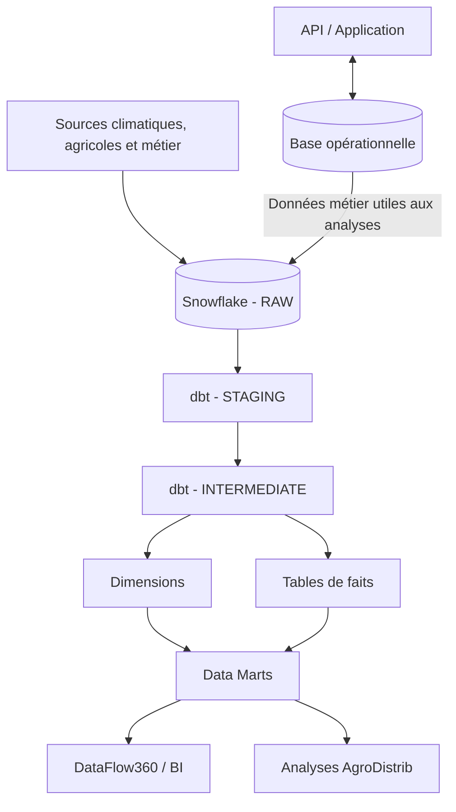

# DataFlow360 & AgroDistrib
## Modélisation multidimensionnelle et architecture décisionnelle

**Projet :** Assaman & Suuf  
**Équipe :** AKAI — Alliance for Knowledge, Action & Innovation  
**Entrepôt de données :** Snowflake  
**Transformation des données :** dbt  
**Base opérationnelle de l'application :** PostgreSQL (proposition)

---

> **État de mise en œuvre (10/11/2026).** Ce document décrit l'architecture **cible**. Ce qui est réellement construit, avec les grains, volumes, règles et limites, est suivi dans [`etat-modelisation.md`](etat-modelisation.md) ; le contrat des marts est dans [`contrat-donnees.md`](contrat-donnees.md).
>
> | Élément proposé ici | État |
> |---|---|
> | `dim_temps`, `dim_geographie`, `dim_zone_agroecologique`, `dim_culture`, `dim_variete` | construits |
> | `dim_region` (non prévue ici) | construite : région et zone sont deux regroupements parallèles (voir 6.1) |
> | `dim_intrant` | construite sur le référentiel `seeds/ref_intrants.csv` (9 intrants), en attendant `APP_INTRANTS` |
> | `dim_organisation`, `dim_scenario_allocation` | désactivées : tables de l'application pas encore disponibles |
> | `fact_pluviometrie_decadaire`, `fact_climatologie_decadaire`, `fact_rendement_departement`, `fact_reference_agronomique` | construits |
> | `fact_climat_mensuel`, `fact_pluie_station_mensuelle` | non construits : `departement_mois` et `stations_pluie_mois` ne sont pas dans `SALTIS.RAW` |
> | `fact_rendement_national` | non construit : les valeurs nationales sont exclues des faits départementaux ; pas de source nationale dédiée dans RAW |
> | `fact_besoin_intrant` | remplacé pour l'instant par `fact_besoin_reference` (besoins de référence historiques, pas prévisionnels) ; le fait prévisionnel attend les plans culturaux de l'application et les doses ISRA |
> | `fact_stock_intrant`, `fact_allocation_intrant` | à venir : tables de l'application (`APP_*`) |
> | Faits ajoutés, non prévus ici | `fact_saison_departement` (bilan de saison, référence), `fact_adequation_culture`, `fact_adequation_variete`, `fact_facteurs_limitants` |
> | Data marts (section 12) | remplacés par des marts par écran : `mart_carte_agroclimat`, `mart_suivi_decadaire`, `mart_choix_cultures`, `mart_besoins`, `mart_territoires_agrodistrib`, `mart_vulnerabilite_departement`, `mart_ml_prevision_pluie` |
> | Anciens marts (copies du staging) | supprimés : `mart_saisons`, `mart_profil_agro`, `mart_adequation`, `mart_adequation_varietes`, `mart_rendements`, `mart_facteurs_limitants`, `mart_agrodistrib` ; `mart_besoins` reconstruit sur les faits |
>
> Les coopératives et les fournisseurs d'intrants sont hors périmètre (section 3).

---

# 1. Contexte et objectifs

Assaman & Suuf est une plateforme d'aide à la décision agricole qui exploite les données climatiques, agricoles et agroclimatiques pour accompagner les producteurs, les conseillers agricoles, les ONG et les services publics dans leurs décisions.

La plateforme repose sur deux composantes complémentaires :

- **DataFlow360 :** socle d'intégration, de préparation, d'analyse et de visualisation des données.
- **AgroDistrib :** fonctionnalité d'estimation des besoins en intrants et d'aide à l'optimisation de leur répartition entre les départements.

L'objectif de cette modélisation est de structurer les données nécessaires aux fonctionnalités actuelles et futures, tout en distinguant les données déjà disponibles des données qui devront être collectées ou saisies.

## 1.1. Objectifs de la modélisation

La modélisation doit permettre de :

- Centraliser les données climatiques, agricoles et agroclimatiques.
- Analyser les précipitations, les températures et les anomalies climatiques.
- Comparer les situations agricoles entre départements et zones agroécologiques.
- Analyser les superficies, productions et rendements agricoles.
- Exploiter les références agronomiques disponibles.
- Estimer les besoins en semences et fertilisants.
- Enregistrer les stocks déclarés indépendamment par chaque organisation.
- Proposer des scénarios de répartition des intrants.
- Suivre les allocations proposées et validées.
- Alimenter les tableaux de bord et les analyses décisionnelles.

## 1.2. Principes de conception

La conception repose sur les principes suivants :

1. Conserver les données sources dans la couche RAW.
2. Utiliser dbt pour transformer les données dans Snowflake.
3. Conserver les modèles STAGING déjà construits et migrés dans Snowflake.
4. Construire progressivement les couches INTERMEDIATE, DIMENSIONS, FACTS et MARTS.
5. Définir une granularité précise pour chaque table de faits.
6. Distinguer les données historiques des données opérationnelles.
7. Ne pas mélanger les niveaux départemental, zonal et national.
8. Conserver la traçabilité et la provenance des données.
9. Gérer les utilisateurs et leurs autorisations hors de Snowflake.
10. Ne pas intégrer la gestion des entrepôts, du transport ou de la logistique physique.

---

# 2. Périmètre fonctionnel

La plateforme s'organise autour de DataFlow360 et de quatre fonctionnalités métier complémentaires.

## 2.1. DataFlow360 — Socle de données et d'analyse

DataFlow360 assure :

- L'intégration des données provenant de différentes sources.
- La préparation et la standardisation des données.
- La centralisation des données dans Snowflake.
- La visualisation des données climatiques et agricoles.
- L'analyse historique par département, zone agroécologique et année.
- La comparaison des campagnes agricoles.
- La préparation des données pour les analyses BI et les futurs modèles prédictifs.

## 2.2. Suivi et anticipation agroclimatique

Cette fonctionnalité doit permettre de :

- Suivre les précipitations et les températures.
- Comparer les conditions climatiques entre départements.
- Analyser les tendances par zone agroécologique.
- Étudier les anomalies et les périodes sèches ou humides.
- Identifier les périodes favorables ou défavorables aux activités agricoles.
- Préparer des modèles de prévision lorsque les données et les validations nécessaires seront disponibles.

## 2.3. Aide au choix des cultures et des semences

Cette fonctionnalité doit permettre de :

- Comparer les cultures selon les caractéristiques agroclimatiques des territoires.
- Exploiter les références agronomiques disponibles.
- Comparer les besoins en eau et en fertilisants.
- Intégrer progressivement un catalogue de variétés de semences.
- Prendre en compte les caractéristiques des variétés : durée du cycle, besoins en eau et autres critères agronomiques.
- Accompagner les producteurs et les conseillers agricoles dans leurs choix culturaux.

## 2.4. Estimation des besoins et analyse des rendements

Cette fonctionnalité doit permettre de :

- Analyser les superficies, productions et rendements.
- Comparer les résultats entre départements et campagnes agricoles.
- Estimer les besoins en semences et fertilisants.
- Identifier les facteurs susceptibles de limiter les rendements.
- Comparer les besoins estimés aux quantités disponibles.

## 2.5. AgroDistrib — Optimisation de la distribution des intrants

AgroDistrib doit permettre à chaque organisation de :

- Déclarer son propre stock de semences et de fertilisants.
- Identifier les besoins des départements ciblés.
- Définir les ressources qu'elle souhaite mobiliser.
- Générer des propositions de répartition des intrants.
- Comparer plusieurs scénarios d'allocation.
- Ajuster et valider les propositions.
- Analyser les quantités proposées et validées par département.

AgroDistrib ne prend pas en charge :

- La gestion des entrepôts.
- La gestion des magasins physiques.
- Le transport des intrants.
- Les mouvements logistiques.
- La gestion des fournisseurs d'intrants.

---

# 3. Acteurs concernés

| Acteur | Besoins et responsabilités |
|---|---|
| Producteurs agricoles | Suivi agroclimatique, choix des cultures et estimation des besoins |
| Conseillers agricoles | Analyse territoriale et accompagnement des décisions techniques |
| ONG | Déclaration de leurs stocks, identification des besoins et allocation de leurs ressources |
| État et services agricoles publics | Suivi des campagnes, analyse agricole et allocation de leurs propres ressources |
| Administrateurs de la plateforme | Gestion des utilisateurs, des droits et des référentiels |

Les fournisseurs d'intrants et les coopératives ne font pas partie du périmètre fonctionnel retenu.

## 3.1. Gestion indépendante des organisations

Chaque ONG ou service public gère ses propres ressources.

Exemple :

- ONG A : 20 tonnes de semences de mil.
- ONG B : 15 tonnes de semences de mil.
- Service public : 50 tonnes de semences de mil.

Ces stocks restent indépendants.

Les scénarios d'allocation d'une organisation doivent uniquement mobiliser les ressources déclarées par cette même organisation.

Aucune fusion automatique des stocks entre organisations n'est prévue.

---

# 4. Architecture générale des données

L'architecture distingue les données analytiques exploitées dans Snowflake et les données opérationnelles gérées par l'application.



## 4.1. Snowflake

Snowflake constitue l'entrepôt de données analytique.

Il contient :

- Les données climatiques.
- Les données agricoles.
- Les données agroclimatiques.
- Les références agronomiques.
- Les données de besoins estimés.
- Les stocks déclarés nécessaires aux analyses.
- Les scénarios et allocations utiles au suivi décisionnel.

## 4.2. dbt

dbt assure la transformation et l'organisation des données dans Snowflake.

| Couche | Responsabilité |
|---|---|
| RAW | Données chargées depuis les sources |
| STAGING | Nettoyage technique, typage et standardisation |
| INTERMEDIATE | Harmonisation et enrichissement métier |
| DIMENSIONS | Référentiels analytiques |
| FACTS | Mesures et événements métier |
| MARTS | Données prêtes pour les tableaux de bord et analyses |

Les données RAW ne doivent pas être modifiées directement par les modèles dbt.

Les modèles STAGING existants doivent être réutilisés et améliorés si nécessaire, sans reconstruire inutilement les transformations déjà réalisées.

## 4.3. Base opérationnelle de l'application

La base opérationnelle, par exemple PostgreSQL, gère :

- Les comptes utilisateurs.
- L'authentification.
- Les rôles et permissions.
- Les organisations.
- Les rattachements des utilisateurs aux organisations.
- Les déclarations de stocks.
- Les opérations de création et de validation des scénarios.

Les informations nécessaires aux analyses peuvent ensuite être transmises à Snowflake.

---

# 5. Données actuellement disponibles

Les neuf tables consolidées constituent la base des analyses historiques.

| Table source | Granularité | Utilisation |
|---|---|---|
| `departement_annee_culture` | Département × campagne × culture | Rendements, production, superficies et indicateurs agroclimatiques |
| `national_annee_culture` | Campagne × culture | Analyse agricole nationale |
| `departement_mois` | Département × année × mois | Pluviométrie, températures et autres variables climatiques |
| `departement_statique` | Département | Sols, occupation des terres et caractéristiques territoriales |
| `stations_pluie_mois` | Station × année × mois | Observations pluviométriques des stations |
| `departement_decade` | Département × année × décade | Suivi pluviométrique décadaire |
| `departement_decade_climatologie` | Département × décade climatologique | Références climatiques départementales |
| `zone_decade_climatologie` | Zone agroécologique × décade climatologique | Références climatiques zonales |
| `zone_culture_intrants` | Zone agroécologique × culture | Références agronomiques, besoins en eau, fertilisants et potentiel de rendement |

Ces tables ne possèdent pas toutes le même niveau de détail.

Elles doivent être exploitées selon leur granularité d'origine.

## 5.1. Limites des données actuelles

Les données disponibles ne permettent pas encore de renseigner automatiquement toutes les fonctionnalités.

Les informations suivantes restent notamment à obtenir ou à construire :

- Les superficies prévues par culture et par département pour chaque campagne.
- Les doses de semences par hectare.
- Les doses de fertilisants validées pour toutes les cultures.
- Le catalogue détaillé des variétés de semences.
- Les stocks réellement disponibles auprès de chaque organisation.
- Les quantités d'intrants effectivement distribuées.
- Les données départementales de rendement après 2021 pour certaines séries.
- Des observations suffisamment complètes pour certaines stations et périodes.

Les références agronomiques incomplètes doivent être identifiées comme telles.

Les données historiques ne doivent pas être présentées comme des prévisions. Les prévisions climatiques ou agricoles nécessiteront des modèles entraînés et évalués séparément.

---

# 6. Règles de granularité géographique et temporelle

## 6.1. Géographie

Chaque département est rattaché à une région et à une zone agroécologique dans le référentiel géographique retenu.

Zone agroécologique et région ne sont **pas emboîtées** : ce sont deux regroupements **parallèles** des départements.

**Département → Région** et **Département → Zone agroécologique**

Un département appartient à une seule région et à une seule zone agroécologique, mais une région peut couvrir plusieurs zones : Louga, Matam et Tambacounda s'étendent chacune sur deux zones. Il ne faut donc pas coder de hiérarchie zone → région.

La dimension géographique doit permettre d'agréger les départements par région ou par zone, sans dupliquer les mesures.

### Règle de granularité

Une observation départementale reste départementale.

Une référence zonale reste zonale.

Il ne faut pas recopier une valeur zonale sur chaque département puis additionner ces valeurs, car cela créerait un double comptage.

Les faits départementaux et zonaux doivent donc conserver leur niveau géographique d'origine.

## 6.2. Temps

Les analyses doivent distinguer :

- L'année civile.
- L'année de campagne agricole.
- Le mois.
- La décade.
- La période de référence climatologique.

La campagne agricole ne doit pas être confondue avec l'année civile.

Dans les données actuelles, l'année de campagne correspond principalement à l'hivernage, de juin à octobre.

Les normales climatiques disponibles reposent sur la période 1991-2020.

---

# 7. Dimensions analytiques

Les dimensions sont des référentiels utilisés pour décrire les faits et faciliter les analyses.

## 7.1. `dim_temps`

**Rôle :** analyser les données selon les périodes.

| Champ | Description |
|---|---|
| `id_temps` | Clé technique |
| `date_complete` | Date de référence |
| `annee` | Année civile |
| `annee_campagne` | Année de campagne agricole |
| `mois` | Numéro du mois |
| `nom_mois` | Libellé du mois |
| `decade` | Première, deuxième ou troisième décade |
| `trimestre` | Trimestre civil |
| `saison` | Saison agricole ou climatique |

La granularité devra être adaptée à chaque fait. Une table mensuelle ne doit pas être artificiellement transformée en table quotidienne.

## 7.2. `dim_geographie`

**Rôle :** centraliser les informations territoriales départementales.

| Champ | Description |
|---|---|
| `id_departement` | Clé technique |
| `code_departement` | Identifiant géographique source |
| `nom_departement` | Nom du département |
| `code_region` | Identifiant de la région |
| `nom_region` | Nom de la région |
| `id_zone_agroecologique` | Référence vers la zone |
| `latitude` | Latitude indicative |
| `longitude` | Longitude indicative |

## 7.3. `dim_zone_agroecologique`

**Rôle :** décrire les zones agroécologiques.

| Champ | Description |
|---|---|
| `id_zone_agroecologique` | Clé technique |
| `code_zone` | Code de la zone |
| `nom_zone` | Nom de la zone |
| `description` | Description éventuelle |

## 7.4. `dim_culture`

**Rôle :** décrire les cultures agricoles.

| Champ | Description |
|---|---|
| `id_culture` | Clé technique |
| `code_culture` | Code de référence |
| `nom_culture` | Nom de la culture |
| `categorie` | Catégorie de culture |
| `unite_production` | Unité de production |

## 7.5. `dim_variete`

**Rôle :** référencer les variétés de semences.

| Champ | Description |
|---|---|
| `id_variete` | Clé technique |
| `id_culture` | Culture associée |
| `nom_variete` | Nom de la variété |
| `duree_cycle_jours` | Durée du cycle |
| `besoin_eau` | Référence de besoin en eau |
| `caracteristiques` | Informations agronomiques |

**Statut : dimension future.**

Les données actuellement disponibles sont principalement au niveau de la culture et non de la variété.

Une variété ne devra être ajoutée qu'avec une source de référence fiable.

## 7.6. `dim_intrant`

**Rôle :** référencer les semences et les fertilisants.

| Champ | Description |
|---|---|
| `id_intrant` | Clé technique |
| `code_intrant` | Code métier |
| `nom_intrant` | Désignation |
| `type_intrant` | Semence ou fertilisant |
| `unite_mesure` | kg, tonne, litre, etc. |
| `id_culture` | Culture concernée si applicable |

`id_intrant` identifie un intrant précis et permet de le relier aux stocks, aux besoins et aux allocations.

## 7.7. `dim_organisation`

**Rôle :** référencer les organisations qui déclarent leurs stocks et réalisent des allocations.

| Champ | Description |
|---|---|
| `id_organisation` | Clé technique |
| `code_organisation` | Identifiant métier |
| `nom_organisation` | Nom de l'organisation |
| `type_organisation` | ONG ou service public / État |
| `statut` | Statut de l'organisation |

Cette dimension analytique ne remplace pas la table opérationnelle des organisations de l'application.

## 7.8. `dim_scenario_allocation`

**Rôle :** identifier les scénarios de répartition calculés.

| Champ | Description |
|---|---|
| `id_scenario` | Identifiant du scénario |
| `nom_scenario` | Nom du scénario |
| `id_organisation` | Organisation concernée |
| `date_creation` | Date de création |
| `methode_optimisation` | Méthode utilisée |
| `statut_scenario` | Brouillon, calculé, retenu ou abandonné |
| `version_algorithme` | Version de l'algorithme |

---

# 8. Tables de faits historiques — DataFlow360

Les faits historiques décrivent les observations et les références déjà disponibles.

## 8.1. `fact_climat_mensuel`

**Source principale :** `departement_mois`

**Granularité :** un département, une année et un mois.

Mesures et attributs :

- `id_departement`
- `id_temps`
- `pluie_mm`
- `anomalie_pluie`
- `temperature_moyenne`
- `temperature_minimale`
- `temperature_maximale`
- `humidite`
- `rayonnement`
- `humidite_sol`
- `ndvi`
- `et0`
- Indices océaniques disponibles.

**Utilisation :**

- Comparaison climatique entre départements.
- Évolution mensuelle des précipitations.
- Analyse des anomalies et des tendances.

## 8.2. `fact_pluviometrie_decadaire`

**Source principale :** `departement_decade`

**Granularité :** un département, une année et une décade.

Mesures :

- `pluie_mm`
- `nombre_jours_pluie`
- `indicateurs_secheresse`
- `indicateurs_sequence_seche`

**Utilisation :**

- Suivi de la pluviométrie au cours de l'hivernage.
- Identification des périodes sèches.
- Comparaison des campagnes agricoles.

## 8.3. `fact_climatologie_decadaire`

**Sources :**

- `departement_decade_climatologie`
- `zone_decade_climatologie`

**Granularité :** un territoire, une décade et une période climatologique.

Le territoire peut être un département ou une zone agroécologique.

Champs :

- `id_departement`, nullable selon le niveau géographique.
- `id_zone_agroecologique`, nullable selon le niveau géographique.
- `decade`
- `periode_reference`
- `pluie_moyenne_mm`
- `probabilite_periode_seche`
- `probabilite_periode_humide`

Une ligne correspond à un seul niveau géographique.

Il ne faut jamais renseigner simultanément un département et sa zone pour représenter deux observations différentes dans la même ligne.

## 8.4. `fact_pluie_station_mensuelle`

**Source :** `stations_pluie_mois`

**Granularité :** une station, une année et un mois.

Mesures :

- `precipitation_mm`
- `nombre_jours_pluie`
- `nombre_observations`, si disponible.

Cette table permet une analyse au niveau des stations. Elle ne doit pas être additionnée directement à la pluviométrie départementale sans règle d'agrégation explicite.

Une dimension `dim_station` pourra être créée si les informations de station sont suffisamment complètes et stables.

## 8.5. `fact_rendement_departement`

**Source :** `departement_annee_culture`

**Granularité :** un département, une campagne et une culture.

Mesures :

- `superficie_ha`
- `production_t`
- `rendement_t_ha`
- `superficie_recoltee_ha`, si disponible.
- Indicateurs agroclimatiques associés.

**Utilisation :**

- Comparaison des rendements.
- Analyse de la production agricole.
- Identification des écarts entre territoires et campagnes.

Les années manquantes doivent rester identifiées comme manquantes. Elles ne doivent pas être remplacées artificiellement par zéro.

## 8.6. `fact_rendement_national`

**Source :** `national_annee_culture`

**Granularité :** une campagne et une culture au niveau national.

Mesures :

- `superficie_ha`
- `production_t`
- `rendement_t_ha`

Cette table reste distincte du fait départemental afin d'éviter le mélange des niveaux national et départemental.

## 8.7. `fact_reference_agronomique`

**Source :** `zone_culture_intrants`

**Granularité :** une zone agroécologique et une culture.

Attributs et mesures :

- `id_zone_agroecologique`
- `id_culture`
- `besoin_eau`
- `dose_fertilisant_reference`
- `potentiel_rendement`
- `facteurs_limitants`
- `statut_reference`
- `source_reference`

Cette table représente des références agronomiques et non des consommations réelles.

Les doses incomplètes ou non confirmées doivent être signalées explicitement.

---

# 9. Tables de faits métier — AgroDistrib

Ces tables seront alimentées par les informations saisies ou validées dans l'application et par les calculs réalisés pour les campagnes agricoles.

Elles ne sont pas toutes présentes dans les données historiques actuelles.

## 9.1. `fact_besoin_intrant`

**Rôle :** conserver les besoins estimés en semences et fertilisants.

**Granularité :** une campagne, un département, une culture, un intrant et une version de calcul.

| Champ | Description |
|---|---|
| `id_besoin` | Identifiant du besoin |
| `id_temps` | Campagne concernée |
| `id_departement` | Département concerné |
| `id_culture` | Culture concernée |
| `id_intrant` | Intrant nécessaire |
| `superficie_prevue_ha` | Superficie prévue |
| `dose_reference_ha` | Dose retenue par hectare |
| `quantite_estimee` | Quantité totale estimée |
| `unite_mesure` | Unité de la quantité |
| `version_calcul` | Version de la méthode |
| `date_calcul` | Date du calcul |

**Principe de calcul général :**

Quantité nécessaire = Superficie prévue × Dose de référence par hectare.

La dose dépend du type d'intrant, de la culture, de la variété lorsqu'elle est connue et des références agronomiques disponibles.

La superficie prévue et les doses de référence doivent être renseignées ou validées avant de considérer le résultat comme fiable.

## 9.2. `fact_stock_intrant`

**Rôle :** enregistrer les stocks déclarés par chaque organisation.

**Granularité :** une organisation, une campagne, un intrant et une date de déclaration.

| Champ | Description |
|---|---|
| `id_stock` | Identifiant du stock déclaré |
| `id_organisation` | Organisation propriétaire du stock |
| `id_intrant` | Intrant concerné |
| `id_temps` | Campagne concernée |
| `quantite_disponible` | Quantité déclarée |
| `unite_mesure` | Unité de mesure |
| `date_declaration` | Date de déclaration |
| `statut_validation` | Statut de validation |

**Règles :**

- Chaque organisation déclare son propre stock.
- Les stocks de plusieurs organisations ne sont pas fusionnés.
- Le stock représente une quantité déclarée par l'organisation.
- Aucun entrepôt ni emplacement physique n'est géré.
- Une nouvelle déclaration doit être historisée ou versionnée.
- Une quantité déclarée à une date donnée ne doit pas être additionnée aux déclarations précédentes comme s'il s'agissait de nouveaux stocks.

## 9.3. `fact_allocation_intrant`

**Rôle :** conserver les propositions et les allocations validées par une organisation.

**Granularité :** une organisation, une campagne, un département, un intrant et un scénario d'allocation.

| Champ | Description |
|---|---|
| `id_allocation` | Identifiant de l'allocation |
| `id_scenario` | Scénario concerné |
| `id_organisation` | Organisation responsable |
| `id_temps` | Campagne concernée |
| `id_departement` | Département destinataire |
| `id_intrant` | Intrant concerné |
| `quantite_besoin` | Besoin estimé |
| `quantite_proposee` | Quantité proposée |
| `quantite_validee` | Quantité validée |
| `statut_allocation` | Brouillon, proposé, validé ou rejeté |
| `date_allocation` | Date de création ou validation |

**Règles :**

- Une allocation appartient toujours à une organisation.
- Une organisation ne peut allouer que son propre stock.
- La destination départementale est portée par l'allocation et non par le stock global.
- Une proposition algorithmique n'est pas automatiquement une allocation validée.
- Plusieurs scénarios peuvent être comparés avant validation.
- Le total alloué ne doit pas dépasser le stock mobilisable de l'organisation dans le scénario considéré.

## 9.4. Distribution effective des intrants

Une table `fact_distribution_intrant` pourra être ajoutée si le projet souhaite suivre les quantités effectivement remises aux bénéficiaires ou départements.

Elle ne fait pas partie du premier périmètre obligatoire.

Elle devra représenter une distribution déclarée ou confirmée, sans introduire de gestion de transport, d'entrepôt ou de mouvements logistiques.

---

# 10. Gestion des utilisateurs — Hors Snowflake

La gestion des utilisateurs doit être réalisée dans la base opérationnelle de l'application, par exemple PostgreSQL.

Elle ne doit pas être intégrée aux modèles dbt ni aux tables analytiques Snowflake.

## 10.1. Tables opérationnelles proposées

### `users`

| Champ | Description |
|---|---|
| `id_user` | Identifiant utilisateur |
| `nom` | Nom |
| `prenom` | Prénom |
| `email` | Adresse de connexion, unique |
| `password_hash` | Empreinte sécurisée du mot de passe |
| `statut` | Actif, suspendu ou en attente |
| `created_at` | Date de création |
| `updated_at` | Date de modification |

Le mot de passe en clair ne doit jamais être stocké.

### `roles`

| Champ | Description |
|---|---|
| `id_role` | Identifiant du rôle |
| `nom_role` | Nom du rôle |
| `description` | Description |

Rôles fonctionnels possibles :

- Producteur.
- Conseiller agricole.
- Gestionnaire ONG.
- Gestionnaire service public.
- Administrateur.

### `permissions`

| Champ | Description |
|---|---|
| `id_permission` | Identifiant |
| `code_permission` | Code unique |
| `description` | Description |

Exemples :

- Consulter les données.
- Déclarer un stock.
- Créer un scénario.
- Valider une allocation.
- Gérer les utilisateurs.

### `user_roles`

Table d'association entre les utilisateurs et leurs rôles.

| Champ | Description |
|---|---|
| `id_user` | Utilisateur |
| `id_role` | Rôle |

### `role_permissions`

Table d'association entre les rôles et les permissions.

| Champ | Description |
|---|---|
| `id_role` | Rôle |
| `id_permission` | Permission |

### `organisations`

| Champ | Description |
|---|---|
| `id_organisation` | Identifiant |
| `nom_organisation` | Nom |
| `type_organisation` | ONG ou service public / État |
| `statut` | Statut |

### `organisation_memberships`

Cette table rattache les utilisateurs aux organisations.

| Champ | Description |
|---|---|
| `id_user` | Utilisateur |
| `id_organisation` | Organisation |
| `role_organisation` | Rôle dans l'organisation |
| `statut` | Statut du rattachement |

Un utilisateur peut appartenir à une organisation et y disposer d'un rôle spécifique.

## 10.2. Séparation des responsabilités

La base opérationnelle gère :

- L'inscription et la connexion.
- Les mots de passe et les sessions.
- Les rôles et permissions.
- Les rattachements aux organisations.
- Les autorisations d'accès aux stocks et allocations.

Snowflake ne reçoit pas les mots de passe, les sessions ou les informations personnelles inutiles aux analyses.

Seules les informations organisationnelles nécessaires aux analyses peuvent être transmises à Snowflake, notamment pour alimenter `dim_organisation`.

Les autorisations doivent être vérifiées dans l'application ou l'API. Une simple clé `id_organisation` dans Snowflake ne constitue pas un mécanisme de sécurité.

---

# 11. Relations entre les dimensions et les faits

Les dimensions décrivent les faits. Chaque fait conserve sa granularité propre.

```mermaid
erDiagram
    DIM_TEMPS ||--o{ FACT_CLIMAT_MENSUEL : periode
    DIM_GEOGRAPHIE ||--o{ FACT_CLIMAT_MENSUEL : territoire

    DIM_TEMPS ||--o{ FACT_PLUVIOMETRIE_DECADAIRE : periode
    DIM_GEOGRAPHIE ||--o{ FACT_PLUVIOMETRIE_DECADAIRE : territoire

    DIM_TEMPS ||--o{ FACT_RENDEMENT_DEPARTEMENT : campagne
    DIM_GEOGRAPHIE ||--o{ FACT_RENDEMENT_DEPARTEMENT : territoire
    DIM_CULTURE ||--o{ FACT_RENDEMENT_DEPARTEMENT : culture

    DIM_CULTURE ||--o{ FACT_RENDEMENT_NATIONAL : culture
    DIM_TEMPS ||--o{ FACT_RENDEMENT_NATIONAL : campagne

    DIM_ZONE_AGROECOLOGIQUE ||--o{ FACT_REFERENCE_AGRONOMIQUE : zone
    DIM_CULTURE ||--o{ FACT_REFERENCE_AGRONOMIQUE : culture

    DIM_TEMPS ||--o{ FACT_BESOIN_INTRANT : campagne
    DIM_GEOGRAPHIE ||--o{ FACT_BESOIN_INTRANT : territoire
    DIM_CULTURE ||--o{ FACT_BESOIN_INTRANT : culture
    DIM_INTRANT ||--o{ FACT_BESOIN_INTRANT : intrant

    DIM_TEMPS ||--o{ FACT_STOCK_INTRANT : campagne
    DIM_ORGANISATION ||--o{ FACT_STOCK_INTRANT : organisation
    DIM_INTRANT ||--o{ FACT_STOCK_INTRANT : intrant

    DIM_TEMPS ||--o{ FACT_ALLOCATION_INTRANT : campagne
    DIM_GEOGRAPHIE ||--o{ FACT_ALLOCATION_INTRANT : destination
    DIM_ORGANISATION ||--o{ FACT_ALLOCATION_INTRANT : organisation
    DIM_INTRANT ||--o{ FACT_ALLOCATION_INTRANT : intrant
    DIM_SCENARIO_ALLOCATION ||--o{ FACT_ALLOCATION_INTRANT : scenario
```



Les faits de climatologie, de stations et les autres faits historiques complètent ce schéma avec leurs dimensions propres.

---

# 12. Data Marts proposés

> Proposition initiale. Les marts réellement construits sont des marts par écran (voir l'état de mise en œuvre en tête de document et [`contrat-donnees.md`](contrat-donnees.md)).

Les Data Marts regroupent les indicateurs destinés aux utilisateurs de la plateforme et aux outils de visualisation.

| Data Mart | Contenu | Utilisation |
|---|---|---|
| `mart_climat_departement_mois` | Pluie, températures, anomalies | Suivi climatique |
| `mart_climat_zone_decade` | Références climatologiques zonales | Comparaison agroécologique |
| `mart_rendement_departement` | Production, superficie, rendement | Analyse agricole territoriale |
| `mart_rendement_national` | Séries nationales | Tendances nationales |
| `mart_reference_agronomique` | Cultures et références par zone | Aide au choix cultural |
| `mart_besoins_intrants` | Besoins estimés par département | Estimation des besoins |
| `mart_stocks_organisations` | Stocks déclarés par organisation | Consultation des disponibilités |
| `mart_scenarios_allocation` | Besoins, propositions et allocations validées | Analyse des répartitions |

Les Data Marts doivent conserver les clés et les niveaux de granularité nécessaires pour éviter les doubles comptages.

---

# 13. Organisation cible du projet dbt

La structure suivante est une proposition d'organisation cible.

Elle ne signifie pas que tous ces modèles existent déjà.

```text
dbt/
└── models/
    ├── staging/
    │   ├── stg_climat.sql
    │   ├── stg_postgres_agriculture.sql
    │   ├── stg_mongo_agriculture.sql
    │   ├── stg_kafka_agriculture.sql
    │   └── ...
    │
    ├── intermediate/
    │   ├── int_agriculture.sql
    │   ├── int_climat_mensuel.sql
    │   ├── int_climat_decadaire.sql
    │   ├── int_rendement_agricole.sql
    │   └── ...
    │
    ├── dimensions/
    │   ├── dim_temps.sql
    │   ├── dim_geographie.sql
    │   ├── dim_zone_agroecologique.sql
    │   ├── dim_culture.sql
    │   ├── dim_variete.sql
    │   ├── dim_intrant.sql
    │   ├── dim_organisation.sql
    │   └── dim_scenario_allocation.sql
    │
    ├── facts/
    │   ├── fact_climat_mensuel.sql
    │   ├── fact_pluviometrie_decadaire.sql
    │   ├── fact_climatologie_decadaire.sql
    │   ├── fact_pluie_station_mensuelle.sql
    │   ├── fact_rendement_departement.sql
    │   ├── fact_rendement_national.sql
    │   ├── fact_reference_agronomique.sql
    │   ├── fact_besoin_intrant.sql
    │   ├── fact_stock_intrant.sql
    │   └── fact_allocation_intrant.sql
    │
    └── marts/
        ├── mart_climat_departement_mois.sql
        ├── mart_climat_zone_decade.sql
        ├── mart_rendement_departement.sql
        ├── mart_rendement_national.sql
        ├── mart_reference_agronomique.sql
        ├── mart_besoins_intrants.sql
        ├── mart_stocks_organisations.sql
        └── mart_scenarios_allocation.sql
```

Les noms et le nombre de fichiers pourront être ajustés après inspection des modèles SQL staging réellement présents.

---

# 14. Qualité, traçabilité et règles de gestion

Chaque modèle devra être accompagné de tests dbt adaptés.

## 14.1. Tests généraux

- Unicité des clés primaires.
- Absence de valeurs NULL sur les clés obligatoires.
- Intégrité référentielle entre faits et dimensions.
- Cohérence des unités de mesure.
- Valeurs positives ou nulles pour les quantités.
- Cohérence des dates et campagnes.
- Vérification des doublons selon la granularité définie.

## 14.2. Tests métier

### Stocks

- Quantité disponible non négative.
- Organisation obligatoire.
- Intrant obligatoire.
- Campagne obligatoire.

### Besoins

- Superficie prévue non négative.
- Dose de référence identifiée.
- Quantité estimée cohérente avec la superficie et la dose.

### Allocations

- Organisation obligatoire.
- Scénario obligatoire.
- Département destinataire obligatoire.
- Intrant obligatoire.
- Quantité proposée non négative.
- Quantité validée non négative.
- Allocation rattachée au stock de la même organisation.
- Total alloué ne dépassant pas le stock mobilisable de l'organisation dans le scénario considéré.

## 14.3. Traçabilité

Les modèles doivent conserver, lorsque cela est pertinent :

- La source d'origine.
- La date de collecte ou de déclaration.
- La période de référence.
- La version de la méthode de calcul.
- Le statut de validation.
- La date de transformation.

Les données manquantes ne doivent pas être remplacées arbitrairement par zéro.

---

# 15. Limites et évolutions futures

Les éléments suivants ne doivent pas être considérés comme déjà disponibles tant que les données correspondantes n'ont pas été collectées ou validées :

1. Catalogue détaillé des variétés de semences.
2. Doses de semences par culture et par variété.
3. Références complètes de fertilisation.
4. Superficies agricoles prévisionnelles par département.
5. Stocks réellement disponibles auprès des organisations.
6. Historique des distributions effectives.
7. Prévisions climatiques et agricoles issues de modèles validés.

Les capteurs de sol et de climat peuvent constituer une source future de données, mais ne doivent pas être considérés comme une source opérationnelle tant que leur déploiement et leur alimentation ne sont pas effectifs.

---

# 16. Ordre recommandé d'implémentation

L'implémentation doit être progressive.

## Phase 1 — Vérification de l'existant

- Vérifier les modèles staging existants.
- Vérifier les sources RAW et les colonnes réellement disponibles.
- Contrôler les types, les clés et les valeurs manquantes.
- Identifier les tables consolidées déjà chargées dans Snowflake.
- Éviter de reconstruire des modèles qui existent déjà et sont corrects.

## Phase 2 — Modélisation historique DataFlow360

- Construire les dimensions temps et géographie.
- Construire les dimensions culture et zone agroécologique.
- Construire les faits climatiques.
- Construire les faits agricoles.
- Construire les faits de références agronomiques.
- Créer les premiers Data Marts.

## Phase 3 — Référentiels AgroDistrib

- Créer les dimensions intrants et organisations.
- Définir les références agronomiques utilisables.
- Préparer les données nécessaires à l'estimation des besoins.

## Phase 4 — Données opérationnelles AgroDistrib

- Créer les tables de besoins.
- Connecter les déclarations de stocks.
- Construire les scénarios d'allocation.
- Conserver les propositions et validations.

## Phase 5 — Intégration applicative

- Développer la gestion des utilisateurs dans la base opérationnelle.
- Mettre en place les rôles et permissions.
- Relier les utilisateurs à leurs organisations.
- Sécuriser l'accès aux stocks et allocations.
- Transmettre à Snowflake uniquement les données analytiques nécessaires.

## Phase 6 — Validation

- Exécuter les tests dbt.
- Contrôler les agrégations.
- Vérifier les règles de gestion.
- Comparer les résultats aux sources.
- Valider les Data Marts avant leur utilisation dans les dashboards.

---

# 17. Conclusion

La modélisation proposée permet de conserver DataFlow360 comme socle d'intégration et d'analyse, tout en ajoutant progressivement les données nécessaires aux fonctionnalités d'AgroDistrib.

Elle distingue :

- Les données historiques climatiques et agricoles.
- Les références agroclimatiques et agronomiques.
- Les besoins estimés en intrants.
- Les stocks déclarés indépendamment par chaque organisation.
- Les scénarios et allocations par organisation et département.
- Les utilisateurs et leurs autorisations, gérés hors de Snowflake.

Cette séparation constitue la base de travail avant la création des modèles intermédiaires, dimensions, faits et Data Marts dans dbt.