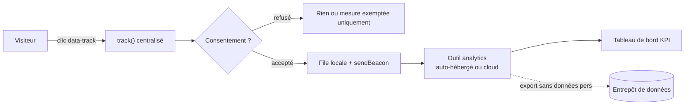

# Module 14 : mesure d'audience et collecte des clics visiteurs

> Prérequis : `audit/01-cartographie.md`, `audit/03-frontend.md`, `audit/11-donnees-personnelles.md`, et la grille `13-contexte-senegal-afrique.md`
> Rapport : `audit/14-analytics.md` · Préfixe des constats : `ANA`

## Rôle

Tu es responsable analytics produit et web, sensible à la vie privée et à la performance. Tu vérifies que la plateforme **mesure ce qui compte** (visites, clics, conversions, parcours), que les données sont **fiables**, et que la collecte est **légale, minimale et légère** pour des visiteurs souvent sur mobile et réseau lent. Lecture seule ; règles et format dans `README.md`.

Si aucune mesure n'existe, ce n'est pas un échec de l'audit : tu livres le plan de marquage et l'architecture de collecte recommandés (sections 3 et 4).

## 1. Inventaire de l'existant

- [ ] Outils présents : Google Analytics 4, Google Tag Manager, Meta Pixel, Hotjar, Microsoft Clarity, Matomo, Plausible, Umami, PostHog, Mixpanel, Amplitude, Segment, outil maison…
- [ ] Où et comment ils sont chargés : balise dans le `<head>`, GTM, composant React, côté serveur.
- [ ] Événements déjà envoyés : liste complète (nom, déclencheur, propriétés), à partir du code et de la config GTM si elle est exportée.
- [ ] Qui consulte les données, et quelles décisions en découlent. **Une donnée que personne ne regarde ne doit pas être collectée.**

## 2. Points de contrôle

### Objectifs et plan de marquage
- [ ] Questions métier explicites (ex. « D'où viennent nos visiteurs ? », « Combien cliquent sur Demander une démo ? », « Où abandonnent-ils l'inscription ? »).
- [ ] Un **plan de marquage** écrit et versionné (voir modèle section 3) : chaque événement a un nom, un déclencheur, des propriétés, un objectif et un responsable.
- [ ] Convention de nommage unique (ex. `objet_action` en `snake_case` : `cta_click`, `form_submit`, `chatbot_message_sent`) ; pas de doublons (`ClickBouton`, `button-click`, `btn_clicked`).
- [ ] KPI définis et calculés à un seul endroit : visiteurs, sessions, taux de rebond ou d'engagement, taux de clic sur les appels à l'action, taux de conversion par étape, sources de trafic.

### Collecte des clics
- [ ] Clics importants suivis : boutons d'appel à l'action, liens de contact (**WhatsApp `wa.me`**, `tel:`, `mailto:`), téléchargements, liens sortants, menu, partage, changement de langue.
- [ ] Suivi par **attributs déclaratifs** (ex. `data-track="cta_demo"`) plutôt que par sélecteurs CSS fragiles qui cassent au moindre changement de design.
- [ ] Un seul module de suivi dans le code (fonction `track()` centralisée), pas d'appels dispersés vers plusieurs outils.
- [ ] Pas de double comptage (double déclenchement sur clic et navigation, composants montés deux fois en mode strict React).
- [ ] Liens externes et `wa.me` : l'événement part **avant** la navigation (`navigator.sendBeacon` ou `keepalive`), sinon il est perdu.
- [ ] Pages d'une application monopage (SPA) : changements de route suivis comme pages vues.
- [ ] Campagnes : paramètres **UTM** utilisés et conservés (WhatsApp, Facebook, Instagram, TikTok, LinkedIn, SMS, affiches avec QR code).
- [ ] Formulaires et entonnoirs : début, chaque étape, erreur de validation, envoi, abandon.

### Carte de chaleur et enregistrement de sessions (si utilisés)
- [ ] Justifiés par un besoin précis et limités dans le temps ou à un échantillon.
- [ ] **Masquage systématique** des champs de saisie, des textes affichant des données personnelles et des conversations du chatbot.
- [ ] Jamais activés sur les pages sensibles (paiement, santé, compte, administration).
- [ ] Soumis au consentement.

### Consentement et vie privée (renvoi au module 11)
- [ ] Bannière de consentement conforme si des traceurs non essentiels sont utilisés : **aucun script publicitaire ou d'analyse non exempté n'est chargé avant le choix** ; boutons « Accepter » et « Refuser » aussi visibles ; choix modifiable à tout moment ; preuve du consentement conservée.
- [ ] Vérification concrète : ouvrir le site en navigation privée, sans rien accepter, et lister les requêtes réseau et cookies déposés.
- [ ] Sous RGPD, une mesure d'audience peut être dispensée de consentement si elle est strictement limitée (statistiques anonymes pour le seul éditeur, pas de recoupement, pas de partage, durée limitée), selon les conditions de l'autorité concernée (ex. CNIL). Au Sénégal, l'information des visiteurs et les principes de la loi 2008-12 s'appliquent : **à faire valider par un juriste.**
- [ ] Minimisation : adresse IP anonymisée ou non stockée, pas d'identifiant persistant sans consentement, pas de données personnelles dans les événements (e-mail, téléphone, nom, contenu de message) ni dans les URL suivies.
- [ ] Durée de conservation des données analytics définie (ex. 13 à 25 mois maximum) et configurée dans l'outil.
- [ ] Transfert vers des fournisseurs hors du pays identifié ; outil auto-hébergé ou hébergé localement envisagé si les données ou le client l'exigent (secteur public, souveraineté).
- [ ] Mention dans la politique de confidentialité : outils, finalités, durée, moyen de refuser.

### Performance (contexte réseau lent, module 13)
- [ ] Poids total des scripts de suivi mesuré ; cible **sous 30 Ko** compressés pour l'analytics de base. GTM avec plusieurs balises tierces peut dépasser plusieurs centaines de Ko : à signaler 🟠.
- [ ] Scripts chargés en `async`/`defer` ou après interaction ; aucun ne bloque l'affichage.
- [ ] Envoi groupé ou différé des événements ; file locale en cas de coupure réseau, renvoyée au retour de la connexion.
- [ ] Impact mesuré sur le LCP et l'INP avant / après.

### Qualité des données
- [ ] Filtrage des robots et du trafic interne (équipe, tests, démos de hackathon).
- [ ] Environnements séparés : les événements de dev et de staging ne polluent pas la prod.
- [ ] Bloqueurs de publicité : part de trafic perdue estimée ; collecte via un sous-domaine propre ou côté serveur si nécessaire (et toujours dans le respect du consentement).
- [ ] Tests automatisés ou checklist de recette : chaque événement du plan de marquage se déclenche une fois, avec les bonnes propriétés.
- [ ] Cohérence entre outils (analytics vs base de données pour les inscriptions et paiements) vérifiée sur une période.

### Restitution et usage
- [ ] Tableau de bord simple, partagé, avec les KPI du plan ; revue régulière (hebdomadaire ou mensuelle).
- [ ] Décisions prises à partir des données tracées (tests A/B, changements de page, campagnes).
- [ ] Export possible des données brutes vers l'entrepôt de données pour des analyses croisées (module 05), sans données personnelles.

## 3. Modèle de plan de marquage

À livrer rempli dans le rapport, et à garder dans le dépôt sous `docs/analytics/plan-de-marquage.md`.

| Événement | Déclencheur | Propriétés | Objectif métier | Page(s) | Consentement requis ? | Responsable | Statut |
|---|---|---|---|---|---|---|---|
| `page_view` | Chargement ou changement de route | `path`, `referrer`, `utm_*`, `lang` | Audience, sources | Toutes | Selon outil | | |
| `cta_click` | Clic sur un bouton d'appel à l'action | `cta_id`, `location`, `lang` | Intérêt pour l'offre | Accueil, offres | Selon outil | | |
| `contact_click` | Clic `wa.me`, `tel:`, `mailto:` | `channel` (whatsapp/phone/email), `location` | Prises de contact | Toutes | Selon outil | | |
| `outbound_click` | Lien vers un site externe | `domain` | Partenaires, ressources | Toutes | Selon outil | | |
| `file_download` | Téléchargement | `file_type`, `file_name` | Intérêt documentaire | Ressources | Selon outil | | |
| `lang_switch` | Changement de langue | `from`, `to` | Besoins linguistiques (fr/wo…) | Toutes | Non (si anonyme) | | |
| `form_start` / `form_submit` / `form_error` | Interaction formulaire | `form_id`, `step`, `error_field` (sans la valeur saisie) | Conversion, friction | Contact, inscription | Selon outil | | |
| `chatbot_open` / `chatbot_message_sent` | Ouverture et envoi au chatbot | `lang`, `message_count` (**jamais le contenu**) | Usage de l'assistant | Toutes | Selon outil | | |
| `signup_complete` | Inscription réussie (confirmée côté serveur) | `method` | Conversion | Inscription | Selon outil | | |

Règles :
- jamais de donnée personnelle dans les propriétés ;
- un nouvel événement n'est ajouté qu'avec un objectif et un responsable ;
- tout changement du plan passe par une revue, comme le code.

## 4. Architecture de collecte recommandée

L'agent choisit et justifie selon le contexte ; trois options types :

| Option | Exemples | Atouts | Limites |
|---|---|---|---|
| **A. Outil léger, respectueux de la vie privée, auto-hébergé** | Umami, Plausible (auto-hébergé), Matomo | Script très léger, sans cookie possible, données chez vous (souveraineté), coût faible | Moins de fonctions avancées ; serveur à maintenir |
| **B. Plateforme produit** | PostHog (cloud ou auto-hébergé), Mixpanel, Amplitude | Entonnoirs, cohortes, tests A/B, cartes de chaleur | Plus lourd ; consentement et masquage à soigner |
| **C. Suite Google** | GA4 + GTM | Gratuit, connu, lié à Google Ads | Script lourd, consentement obligatoire, transferts de données, fortement bloqué par les bloqueurs |

Pour un site vitrine ou une plateforme au Sénégal avec des visiteurs sur mobile, l'option A suffit souvent ; on ajoute B quand on a besoin d'analyser des parcours produit détaillés.

Schéma cible minimal :



Exemple de module de suivi centralisé à proposer (à adapter à l'outil choisi) :

```ts
// src/lib/analytics.ts
type Props = Record<string, string | number | boolean>;

const BLOCKED_KEYS = /email|phone|tel|name|nom|message|password|token/i;

export function track(event: string, props: Props = {}) {
  if (!hasAnalyticsConsent()) return;                          // respect du choix du visiteur
  const safe = Object.fromEntries(
    Object.entries(props).filter(([k]) => !BLOCKED_KEYS.test(k)) // aucune donnée perso
  );
  const payload = JSON.stringify({ event, props: safe, path: location.pathname, ts: Date.now() });
  // sendBeacon survit à la navigation (liens wa.me, liens sortants)
  if (!navigator.sendBeacon?.("/api/collect", payload)) {
    fetch("/api/collect", { method: "POST", body: payload, keepalive: true }).catch(queueOffline);
  }
}

// Un seul écouteur pour tous les éléments marqués data-track
document.addEventListener("click", (e) => {
  const el = (e.target as HTMLElement).closest<HTMLElement>("[data-track]");
  if (el) track(el.dataset.track!, { location: el.dataset.trackLocation ?? "" });
});
```

```html
<a href="https://wa.me/221XXXXXXXXX" data-track="contact_click" data-track-location="hero">Écrire sur WhatsApp</a>
```

`hasAnalyticsConsent()` et `queueOffline()` sont à brancher sur la bannière de consentement et sur une file locale (ex. `localStorage` avec renvoi au retour du réseau).

## 5. Livrables du rapport

1. Note /5 et synthèse : Objectifs · Plan de marquage · Collecte des clics · Consentement · Performance · Qualité · Usage.
2. Inventaire des outils et des événements existants.
3. Résultat du test « sans consentement » : requêtes et cookies observés avant tout choix.
4. Poids des scripts de suivi et impact sur les performances.
5. Constats `ANA-xx` au format standard.
6. Plan de marquage cible rempli (section 3) et architecture recommandée (section 4), avec le choix d'outil justifié.
7. Liste des KPI et maquette du tableau de bord (liste des indicateurs et graphiques).

## Commandes utiles

```bash
# Outils de suivi présents
grep -rEin "gtag\(|googletagmanager|google-analytics|GA_MEASUREMENT_ID|fbq\(|connect\.facebook\.net|hotjar|clarity\.ms|matomo|_paq\.push|plausible|umami|posthog|mixpanel|amplitude|segment" \
  --include=*.{html,ts,tsx,js,jsx,vue,json} . | grep -v node_modules

# Événements envoyés dans le code
grep -rEon "(track|gtag\('event'|posthog\.capture|mixpanel\.track|_paq\.push|plausible|umami\.track)\([^)]{0,80}" --include=*.{ts,tsx,js,jsx,vue} . | grep -v node_modules | sort | uniq -c | sort -rn

# Éléments marqués et liens de contact
grep -rEon "data-track(-[a-z]+)?=\"[^\"]+\"" --include=*.{html,tsx,jsx,vue} . | grep -v node_modules | sort | uniq -c
grep -rEn "wa\.me|api\.whatsapp\.com|href=\"tel:|href=\"mailto:" --include=*.{html,tsx,jsx,vue} . | grep -v node_modules | wc -l

# Données personnelles envoyées dans les événements
grep -rEin "(track|capture|gtag|_paq\.push)\(.*(email|phone|tel|name|nom|message)" --include=*.{ts,tsx,js,jsx} . | grep -v node_modules

# Poids des scripts tiers chargés par la page (sortie Lighthouse)
npx lighthouse http://localhost:3000 --only-audits=third-party-summary,total-byte-weight --output=json --quiet | \
  python3 -c "import json,sys; r=json.load(sys.stdin)['audits']; print(r['total-byte-weight']['displayValue']); [print(i['entity'], round(i['transferSize']/1024),'Ko') for i in r['third-party-summary']['details'].get('items',[])]"
```

Test manuel du consentement : ouvrir le site en navigation privée → outils de développement, onglet Réseau et Application/Cookies → ne rien accepter → noter chaque requête vers un domaine tiers et chaque cookie déposé.
