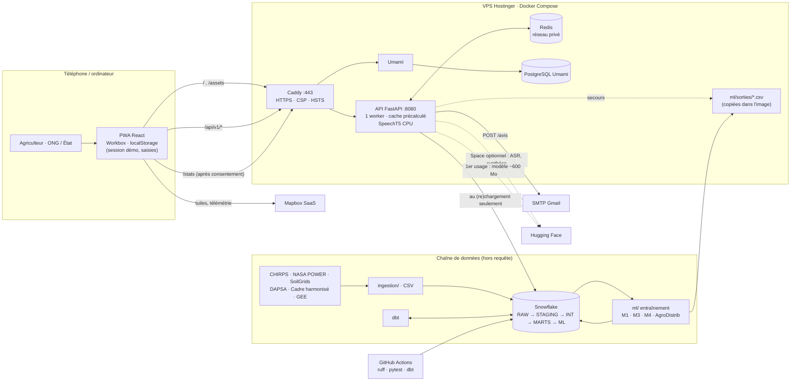

# 01 · Cadrage et cartographie — Assaman & Suuf

> Audit du 21/11/2026, branche `dev/all-recup` (commit `51e448d`). Lecture seule.
> Ce module **inventorie sans juger**. Les points à traiter sont listés à la fin et renvoyés aux modules suivants.
> Statuts : `Constaté` (vérifié dans le dépôt ou par commande), `Probable`, `À vérifier`.

> **Suivi (21/11/2026, après l'audit).** Plusieurs écarts relevés ici sont corrigés :
> - le `Makefile` utilise `venv/` et lance `api-prod` avec 1 worker ;
> - `.env.example` documente `SNOWFLAKE_SCHEMA_ML` et `SNOWFLAKE_ML_*`, et `app/.env.example` documente `VITE_UMAMI_ID` ;
> - `.python-version` et `.nvmrc` sont ajoutés ;
> - la racine est nettoyée et `docs/` est rangé en sous-dossiers.
>
> Les chemins cités dans ce rapport sont ceux de la version auditée (`51e448d`) ; la correspondance avec les nouveaux chemins est dans `RAPPORT-AUDIT.md`, annexe H.

---

## 1. Fiche d'identité

| Élément | Valeur | Preuve |
|---|---|---|
| Type de dépôt | Monorepo simple, sans outil d'orchestration (pas de workspaces, Nx, Turborepo). `make` sert d'orchestrateur. | `Makefile`, `package-lock.json` racine vide (`"packages": {}`) |
| Python | 3.12 en prod et en CI ; 3.14.4 sur le poste local | `deploy/Dockerfile.api:2`, `.github/workflows/ci.yml` (`PYTHON_VERSION: "3.12"`), `python3 --version` |
| Node | `>=20.19` exigé ; 22 dans l'image de build ; 26.1 sur le poste local | `app/package.json` (`engines`), `deploy/Dockerfile.web:2`, `node -v` |
| Fichiers de version | Ni `.nvmrc`, ni `.python-version`, ni `pyproject.toml` | `ls -a` (aucun) |
| Contributeurs | 4 auteurs, 71 commits du 08/11 au 21/11/2026 (13 jours) | `git shortlog -sn`, `git log` |
| Branches | 7 locales, 14 distantes (`main`, `develop`, `dev/*`, `rescue-snowflake`, `revert-17-…`) | `git branch -a` |

### Frameworks et versions

| Couche | Paquets (version déclarée) | Remarque |
|---|---|---|
| Front | React `^19.3.1`, react-router `^7.18.5`, Vite `^8.3.8`, TypeScript `^5.9.3`, Tailwind `^4.3.5`, TanStack Query `^5.107.1`, mapbox-gl `^3.34.2` + react-map-gl `^8.1.3`, Recharts `^3.10.1`, jsPDF `4.2.1` (seule version figée), vite-plugin-pwa `^2.0.0`, lucide-react | Versions récentes, aucune en fin de vie connue. Plages `^`, verrouillées par `app/package-lock.json`. |
| API | FastAPI, Uvicorn, pydantic-settings, redis, snowflake-connector-python, gradio_client, numpy | **Aucune version figée** (`requirements-api.txt`). Le build Docker prend la dernière version publiée. → module 08 |
| Voix | torch (index CPU), transformers, sentencepiece | Pas de version figée (`requirements-voix.txt`) |
| Data | dbt-snowflake, pandas, sqlalchemy, psycopg2-binary, openpyxl, pyarrow | Pas de version figée (`requirements.txt`) |
| ML | scikit-learn, xgboost | Pas de version figée (`requirements.txt`) |
| Infra | Caddy `2-alpine`, Redis `7-alpine`, PostgreSQL `16-alpine`, Umami `3.4.1` (seule image figée), python `3.12-slim`, node `22-alpine` | `docker-compose.prod.yml`, `deploy/Dockerfile.*` |

### Volumétrie (fichiers suivis par git, hors images)

`cloc` et `tokei` ne sont pas installés. Comptage par `git ls-files | xargs cat | wc -l` :

| Langage | Fichiers | Lignes |
|---|---|---|
| Python | 86 | 8 898 |
| TSX | 46 | 6 641 |
| TypeScript | 51 | 5 301 |
| SQL (dbt, Snowflake) | 88 | 5 654 |
| Markdown | 37 | 5 668 |
| YAML | 10 | 1 784 |
| CSV (seeds, référentiels, sorties ML) | 26 | 76 302 |

Le code applicatif fait environ 26 500 lignes. Les fichiers versionnés comprennent aussi des **données** : `ml/sorties/*.csv` (17 fichiers, dont `risque_semis.csv`), `dbt/seeds/*.csv` et `data/referentiels/*` (doses, besoins, zones). → modules 05 et 12.

---

## 2. Carte des composants

| Composant | Rôle | Dossier | Techno | Entrée | Port | Dépend de |
|---|---|---|---|---|---|---|
| **Site / PWA** | Landing, pages publiques, « scène » (carte et 12 modes) et exports PDF | `app/` | React 19, Vite 8, Mapbox GL, Workbox | `app/src/main.tsx`, routes `app/src/App.tsx:22-39` | 5173 (dev) ; Caddy 443 (prod) | API `/api/v1`, Mapbox, Umami `/stats` |
| **Faux serveur (mock)** | Données d'exemple et **comptes de démonstration dans le navigateur** | `app/src/api/mock/` | TS | `app/src/api/mock/serveur.ts` | — | — |
| **Reverse proxy** | HTTPS automatique, en-têtes de sécurité, CSP ; sert le site, transmet `/api/*` et `/stats/*` | `deploy/Caddyfile` | Caddy 2 | `deploy/Dockerfile.web:18` | 80, 443 | api, umami |
| **API** | Lit les marts une fois, précalcule toutes les réponses, les sert depuis un cache versionné ; voix ; avis ONG | `api/` | FastAPI, Uvicorn (1 worker) | `api/main.py:36` (`creer_app`), `python -m api` | 8080 (interne) | Redis, Snowflake (au chargement), `ml/sorties` (secours), Space HF, SMTP |
| **Cache** | Réponses précalculées, versions et retour arrière | `api/cache/` | Redis 7 ou mémoire | `api/cache/service.py` | 6379 (réseau `prive`) | — |
| **Voix wolof (local)** | Synthèse SpeechT5 sur le processeur | `api/voix/tts_local.py` | torch, transformers | importé par `api/routes/voix.py:21` | — | modèle téléchargé depuis Hugging Face (`HF_HOME=/donnees/huggingface`) |
| **Voix wolof (Space)** | Reconnaissance (ASR) et synthèse sur un Space Hugging Face | `voix/space/` (déployé par `voix/deployer_space.py`) | Gradio | `voix/space/app.py` | 7860 (Space) | Hugging Face |
| **Entrepôt** | RAW → STAGING → INTERMEDIATE → MARTS → ML | `snowflake/` (scripts DDL), `dbt/` | Snowflake (SaaS) | — | — | — |
| **Transformations** | 25 staging, 3 intermediate, 32 marts/faits/dim, 5 seeds, 23 tests SQL | `dbt/` | dbt-snowflake | `dbt/dbt_project.yml`, `dbt/profiles.yml` | — | Snowflake |
| **Modèles ML** | M1 saison, M3 rendement et alerte, M4 date de semis, AgroDistrib, comparaison d'algorithmes | `ml/` | scikit-learn, XGBoost, pandas | `ml/m*/entrainer.py`, `ml/agrodistrib/moteur.py` | — | marts (parquet ou Snowflake) → `ml/sorties/*.csv` → `SALTIS.ML` (`ml/charger_snowflake.py`) |
| **Ingestion (Snowflake)** | Chargement du Cadre harmonisé et des eaux de surface (GEE) dans RAW | `ingestion/collecte/` | Python, Google Earth Engine (JS) | `charger_snowflake.py`, `preparer_*.py` | — | Snowflake |
| **Ingestion (PostgreSQL, historique)** | Chargeur des CSV `data/modules/` vers PostgreSQL | `ingestion/load_modules.py` | SQLAlchemy, psycopg2 | `make load` | 5432 (`docker-compose.yml`) | PostgreSQL local |
| **Mesure d'audience** | Statistiques de visite, après consentement | service `umami` | Umami 3.4.1 et PostgreSQL 16 | `docker-compose.prod.yml` | 127.0.0.1:3001 | umami-db (réseau `umami`, interne) |
| **CI** | Lint ruff (règles d'erreurs seulement), compileall, pytest, dbt build (`SNOWFLAKE_SCHEMA: CI`, mais voir DATA-01 : pas isolé), lint et build du front, verdict unique `ci-status` | `.github/workflows/ci.yml` | GitHub Actions | push `main`, `develop`, `dev/**` ; PR | — | secrets Snowflake |

### Routes de l'API (`/api/v1`, 37 routes)

| Groupe | Routes | Fichier |
|---|---|---|
| Référentiels | `GET /referentiels/{departements, regions, zones, cultures, periodes, intrants, phases-cadre-harmonise}` | `api/routes/donnees.py:41-82` |
| A. Agroclimat | `GET /agroclimat/campagnes/{campagne}`, `/agroclimat/departements/{code}`, `/suivi-decadaire/{code}/{annee}` | `donnees.py:102-121` |
| B. Cultures | `GET /choix-cultures/{code}` | `donnees.py:149` |
| C. Besoins | `GET /besoins/departements/{code}`, `/besoins/totaux`, `/prix-intrants` | `donnees.py:167-180`, `cadre_prix.py:81` |
| D. AgroDistrib | `GET /agrodistrib/{territoires, agregats}`, `/vulnerabilite`, `/vulnerabilite/{code}` | `donnees.py:193-222` |
| E. Opportunités | `GET /opportunites`, `/opportunites/{code}` | `opportunites.py:33-45` |
| F. Cadre harmonisé | `GET /cadre-harmonise`, `/cadre-harmonise/{code}` | `cadre_prix.py:56-65` |
| IA · Prévisions | `GET /previsions/saison/{annee}`, `/saison/departements/{code}`, `/rendement/{code}/{annee}`, `/alerte-recolte/{annee}`, `/semis/departements/{code}`, `/semis/carte`, `/fiabilite` | `previsions.py:59-155` |
| IA · Voix | `POST /voix/texte`, `/voix/question` (audio), `/voix/parler` | `voix.py:71-131` |
| Avis | `POST /avis` (e-mail SMTP) | `avis.py:66` |
| Système | `GET /systeme/sante`, `/systeme/cache` ; `POST /systeme/cache/rafraichir`, `/cache/retour-arriere` (en-tête `X-Admin-Token`) | `systeme.py:32-71` |

Il n'y a **aucune route d'authentification** (`/auth/login`, `/moi`) côté API.

---

## 3. Flux et intégrations

| Service externe | Usage | Où | Données envoyées |
|---|---|---|---|
| **Snowflake** (SaaS) | Entrepôt : dbt, ML, ingestion ; lu par l'API seulement au (re)chargement du cache | `api/source_snowflake.py`, `dbt/profiles.yml`, `ml/charger_snowflake.py:101-105` | Requêtes en lecture `select * … order by` (`source_snowflake.py:37-40`) |
| **Mapbox** (SaaS) | Fond de carte, tuiles, télémétrie `events.mapbox.com` | `app/src/scene/Carte.tsx`, CSP `deploy/Caddyfile` | Position de la carte vue par l'utilisateur, IP, en-têtes du navigateur → module 11 |
| **Hugging Face** | Téléchargement du modèle SpeechT5 (~600 Mo, premier usage) ; Space optionnel pour l'ASR et la synthèse | `api/voix/tts_local.py`, `api/voix/espace.py:28-38` (`gradio_client`) | Texte wolof ; **audio de l'utilisateur** si `/voix/question` est appelé (`api/routes/voix.py`, `espace.transcrire`) |
| **SMTP** (Gmail d'après le contexte) | Envoi des avis ONG | `api/routes/avis.py`, `api/config.py` (`smtp_*`) | Nom de l'organisation, type, régions, retours |
| **Umami** (auto-hébergé) | Audience, chargée seulement après « Accepter » | `app/src/consentement/audience.ts:1-14`, `deploy/Caddyfile` (`@audience`) | Pages vues, événements, IP vue par le serveur |
| **Google Earth Engine** | Préparation des eaux de surface (hors ligne) | `ingestion/collecte/eau/gee_eau_surface.js` | — |
| **PostgreSQL** | Base Umami (prod) ; chargeur historique (dev) | `docker-compose.prod.yml`, `docker-compose.yml`, `ingestion/load_modules.py:14` | — |
| Paiement (Wave, Orange Money…) | **Aucun** | `grep` sans résultat | — |
| WhatsApp, SMS, USSD, IVR | **Aucun** | `grep` sans résultat | — |
| LLM (OpenAI, Anthropic…) | **Aucun** : la « compréhension » vocale repose sur des règles | `api/voix/comprendre.py` | — |

### Deux corrections au contexte fourni

1. **L'audio de l'utilisateur ne part pas, dans le code actuel du front** (`Constaté`). Le front n'appelle que `POST /voix/parler` (texte wolof → audio), dans `app/src/api/index.ts:158-159` et `app/src/scene/lecture.ts:102`. `grep` ne trouve ni `MediaRecorder`, ni `getUserMedia`, ni d'appel à `/voix/question` ou `/voix/texte` dans `app/src`. Les routes audio existent côté API et sont publiques, mais aucun écran ne s'en sert. Pourtant le CSP et la `Permissions-Policy` autorisent le micro (`microphone=(self)`).
2. **Le « JWT » est un simulacre de connexion** (`Constaté`). En prod, le build force `VITE_AUTH_DEMO=true` (`deploy/Dockerfile.web:14`). Les deux « portes » de la landing ouvrent une session avec des comptes de démonstration codés dans le front : `app/src/landing/entrer.ts:10`, `app/src/api/mock/comptes.ts:5` (mot de passe de démo en clair, sans valeur réelle). La session est stockée dans `localStorage['assaman.session']` (`app/src/auth/session.ts:5,31`). La carte est derrière `RouteProtegee` (`app/src/App.tsx:27-29`). L'appel `api.moi()` est fait à chaque ouverture (`AuthContext.tsx:23`). → modules 03, 07, 11

### Variables d'environnement (noms seulement)

| Constat | Variables |
|---|---|
| `.env.example` racine (37 noms) | `API_*`, `SNOWFLAKE_*`, `SMTP_*`, `AVIS_DESTINATAIRE`, `HF_TOKEN`, `VOIX_SPACE`, `REDIS_*`, `POSTGRES_*`, `UMAMI_*`, `DOMAINE`, `EMAIL_CONTACT`, `MAPBOX_TOKEN`, `VITE_MAPBOX_TOKEN`, `CORS_ORIGINES`, `LIMITE_*` |
| Lues par le code, **absentes** de `.env.example` | `SNOWFLAKE_ML_USER`, `SNOWFLAKE_ML_PASSWORD`, `SNOWFLAKE_ML_ROLE` (`ml/charger_snowflake.py:102-104` ; la dernière est dans le `.env` local) ; `HF_SPACE_NOM`, `SPACES_ZERO_GPU`, `VOIX_HOTE`, `VOIX_PORT` (`voix/`) ; réglages pydantic `API_HOST`, `REDIS_PREFIXE`, `SNOWFLAKE_SCHEMA_ML`, `CACHE_*`, `HTTP_MAX_AGE_S`, `LIMITE_ADMIN_PAR_MINUTE`, `TAILLE_MAX_JSON_OCTETS`, `PRECHARGEMENT_AU_DEMARRAGE`, `VOIX_CACHE_MAX_FICHIERS` (ils ont une valeur par défaut, `api/config.py`) |
| Front (`app/.env.example`) | `VITE_API_URL`, `VITE_USE_MOCK`, `VITE_AUTH_DEMO`, `VITE_DONNEES_DEMO`, `VITE_MAPBOX_*`, `VITE_ACTIVER_SEMENCIERS`, `VITE_URL_SITE`, `EMAIL_CONTACT`, `VITE_LIEN_*`. `VITE_UMAMI_ID` est lue par le code mais absente de `app/.env.example`. |
| `.env` local (présence seulement) | `DOMAINE` et `MAPBOX_TOKEN` renseignées. `VOIX_SPACE`, `HF_TOKEN`, `REDIS_URL`, `SMTP_HOST`, `UMAMI_WEBSITE_ID` et `API_ADMIN_TOKEN` sont vides : en local, le Space vocal, l'envoi des avis, Umami et l'administration sont donc désactivés. |

---

## 4. Diagramme

---

## 5. Environnements et déploiement

| Environnement | Ce que montre le dépôt | Preuve |
|---|---|---|
| **dev** | `python -m api` (127.0.0.1:8080, `/docs` actif, CORS `*`), `vite` (5173), mock par défaut (`VITE_USE_MOCK=true`). `docker-compose.yml` lance PostgreSQL et Redis **exposés sur l'hôte** (5432, 6379). | `api/__main__.py`, `api/config.py`, `app/.env.example`, `docker-compose.yml` |
| **CI** | Lint ruff limité aux règles `E9,F63,F7,F82,F401` ; `compileall` ; `pytest` (le code de sortie 5, « aucun test », est toléré) ; dbt avec `SNOWFLAKE_SCHEMA: CI`, sauté pour les PR venant de forks (le schéma n'est en réalité pas isolé, voir DATA-01) ; job front : `npm ci`, `npm run lint`, `npm run build` (le build inclut le typecheck) avec `VITE_USE_MOCK=true` ; job `ci-status` qui résume le tout. Aucun scan de dépendances. *(Corrigé à l'étape 5 : la première version disait à tort « aucun job front ».)* | `.github/workflows/ci.yml` |
| **prod** | `docker-compose.prod.yml` : 5 services, réseaux `prive` et `umami` internes, `cap_drop: ALL`, `no-new-privileges`, limites mémoire (total ≈ 7 Go sur 8), healthchecks. Images construites sur le VPS (`--build`). Pas de registre d'images, pas d'IaC, pas de pipeline de déploiement. | `docker-compose.prod.yml`, `deploy/README.md` |
| **staging** | Aucun | — |
| **Vercel** | `app/vercel.json` présent, non utilisé (confirmé par l'équipe) | `app/vercel.json` |

**Écarts entre fichiers** (`Constaté`, analysés dans les modules 02 et 08) :
- `Makefile` utilise `.venv/` (`make install`, `make api`), alors que le venv du poste s'appelle `venv/` et que le `.gitignore` liste les deux.
- `make api-prod` lance Uvicorn avec 4 workers (`Makefile`). L'image Docker n'en lance qu'un, volontairement, pour la voix (`deploy/Dockerfile.api`).

**Prod en ligne (`https://assaman-suuf.tech/`, vérifiée en lecture le 21/11/2026)** : déploiement du 19/11, plus ancien que le dépôt.
- HTTP renvoie `308` vers HTTPS.
- La page d'accueil pèse 814 octets compressée et répond en 0,35 s depuis le poste de l'auditeur.
- `GET /api/v1/systeme/sante` répond `200`, avec le mode de cache, la version active et l'état de Redis.
- Les en-têtes en ligne diffèrent du `Caddyfile` du dépôt : HSTS sans `includeSubDomains`, CSP sans `upgrade-insecure-requests`, et une adresse inconnue répond `200` au lieu de `404`. Le site en ligne n'est donc pas la version du dépôt : les modules suivants jugeront le dépôt et marqueront « état en ligne » ce qui vient de la prod.

---

## 6. Parcours critiques (à auditer en priorité)

| # | Parcours | Fichiers front | API / données | Pourquoi c'est critique |
|---|---|---|---|---|
| P1 | **Entrée par une porte** : landing → clic « Agriculteur » ou « ONG / État » → session de démo → carte | `pages/Landing.tsx`, `landing/Portes.tsx`, `landing/entrer.ts`, `auth/*`, `api/mock/comptes.ts`, `App.tsx` | Aucune (comptes dans le navigateur) | Première impression devant le jury et les autorités ; incohérence avec « pas de compte » |
| P2 | **Agriculteur : ma parcelle → que semer, quand, combien** | `scene/modes/Parcelle.tsx` (géolocalisation, l. 134-136), `Semer.tsx`, `QuandSemer.tsx`, `Surface.tsx`, `scene/conseil.ts`, `scene/fiche.tsx` | `/choix-cultures`, `/previsions/semis/*`, `/besoins/*`, `/prix-intrants` ; marts B et C, M4 ; `data/referentiels/doses_*.csv` | Doses non validées par l'ISRA ; géolocalisation ; règle « jamais 0 pour une valeur inconnue » |
| P3 | **Quelle saison des pluies** (2026 « océan », 2027-2035 « tendance ») | `scene/modes/Saison.tsx`, `scene/previsions.tsx`, `scene/fiabilite.ts`, `CourbeCumul.tsx`, `Carte.tsx` | `/previsions/saison/*`, `/previsions/fiabilite`, `/agroclimat/*`, `/suivi-decadaire` ; M1 | Chiffre phare du pitch ; honnêteté sur la fiabilité |
| P4 | **ONG / État : préparer la campagne, alerte récolte, vulnérabilité, répartir un stock, exporter un PDF, donner son avis** | `scene/modes/{Campagne, AlerteRecolte, Repartir, BesoinsPays, Exporter}.tsx`, `scene/repartition.ts`, `scene/vueVulnerabilite.tsx`, `export/*` (jsPDF), `scene/AvisOng.tsx` | `/agrodistrib/*`, `/vulnerabilite/*`, `/previsions/alerte-recolte`, `/cadre-harmonise/*`, `POST /avis` (SMTP) | Public payant visé ; données saisies (stock, prix) ; envoi d'e-mail |
| P5 | **Voix wolof de la mascotte** (texte → voix) | `scene/Mascottes.tsx`, `scene/FicheReponse.tsx`, `scene/lecture.ts`, `scene/wolof.ts` | `POST /voix/parler` → SpeechT5 local ou Space HF ; `api/voix/*` | Seul canal pour les personnes peu à l'aise avec l'écrit ; CPU de 2 vCPU ; délai d'attente côté front de 900 000 ms (15 min) (`api/index.ts:159`) |
| P6 | **Chaîne de rafraîchissement des données** (pas un parcours visiteur) | — | dbt → `SALTIS.MARTS` / `ML` → `POST /systeme/cache/rafraichir` → Redis ; secours `ml/sorties/*.csv` | Si elle casse, tous les écrans affichent des données périmées ou vides |

---

## 7. Zones d'ombre

| Sujet | Ce qui manque | Statut |
|---|---|---|
| Schéma, rôles et droits Snowflake réels (`SYSADMIN` par défaut pour dbt et l'API : `api/config.py`, `dbt/profiles.yml`) | Export de `SHOW GRANTS`, liste des utilisateurs de service | À vérifier |
| `.env` de prod sur le VPS (Space vocal, SMTP, Umami, jeton admin activés ou non ?) | Liste des noms de variables renseignées en prod | À vérifier |
| Configuration du VPS : pare-feu, SSH, sauvegardes des volumes (`redis-donnees`, `umami-db`, `api-donnees`), mises à jour | Accès ou description | À vérifier |
| Restriction de domaine du jeton Mapbox public | Capture du compte Mapbox | À vérifier |
| Le Space Hugging Face (`voix/space`) est-il déployé, public ou privé, et où sont ses journaux ? | Nom du Space et visibilité | À vérifier |
| Usage réel du chargeur PostgreSQL `ingestion/load_modules.py` (dernière modification le 16/11 ; cité par le `Makefile` et le `README`) | Confirmation de l'équipe | À vérifier |
| Usage des routes `/voix/question` et `/voix/texte`, que le front n'appelle pas | Sont-elles prévues pour un autre client (WhatsApp, appli) ? | À vérifier |
| Date de la démo SALTIS et de la présentation aux autorités | Calendrier | À vérifier |
| Règlement du SALTIS PAS Challenge (droits sur le code et les données, publication) | Texte du règlement | À vérifier (module 12) |
| Propriété des comptes : domaine `assaman-suuf.tech`, VPS, Snowflake, Mapbox, Gmail SMTP (personne physique ou structure ?) | Information de l'équipe | À vérifier (module 08, grille locale) |

---

## Résumé

- Monorepo d'environ 26 500 lignes (Python, TS/TSX, SQL), construit en 13 jours par 4 personnes. Front React/PWA → Caddy → FastAPI à cache précalculé (Redis), alimenté hors requête par Snowflake, dbt et `ml/`, sur un seul VPS Docker.
- Intégrations : Snowflake, Mapbox, Hugging Face (modèle et Space optionnel), SMTP Gmail, Umami auto-hébergé. Ni paiement, ni WhatsApp/SMS/USSD, ni LLM.
- Deux corrections au contexte : le front n'envoie pas d'audio (seulement `/voix/parler`), et la « connexion JWT » est un simulacre de démo actif en prod (`VITE_AUTH_DEMO=true`).
- Écarts visibles : dépendances Python non figées ; CI dbt non isolée de la prod (DATA-01) ; variables ML et voix absentes de `.env.example` ; `Makefile` qui pointe vers `.venv` ; prod en ligne antérieure au dépôt.
- Modules suivants pertinents : tous. Le 06 porte sur le ML et la voix (pas de LLM). Le 14 s'applique (Umami). Priorité aux parcours P1 à P5.
