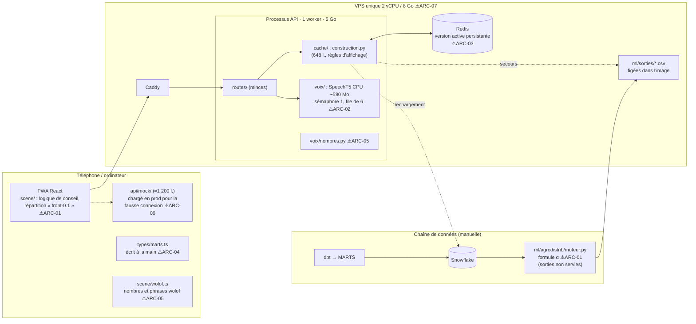
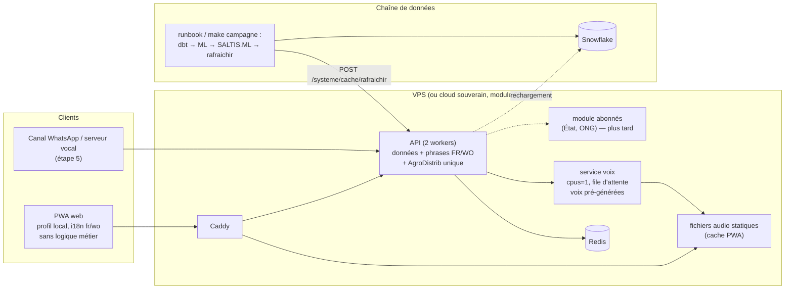

# 02 · Architecture — Assaman & Suuf

> Audit du 21/11/2026, branche `dev/all-recup` (commit `51e448d`). Lecture seule. Prérequis : `01-cartographie.md`.
> Préfixe des constats : `ARC`. Échelle de sévérité et format : `audit/README.md`.
> Grille locale (module 13) appliquée : réseau lent, téléphone d'entrée de gamme, wolof, canaux d'accès, VPS unique.

---

## 1. Note globale : **3 / 5 (acceptable)**

Le style de l'architecture est clair et **proportionné au besoin** : un monolithe modulaire (une API, un site) et une chaîne de données hors ligne. Ce choix est juste pour 4 personnes et environ 500 utilisateurs. La logique métier est en revanche dispersée entre le front, l'API et `ml/`. Le calcul vocal, lourd, partage le processeur de l'API de données. La procédure documentée de rafraîchissement des données ne fonctionne pas en prod.

| 3 forces | 3 faiblesses |
|---|---|
| **Réponses précalculées et versionnées.** Snowflake n'est jamais appelé pendant une requête. Les réponses sont compressées, avec un retour arrière possible et un repli mémoire si Redis tombe (`api/cache/service.py:46-67`, `175-227`). C'est idéal pour un réseau lent et un serveur modeste. | **La logique métier existe en double, avec des écarts.** Il y a deux moteurs AgroDistrib aux formules différentes (ARC-01) et un contrat de types écrit deux fois à la main (ARC-04). La transcription des nombres en wolof existe en TS et en Python (ARC-05). |
| **Le fournisseur de données est isolé.** Toute l'API ne dépend de Snowflake que par une fonction `Lecteur` (`api/source_snowflake.py`), avec un secours sur `ml/sorties/*.csv` (`api/source_locale.py`). Un seul point d'entrée côté front pour les données (`app/src/api/index.ts:1`). | **La synthèse vocale CPU tourne dans le seul worker de l'API de données**, sur 2 vCPU (ARC-02). |
| **Les décisions sont écrites.** README par dossier (`api/`, `ml/`, `dbt/`, `deploy/`, `voix/`), cahier des charges V1 (`docs/v1-cahier-des-charges.md`) et contrat de données (`docs/contrat-donnees.md`). | **La procédure de mise à jour des données est fausse en prod**, avec Redis (ARC-03). La fausse connexion de démo est livrée en prod (ARC-06). |

---

## 2. Architecture actuelle (points faibles annotés)



---

## 3. Constats

### [ARC-01] Deux moteurs AgroDistrib aux formules différentes ; celui de `ml/` n'est pas servi
- Sévérité : 🟠 Élevé   Statut : Constaté
- Où : `app/src/scene/repartition.ts:5-6,27-30` ; `ml/agrodistrib/moteur.py:31,140` ; `api/routes/donnees.py:190-206`
- Constat : l'écran « Répartir un stock » calcule la répartition dans le navigateur avec la méthode `front-0.1` : un poids égal à `besoin × (1 + 3 × priorité × vulnérabilité/100)`. Le « moteur AgroDistrib » de `ml/` utilise un autre critère, `α × valeur_indicative + (1 − α) × vulnérabilité`, avec `ALPHA_DEFAUT = 0.5`. Ses sorties (`ml/sorties/agrodistrib_*.csv`) ne sont lues par aucune route : l'API ne sert que les territoires et les agrégats des marts.
- Preuve : `grep -rn "agrodistrib_\|scenario" api` ne trouve que `agrodistrib_territoires` et `agrodistrib_agregats` (clés de marts). Le front déclare `VERSION = 'front-0.1'`.
- Impact : le README, `ml/MODELES.md` et le pitch présentent « le moteur AgroDistrib ». L'ONG obtient pourtant d'autres chiffres, issus d'une formule qui n'est ni évaluée (`ml/comparaison/agrodistrib.py` porte sur le moteur `ml/`) ni documentée côté méthode. Devant un jury ou un ministère, deux répartitions différentes pour le même stock détruisent la confiance.
- Recommandation : choisir **une** source de vérité. Option simple : porter la formule du moteur `ml/` en TS, avec un test d'équivalence sur un jeu fixe (`agrodistrib_scenarios.csv` comme attendu). Option plus propre : une route `POST /agrodistrib/repartir`, calcul léger côté API, qui réutilise `ml/agrodistrib/moteur.py`. Dans les deux cas, afficher la méthode et sa version dans l'écran et dans le PDF.
- Effort : M

### [ARC-02] Synthèse vocale CPU dans le même worker que l'API de données
- Sévérité : 🟠 Élevé   Statut : Probable (charge non mesurée)
- Où : `deploy/Dockerfile.api` (`--workers 1`) ; `api/routes/voix.py:24-29,119-128` ; `api/voix/tts_local.py:20-21,52-54` ; `app/src/api/index.ts:159` (`timeout: 900000`)
- Constat : la synthèse SpeechT5 (modèle d'environ 580 Mo, plus le vocodeur) tourne par `asyncio.to_thread` dans le processeur du **seul** worker Uvicorn, sur un VPS de 2 vCPU. Une seule synthèse à la fois, jusqu'à 6 en attente, et le front attend jusqu'à 15 minutes. `POST /voix/parler` accepte n'importe quel texte envoyé par le navigateur.
- Preuve : `_synthese = asyncio.Semaphore(1)`, `SYNTHESES_EN_ATTENTE_MAX = 6` (`voix.py:27-28`) ; `mem_limit: 5g` pour l'API (`docker-compose.prod.yml`).
- Impact : pendant une synthèse, un cœur est saturé par PyTorch. Le second sert à la fois les données, Caddy et Umami. La carte et les fiches ralentissent pour tous les utilisateurs, alors qu'elles sont la valeur principale, et le plus pendant la démo. Avec `make api-prod` (4 workers, `Makefile`), le modèle serait chargé 4 fois, soit plus de 2 Go. La voix est le canal des personnes peu à l'aise avec l'écrit : 15 minutes d'attente sur un téléphone en 3G équivalent à une panne.
- Recommandation : (1) Sortir la voix dans un conteneur `voix` séparé (`cpus: 1`, `mem_limit`), appelé par l'API avec un délai court. (2) Les phrases wolof sont des phrases types remplies de chiffres (`app/src/scene/wolof.ts:1-4`) : les **pré-générer** au rafraîchissement du cache, pour la liste finie (département × fonctionnalité × année), et les servir comme fichiers statiques mis en cache par la PWA. (3) Refuser en `/voix/parler` tout texte qui ne correspond à aucun modèle de phrase connu (voir module 07). (4) Ramener le délai du front à 30-60 s, avec un message clair.
- Effort : M

### [ARC-03] La mise à jour des données documentée ne fonctionne pas avec Redis (le cas de la prod)
- **Suivi (21/11/2026, après l'audit)** : 🟡 Partiellement corrigé — `deploy/README.md` et `api/README.md` décrivent la bonne procédure (`POST /systeme/cache/rafraichir` avec le jeton). **Reste** : rendre `API_ADMIN_TOKEN` obligatoire dans `docker-compose.prod.yml` et afficher la version des données.
- Sévérité : 🟠 Élevé   Statut : Constaté
- Où : `deploy/README.md:56` ; `api/cache/service.py:50-56` ; `api/README.md:244,264`
- Constat : le guide de déploiement dit : « Après une mise à jour des marts […] redémarrer seulement l'API pour relire les données ». Or, au démarrage, si Redis contient déjà une version active, l'API la sert « sans appel à Snowflake » et ne relit rien. Seul `POST /systeme/cache/rafraichir` relit les marts, et cette route exige `API_ADMIN_TOKEN`. Elle est désactivée (`403`) si la variable est vide, comme dans le `.env` local.
- Preuve : `service.py:55-56` → `log.info("Cache prêt sans appel à Snowflake : version %s (%s)", …)`. La prod tourne avec Redis : `GET /api/v1/systeme/sante` → `"mode":"redis"`.
- Impact : après un `dbt build` ou un nouveau chargement `SALTIS.ML`, le site continue d'afficher les anciens chiffres sans que personne s'en aperçoive. Cela touche directement la justesse des prévisions montrées aux autorités. De même, les CSV ML de secours sont copiés dans l'image (`Dockerfile.api`, `COPY ml/sorties`) : il faut reconstruire l'image pour les mettre à jour.
- Recommandation : corriger `deploy/README.md` (procédure : `rafraichir` avec le jeton, ou `make cache-warm` dans le conteneur), exiger `API_ADMIN_TOKEN` en prod (`:?` dans `docker-compose.prod.yml`), et afficher la version des données et sa date dans le pied de page ou la fiche méthode. Écrire un runbook « nouvelle campagne de données » : dbt → ML → chargement → rafraîchissement → vérification.
- Effort : S

### [ARC-04] Contrat front-back recopié à la main en trois endroits
- Sévérité : 🟡 Moyen   Statut : Constaté
- Où : `app/src/types/marts.ts` (387 l.), `app/src/types/previsions.ts` ; `api/schemas/*.py` (Pydantic) ; `app/src/api/mock/*.ts` (≈1 200 l.) ; `docs/contrat-donnees.md`
- Constat : l'API publie un schéma OpenAPI (`/openapi.json` en dev) généré depuis Pydantic. Le front n'en tire rien : ses types sont écrits à la main, et le faux serveur doit produire les mêmes formes. Aucun outil de génération (`openapi-typescript` ou équivalent) dans `app/package.json`, et aucun contrôle en CI.
- Preuve : `grep openapi app/package.json app/scripts` ne renvoie rien. `api/schemas/__init__.py` figure parmi les fichiers les plus modifiés (8 fois en 13 jours, module 01).
- Impact : chaque colonne ajoutée dans un mart (fréquent : `_marts.yml` a été modifié 10 fois) doit être reportée en trois endroits. Un oubli donne un champ `undefined`, affiché comme vide ou comme 0, contre la règle « jamais 0 pour une valeur inconnue ».
- Recommandation : générer `app/src/types/api.gen.ts` depuis `/openapi.json` (script `npm run types`), puis vérifier en CI que le fichier généré est à jour (`git diff --exit-code`). Typer le faux serveur avec ces types.
- Effort : S

### [ARC-05] Règles wolof et règles de conseil dupliquées entre front et back
- Sévérité : 🟡 Moyen   Statut : Constaté
- Où : `app/src/scene/wolof.ts:1-4` (« Même règles que api/voix/nombres.py ») ; `api/voix/nombres.py`, `api/voix/repondre.py` ; `app/src/scene/conseil.ts` (129 l.)
- Constat : la conversion des nombres en wolof et les phrases types existent deux fois, l'une en TypeScript pour la mascotte, l'autre en Python pour `/voix/texte`. Les conversions de conseil (sacs, jours d'eau) sont côté front seulement, donc absentes des réponses vocales et de tout futur canal.
- Impact : une correction faite par un relecteur wolof sur un côté ne sera pas reportée sur l'autre, d'où des écarts entre ce qui est écrit et ce qui est dit. Le mot « À FAIRE RELIRE » est déjà dans les deux. Un canal WhatsApp ou un serveur vocal (module 13) devrait tout réécrire une troisième fois.
- Recommandation : faire de l'API la seule source des phrases (FR et WO). Le cache précalculé peut contenir, pour chaque fiche, `texte_fr`, `texte_wo` et les chiffres. Le front se contente d'afficher. Garder un seul jeu de tests de phrases relu par un locuteur.
- Effort : M

### [ARC-06] La fausse connexion de démo est livrée en prod et conditionne l'accès à la carte
- Sévérité : 🟡 Moyen   Statut : Constaté
- Où : `deploy/Dockerfile.web:14` (`VITE_AUTH_DEMO=true`) ; `app/src/App.tsx:26-29` ; `app/src/landing/entrer.ts:10` ; `app/src/api/index.ts:16-26` ; `app/src/auth/AuthContext.tsx:23`
- Constat : pour entrer sur la carte, le front importe dynamiquement le faux serveur (`import('./mock/serveur')`) et « se connecte » avec un compte de démo écrit dans le code. Il garde une « session JWT » dans `localStorage` et revalide le profil (`api.moi()`) à chaque ouverture, auprès du faux serveur. Il n'existe aucun back d'authentification (module 01).
- Impact : (1) Une couche entière, avec session, expiration, `RouteProtegee` et vidage du cache, fonctionne pour rien et charge du code de mock en prod. (2) Le site affirme « pas de compte » mais manipule des comptes, des jetons et des rôles : l'incohérence apparaîtra au premier examen (modules 07 et 11). (3) Le jour où une vraie authentification arrivera (abonnement État et ONG), tout sera à refaire, car la frontière est mal placée.
- Recommandation : remplacer l'authentification par un **choix de profil** (`profil: 'agriculteur' | 'organisation'` dans `localStorage`, sans jeton). Retirer `auth/`, `mock/comptes.ts` et `api.moi()` du build de prod. Garder la place d'un futur module d'authentification côté API, pour les abonnés seulement.
- Effort : S

### [ARC-07] Un seul VPS, sans plan de reconstruction ni sauvegarde documentée des volumes
- Sévérité : 🟡 Moyen   Statut : Probable (configuration du VPS non vue)
- Où : `docker-compose.prod.yml` (volumes `caddy-donnees`, `api-donnees`, `redis-donnees`, `voix-cache`, `umami-db`) ; `deploy/README.md:95`
- Constat : seul un `pg_dump` manuel de la base Umami est documenté. Rien n'est prévu pour les autres volumes (modèle vocal téléchargé, certificats, cache), ni de procédure « le VPS est perdu, je remonte tout ». Les images sont construites sur le VPS lui-même (`--build`), sans registre.
- Impact : en cas de panne ou de suppression du VPS, la reconstruction demande les identifiants Snowflake, un nouveau téléchargement d'environ 600 Mo depuis Hugging Face, une reconstruction des images et un nouveau DNS. Cela prend plusieurs heures, ce qui est risqué la veille d'une présentation. La proportion reste juste : pas besoin de haute disponibilité pour 500 utilisateurs.
- Recommandation : activer les instantanés Hostinger. Ajouter une tâche cron de sauvegarde (`pg_dump` Umami et le dossier du modèle) vers un stockage externe. Écrire un runbook de reconstruction et le **tester une fois**. Construire les images en CI et les pousser sur `ghcr.io`.
- Effort : S

### [ARC-08] Organisation du front : mélange par couche et par fonctionnalité, `scene/` à plat
- **Suivi (21/11/2026, après l'audit)** : 🟡 Partiellement corrigé — `app/src/scene/` rangé en `carte/`, `interface/`, `regles/`, `voix/`, `ong/` (25 fichiers, imports réécrits, build vérifié). **Reste** : alias `@/` et règles de frontières ESLint.
- Sévérité : 🟡 Moyen   Statut : Constaté
- Où : `app/src/` (`api/`, `auth/`, `hooks/`, `lib/`, `types/` par couche ; `scene/`, `export/`, `landing/`, `consentement/` par fonctionnalité) ; `app/src/scene/` (27 fichiers à plat + `modes/` 12 fichiers)
- Constat : la logique d'un écran est répartie entre `scene/modes/X.tsx`, `scene/*.ts` (règles), `hooks/donnees.ts`, `types/marts.ts` et `export/*.ts`. `scene/` mélange composants (`Carte.tsx`, 675 l.), règles métier (`repartition.ts`, `conseil.ts`, `crans.ts`) et textes (`wolof.ts`). Aucun alias d'import : 69 imports en `../../`.
- Impact : il est difficile de retrouver « tout ce qui concerne Répartir un stock ». C'est un frein pour l'équipe, et pour la reprise par un nouveau membre (grille locale « pérennité »).
- Recommandation : organisation par fonctionnalité (section 4), alias `@/`, règle ESLint de frontières. À faire **après** la démo, un module à la fois.
- Effort : M

### [ARC-09] Une seule langue d'interface, sans couche i18n ; web seulement
- Sévérité : 🟡 Moyen   Statut : Constaté
- Où : textes français écrits en dur dans les composants (par exemple `app/src/scene/conseil.ts:8`) ; wolof dans `app/src/scene/wolof.ts` ; aucun dossier `locales/` ni bibliothèque i18n
- Constat : le français est codé en dur dans environ 90 fichiers TSX/TS. Le wolof n'existe qu'en phrases types pour la mascotte. Aucun canal autre que le web : pas de WhatsApp, SMS, USSD ni serveur vocal (module 01).
- Impact (grille locale) : ajouter le pulaar ou le sérère, ou traduire l'interface en wolof, demanderait de reprendre chaque écran. Les agriculteurs sans smartphone ou sans forfait data ne sont pas joignables. Point positif : `api/voix/comprendre.py` et `repondre.py` sont déjà indépendants du canal, et peuvent servir de base à un canal WhatsApp ou vocal.
- Recommandation : V1 (autorités) : rien à changer, le français suffit pour les ONG et l'État. À 6 mois : catalogue de textes (`locales/fr.json`, `locales/wo.json`), puis une couche « canaux » côté API qui réutilise `voix/comprendre` et `repondre`.
- Effort : L

### [ARC-10] Racine encombrée et fichiers d'environnement divergents
- **Suivi (21/11/2026, après l'audit)** : ✅ Corrigé — logos d'origine dans `docs/visuels/`, `package-lock.json` vide supprimé, `dbt.ps1` dans `dbt/`, `REGLE.md` dans `docs/outils-ia/consignes-assistant-ia.md`, `Makefile` sur `venv/` avec `api-prod` à 1 worker, `LICENSE` ajoutée.
- Sévérité : 🔵 Faible   Statut : Constaté
- Où : racine du dépôt
- Constat :
  - `logo.png` (137 Ko) et `les_logos/` (10 PNG/JPEG) doublent `app/public/logos/*.webp`.
  - `package-lock.json` racine vide (`"packages": {}`).
  - `dbt.ps1` à la racine.
  - `REGLE.md`, consignes pour un assistant IA, qui renvoie à une branche personnelle (`dev/aby`) et à un `.venv`.
  - `docker-compose.yml` (dev) qui lance un PostgreSQL servant seulement au chargeur historique.
  - `Makefile` qui utilise `.venv/` alors que le venv réel s'appelle `venv/`.
  - `make api-prod` qui lance 4 workers, en contradiction avec `Dockerfile.api` (1 worker).
- Impact : confusion pour un nouveau venu ; risque de lancer la prod de la mauvaise façon.
- Recommandation : voir la section 4 (arborescence cible).
- Effort : S

### [ARC-11] Cycles d'imports mineurs
- Sévérité : 🔵 Faible   Statut : Constaté
- Où : `app/src/scene/cadre.ts:10` ↔ `scene/fiche.tsx:5` ↔ `scene/previsions.tsx:8` ; `api/cache/__init__.py` → `service.py` → `construction.py:42` (`from . import cles`)
- Preuve : un script local de détection de cycles (madge n'a pas pu être lancé : `npx` a été refusé par le contrôle des permissions) trouve **2 cycles côté TS, tous en `import type`**, donc sans effet à l'exécution. Il trouve 1 cycle côté Python, qui fonctionne parce que `cles` est un sous-module. `ml/` : 0 cycle.
- Impact : faible aujourd'hui. Le cycle Python peut casser à la première réorganisation de `api/cache/__init__.py`.
- Recommandation : remplacer `from . import cles` par `from .cles import …` dans `construction.py`. Déplacer `LigneCheck` dans un fichier de types.
- Effort : S

> Renvois : les dépendances Python non figées (`requirements*.txt`) relèvent du module 08. L'acceptation d'un texte libre par `/voix/parler` et l'ouverture publique de `/systeme/sante` relèvent du module 07. La licence GADM « usage non commercial » face au modèle d'abonnement relève du module 12.

---

## 4. Structure des dossiers

### 4.1 Arborescence actuelle (3 niveaux), annotée

```
.
├── api/                      ✅ couches visibles : routes/ → cache/ → source_*.py ; schemas/ à part
│   ├── cache/                ⚠️ construction.py (648 l.) porte aussi des règles d'affichage
│   ├── routes/  schemas/  static/  tests/
│   └── voix/                 ⚠️ calcul lourd dans le processus de l'API (ARC-02)
├── app/
│   ├── public/{geo,logos}
│   ├── scripts/
│   └── src/
│       ├── api/              ⚠️ mock/ (≈1 200 l.) livré en prod (ARC-06)
│       ├── auth/             ⚠️ fausse authentification (ARC-06)
│       ├── consentement/  export/  landing/        (par fonctionnalité)
│       ├── hooks/  lib/  types/                     (par couche) ⚠️ mélange (ARC-08)
│       ├── pages/{site}
│       └── scene/            ⚠️ 27 fichiers à plat + modes/ (12) ; règles métier et textes mêlés
├── audit/                    (kit d'audit, non versionné)
├── data/{modules,raw,referentiels}   ⚠️ referentiels/ versionné, doublonne en partie dbt/seeds/
├── dataset/                  ⚠️ second dossier de données (README seul)
├── dbt/{macros,models/{staging,intermediate,marts},seeds,tests}   ✅ convention dbt respectée
├── deploy/                   ✅ Dockerfiles, Caddyfile, README
├── docs/                     ⚠️ mélange de docs techniques, de pitch (.pptx) et de prompts d'IA
├── ingestion/{collecte/{cadre_harmonise,eau}, load_modules.py}   ⚠️ chargeur PostgreSQL historique
├── les_logos/  logo.png      ⚠️ doublons d'images (ARC-10)
├── ml/{agrodistrib,commun,comparaison,donnees,entrees,m1_…,m3_…,m4_…,notebooks,sorties,tests}  ✅ un dossier par modèle
├── snowflake/                ✅ scripts DDL numérotés (00_, 10_, 20_…)
├── voix/{space}              ⚠️ code du Space HF séparé de api/voix (deux endroits pour la voix)
├── Makefile  dbt.ps1  REGLE.md  CONTRIBUTING.md  README.md
└── docker-compose.yml  docker-compose.prod.yml  requirements*.txt (×3)  package-lock.json (vide)
```

Points positifs : profondeur maximale raisonnable, aucun fichier en double (`*_old`, `copy`, `_v2`), nommage `snake_case` en Python et `PascalCase` pour les composants, **une seule langue (le français)** appliquée partout, ce qui est cohérent avec l'équipe. Tests rangés de façon cohérente (`api/tests/`, `ml/tests/`, `dbt/tests/`), sauf pour le front, qui n'en a pas (module 09).

### 4.2 Arborescence cible (même stack, sans big bang)

```
.
├── apps/
│   ├── web/                       # ex-app/
│   │   └── src/
│   │       ├── app/               # App.tsx, routes, providers, main.tsx
│   │       ├── fonctionnalites/   # une fonctionnalité = UI + hooks + règles + tests
│   │       │   ├── carte/         # Carte.tsx, couleurs, crans, fonds, geo
│   │       │   ├── saison/        # Saison.tsx, previsions, fiabilite, CourbeCumul
│   │       │   ├── parcelle/      # Parcelle, Semer, QuandSemer, Surface, conseil
│   │       │   ├── campagne-ong/  # Campagne, AlerteRecolte, BesoinsPays, vulnerabilite
│   │       │   ├── repartition/   # Repartir + moteur unique (ARC-01)
│   │       │   ├── export-pdf/    # ex-export/
│   │       │   ├── voix/          # Mascottes, lecture
│   │       │   └── consentement/
│   │       ├── pages-site/        # landing + pages publiques
│   │       ├── partage/           # ui (design system), format, saisie, contact, meta
│   │       ├── api/               # client.ts, index.ts, types.gen.ts (généré, ARC-04)
│   │       └── demo/              # ex-api/mock/, exclu du build de prod
│   ├── api/                       # ex-api/  (routes, cache, schemas, tests)
│   └── voix/                      # service séparé : ex-api/voix/tts_local + ex-voix/space (ARC-02)
├── data/                          # dbt/, snowflake/, ingestion/, referentiels/ (une seule place)
│   ├── dbt/
│   ├── snowflake/
│   ├── ingestion/
│   └── referentiels/
├── ml/                            # inchangé
├── deploy/                        # + docker-compose.*.yml, Caddyfile, runbooks/
├── docs/
│   ├── technique/                 # contrat-donnees, data-dictionary, guide-api, etat-modelisation, ADR/
│   └── projet/                    # pitch, business model, plan, team (ou hors dépôt)
├── Makefile  README.md  CONTRIBUTING.md
└── requirements/{api,voix,dev}.txt  (versions figées)
```

Ce découpage reste un **monolithe modulaire**. Pas de microservices : le seul service ajouté est `voix`, parce que son profil de charge est différent.

### 4.3 Correspondance des déplacements principaux

| Ancien chemin | Nouveau chemin | Raison |
|---|---|---|
| `app/` | `apps/web/` | apps déployables regroupées |
| `api/` (sauf `voix/`) | `apps/api/` | idem |
| `api/voix/tts_local.py`, `voix/space/` | `apps/voix/` | ARC-02 : service à part |
| `api/voix/{comprendre,repondre,nombres}.py` | `apps/api/voix/` | restent dans l'API : logique de phrases unique (ARC-05) |
| `app/src/scene/modes/Repartir.tsx`, `scene/repartition.ts` | `apps/web/src/fonctionnalites/repartition/` | ARC-01, ARC-08 |
| `app/src/scene/{Carte,couleurs,crans,fonds,geo}.ts(x)` | `…/fonctionnalites/carte/` | ARC-08 |
| `app/src/scene/{wolof,lecture,Mascottes}.ts(x)` | `…/fonctionnalites/voix/` | ARC-05, ARC-08 |
| `app/src/api/mock/` | `apps/web/src/demo/` | ARC-06 : exclu de la prod |
| `app/src/auth/` | supprimé, remplacé par `partage/profil.ts` | ARC-06 |
| `app/src/types/marts.ts` | `apps/web/src/api/types.gen.ts` (généré) | ARC-04 |
| `dbt/`, `snowflake/`, `ingestion/` | `data/dbt/`, `data/snowflake/`, `data/ingestion/` | la chaîne de données à un seul endroit |
| `data/referentiels/` | `data/referentiels/` ou `data/dbt/seeds/` | éviter deux copies des doses |
| `les_logos/`, `logo.png` | supprimés (ou `docs/projet/visuels/`) | doublons de `public/logos` |
| `dbt.ps1`, `REGLE.md` | `data/dbt/dbt.ps1`, `.claude/` ou `docs/technique/` | racine lisible |
| `docs/*.pptx`, `pitch-*`, `prompt-*` | `docs/projet/` | séparer technique et projet |

### 4.4 Ordre de réorganisation progressif

À faire **après la démo et la présentation aux autorités**. Une étape = un commit, et les tests passent à chaque étape (`pytest api/tests ml/tests`, `npm run build`, `dbt parse`) :

1. **Sans déplacement** (avant la démo, effort S) : ARC-03 (doc de rafraîchissement, jeton admin obligatoire), ARC-06 (profil au lieu d'auth), ARC-01 (choisir le moteur unique), nettoyage de la racine (ARC-10). *(Suivi 21/11 : racine nettoyée ✅ ; documentation du rafraîchissement corrigée ✅ ; jeton obligatoire, ARC-06 et ARC-01 restent à faire.)*
2. Ajouter l'alias `@/` dans `tsconfig.json` et `vite.config.ts`, puis migrer les imports `../../` (sans changement de comportement).
3. Générer les types depuis OpenAPI (ARC-04), avec vérification en CI.
4. Regrouper `app/src/scene` par fonctionnalité, **une fonctionnalité par commit** (commencer par `repartition/`, la plus isolée). *(Suivi 21/11 : première étape faite. `scene/` est rangé par rôle en `carte/`, `interface/`, `regles/`, `voix/` et `ong/`, avec les 12 écrans dans `modes/`. Le regroupement complet par fonctionnalité reste à faire.)*
5. Sortir le service `voix` (ARC-02) : nouveau conteneur, l'API l'appelle en HTTP.
6. Renommer `app/` → `apps/web/` et `api/` → `apps/api/` en dernier : un seul commit, avec mise à jour du `Makefile`, des Dockerfiles, de la CI et des README.

### 4.5 Conventions à ajouter dans `CONTRIBUTING.md`

- Nommage : composants React en `PascalCase.tsx`, logique en `camelCase.ts`, Python en `snake_case.py`, dossiers en `kebab-case`. Tous les noms en français (choix actuel, à garder).
- Une fonctionnalité n'importe une autre fonctionnalité que par son `index.ts`. Outillage : `eslint-plugin-boundaries` ou `import/no-restricted-paths`. Côté Python : `import-linter` (`api.routes` → `api.cache` → `api.source_*`, jamais l'inverse).
- Aucun calcul métier dans un composant `.tsx` : les règles vont dans un `.ts` testé, ou dans l'API.
- Les types d'API ne s'écrivent pas à la main : `npm run types`.
- Une phrase affichée ou dite en wolof vient de l'API (source unique, relue).

---

## 5. Architecture cible à 6 mois



**Étapes de migration** (chacune livrable seule) :

| # | Étape | Constats | Effort |
|---|---|---|---|
| 1 | Correctifs de fiabilité avant la démo : doc de rafraîchissement, jeton admin obligatoire, version des données affichée, profil local à la place de la fausse auth, moteur AgroDistrib unique | ARC-03, ARC-06, ARC-01 | S-M |
| 2 | Contrat généré et CI front | ARC-04 | S |
| 3 | Phrases FR/WO servies par l'API, voix pré-générées au rafraîchissement, service `voix` séparé | ARC-05, ARC-02 | M |
| 4 | Réorganisation du front par fonctionnalité, alias, frontières outillées | ARC-08, ARC-11 | M |
| 5 | Catalogue i18n, puis canal WhatsApp ou vocal branché sur `voix/comprendre` et `repondre` | ARC-09 | L |
| 6 | Module abonnés (vraie authentification côté API) quand l'offre payante démarre | ARC-06 | L |

**Coût à 10× et 100× (5 000 et 50 000 utilisateurs)** : les données sont précalculées, d'environ 15 Mo par version (`docker-compose.yml`, commentaire Redis). Elles tiennent 100× de charge sur le même VPS, si Caddy met en cache et compresse, ce qui est déjà le cas. **La voix est le seul poste qui ne passe pas à l'échelle** : une synthèse à la fois sur le processeur. Avec la pré-génération (étape 3), le coût devient presque nul. Il n'y a aucun coût par requête (pas de LLM). Snowflake n'est facturé qu'au rafraîchissement.

---

## 6. Tableau des risques

| Risque | Probabilité | Impact | Parade |
|---|---|---|---|
| Après un `dbt build`, la prod affiche d'anciens chiffres (redémarrage sans effet avec Redis) | Élevée | Élevé : chiffres faux devant les autorités | ARC-03 : procédure corrigée, jeton admin, version des données visible |
| La répartition affichée diffère de celle du « moteur AgroDistrib » présenté | Élevée (c'est déjà le cas) | Élevé : crédibilité | ARC-01 : un seul moteur, testé |
| Une ou plusieurs synthèses vocales ralentissent la carte pendant la démo | Moyenne | Élevé | ARC-02 : service séparé, voix pré-générées, ne pas lancer de nouvelles voix pendant la démo |
| Perte du VPS ou mauvaise manipulation | Faible | Élevé : plusieurs heures d'arrêt | ARC-07 : instantanés, runbook testé, images sur un registre |
| Écart de types entre l'API et le front après une évolution de mart | Moyenne | Moyen : champ vide ou 0 affiché | ARC-04 : types générés et vérifiés en CI |
| Phrases wolof divergentes entre l'écrit et la voix | Moyenne | Moyen : perte de confiance des agriculteurs | ARC-05 : source unique, relecture native |
| Incohérence « pas de compte » contre code de comptes et jetons | Élevée | Moyen : question d'un examinateur ou de la CDP | ARC-06 : profil local |
| Extension à d'autres langues ou à WhatsApp trop coûteuse | Moyenne | Moyen | ARC-09 : catalogue i18n, couche canaux |

---

## Résumé

- Architecture proportionnée (monolithe modulaire, données précalculées, Snowflake hors requête) : **3/5**. La base est saine pour 500 utilisateurs et pour 100× plus, sauf la voix.
- 🟠 ARC-01 : deux moteurs AgroDistrib aux formules différentes ; l'écran n'utilise pas celui de `ml/` présenté dans le pitch.
- 🟠 ARC-03 : « redémarrer l'API » ne relit pas les données avec Redis (la prod) ; il faut `rafraichir`, qui exige un jeton admin.
- 🟠 ARC-02 : la synthèse vocale CPU partage le seul worker de l'API de données ; le front attend jusqu'à 15 minutes.
- 🟡 Duplications (types, phrases wolof), fausse auth livrée en prod, front mêlé par couche et par fonctionnalité, pas d'i18n. La réorganisation proposée est progressive et doit venir **après** la démo.
