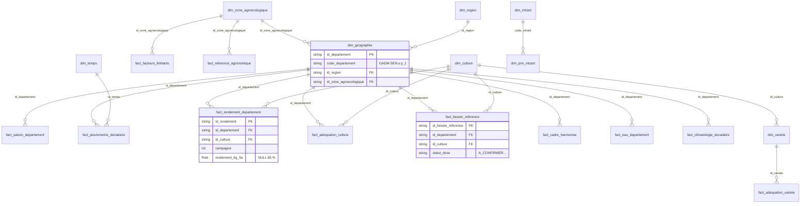
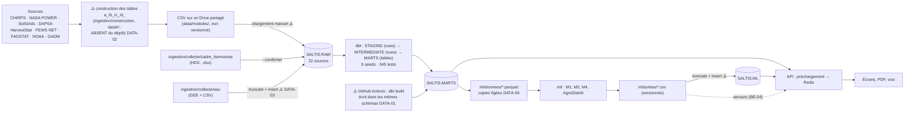

# 05 · Data — Assaman & Suuf

> Audit du 21/11/2026, branche `dev/all-recup` (commit `51e448d`). Lecture seule : **aucune connexion à Snowflake**. Prérequis : `01-cartographie.md`.
> Préfixe des constats : `DATA`. Contrôles faits : `dbt parse` hors ligne (identifiants factices, cible dans le dossier temporaire de l'auditeur), lecture du `manifest.json`, profilage pandas des copies locales des marts (`ml/donnees/*.parquet`, datées du 16/11/2026), lecture des scripts d'ingestion et des scripts SQL.
> La gouvernance complète (licences, provenance, lignée) est au module 12, les données personnelles au module 11.

---

## 1. Note globale : **3 / 5**

Le **modèle dbt est de bonne qualité** : couches claires, clés partagées par macro, 345 tests, et la règle `NULL ≠ 0` appliquée et testée. Les fragilités sont **autour** de dbt :
- la CI reconstruit les schémas de prod ;
- la chaîne qui produit les tables RAW n'est pas dans le dépôt ;
- les chargements ne sont pas atomiques ;
- les modèles ML sont entraînés sur des copies figées.

| Domaine | Note | En bref |
|---|---|---|
| Modèle | 4 | Étoile (dimensions, faits, marts par écran), clés `md5` par macro, grains documentés. Pas de contrainte en base (normal sur Snowflake) : les tests dbt en tiennent lieu. |
| Pipelines | 2 | Pas d'orchestration ni de journal d'exécution. Chaîne amont (sources → RAW) hors dépôt (DATA-02). Chargements `truncate` puis `insert` sans transaction (DATA-03). **CI qui écrit dans les schémas de prod** (DATA-01). |
| Qualité | 4 | 345 tests (`not_null` 76, `accepted_values` 63, `relationships` 38, 19 tests SQL de grain et de plages). 0 doublon dans les marts profilés. Aucune fraîcheur sur les sources. |
| Analytique | 3 | Un mart par écran, réponses précalculées par l'API. Indicateurs documentés (`docs/contrat-donnees.md`), mais 23 % seulement des colonnes décrites dans dbt. Couverture réelle faible sur les intrants et les rendements (DATA-06). |
| Sauvegarde | 2 | RAW n'existe qu'en un exemplaire dans Snowflake, plus des CSV sur un Drive. Aucune procédure de restauration documentée (DATA-10). |
| Gouvernance | 3 | Statuts de validation sur les doses et les prix (`A_CONFIRMER`), sources citées ligne à ligne. Rôle `SYSADMIN` pour dbt et l'API (DATA-09). Pas de donnée personnelle dans l'entrepôt. |

---

## 2. Modèle de données et flux

### 2.1 Schéma (couche MARTS, simplifié)

Clés techniques : `md5(trim(code))` pour le département, `md5(upper(trim(libellé)))` pour la culture et la zone (`dbt/macros/cles.sql`). Une table = un grain, testé par les tests SQL de `dbt/tests/`.

Les **marts** (`mart_carte_agroclimat`, `mart_suivi_decadaire`, `mart_choix_cultures`, `mart_besoins`, `mart_territoires_agrodistrib`, `mart_vulnerabilite_departement`, `mart_carte_opportunites`, `mart_cadre_harmonise_departement`, `mart_ml_prevision_pluie`) sont des tables larges, dénormalisées par écran. Elles sont construites à partir des faits et des dimensions ci-dessus (`ref()` relevés dans le `manifest.json`). La dénormalisation est justifiée : l'API les lit en une fois.

### 2.2 Carte des flux

---

## 3. Registre des données personnelles (couche data)

L'entrepôt **ne contient aucune donnée personnelle** : grain département, culture et année. Les données personnelles de la plateforme sont côté application (module 11).

| Donnée | Finalité | Stockage | Durée | Partage | Constat |
|---|---|---|---|---|---|
| Nom et type d'organisation, régions, retours (formulaire d'avis) | Retour des ONG | **Aucun stockage** : e-mail SMTP (`api/routes/avis.py:1`) | Celle de la boîte mail | Fournisseur SMTP | Module 11 |
| Position de la parcelle (GPS ou saisie) | Trouver le département | Navigateur seulement ; envoyée à l'API sous forme de code de département ? | — | Mapbox (tuiles autour du point) | À vérifier au module 11 |
| Audio de question (route `/voix/question`) | Question en wolof | Non conservé (`voix.py:89`) ; envoyé au Space HF | — | Hugging Face | Route inutilisée (BE-02) |
| `stg_organisations`, `dim_organisation` | (prévu) organisations utilisatrices | **Désactivé** (`stg_organisations.sql:1-8`, `enabled=false`) | — | — | Rien en base aujourd'hui |
| Adresses IP | Limitation de débit, journaux, Umami | Mémoire de l'API, journaux Docker, base Umami | Rotation 3 × 10 Mo ; Umami : ? | — | Module 11 et 14 |

---

## 4. Constats

### [DATA-01] La CI dbt reconstruit les schémas de prod (`STAGING`, `INTERMEDIATE`, `MARTS`) à chaque push
- Sévérité : 🔴 Critique   Statut : Probable (Constaté dans le code ; la valeur du secret `SNOWFLAKE_DATABASE` du CI n'a pas pu être lue, `gh` n'est pas installé)
- Où : `dbt/macros/generate_schema_name.sql:2-5` ; `.github/workflows/ci.yml` (job `dbt` : `SNOWFLAKE_SCHEMA: CI`, déclenché sur push `main`, `develop`, `dev/**`) ; `dbt/dbt_project.yml` (`+schema: staging/intermediate/marts`)
- Constat : la macro remplace le schéma de la cible par le nom personnalisé **sans préfixe** quand l'adaptateur est Snowflake. `SNOWFLAKE_SCHEMA=CI` est donc ignoré pour tous les modèles : la CI écrit dans `STAGING`, `INTERMEDIATE` et `MARTS`, comme la prod. Le groupe de concurrence est par branche : deux branches poussées ensemble construisent en parallèle dans les mêmes tables.
- Preuve : `dbt parse` avec `SNOWFLAKE_SCHEMA=CI` → schémas résolus dans le manifeste : `{('model','marts'): 28, ('model','staging'): 20, ('model','intermediate'): 3, ('seed','staging'): 5}`. Aucun nœud dans `CI`.
- Impact : tout push sur une branche `dev/*`, même en travaux, **remplace les marts lus par la prod** avec du code non relu. Au prochain rafraîchissement du cache, ces chiffres partent sur le site devant les autorités. Un test dbt qui échoue arrête la suite, mais laisse les tables déjà reconstruites dans leur nouvel état. Le contexte annonçait « un schéma CI isolé » : ce n'est pas le cas.
- Recommandation :
  - Avec `target.name == 'ci'` (ou `target.schema != 'PUBLIC'`), préfixer : `{{ target.schema }}_{{ custom_schema_name }}` → `CI_MARTS`. Mieux encore, une base `SALTIS_CI` clonée (`CREATE DATABASE SALTIS_CI CLONE SALTIS`, zéro copie) et un rôle CI sans droit sur `SALTIS`.
  - Ne lancer `dbt build` en CI que sur les PR. Construire la prod seulement depuis `main`, par une action manuelle.
  - Vérifier tout de suite, dans l'historique des requêtes Snowflake (`QUERY_HISTORY`, utilisateur du CI), si des marts de prod ont déjà été écrits par la CI.
- Effort : S

### [DATA-02] La chaîne qui produit les tables RAW n'est pas dans le dépôt ; RAW est chargé à la main
- Sévérité : 🟠 Élevé   Statut : Constaté
- Où : `dataset/README.md:3-10` (« Toutes les tables sont produites par la même commande : `cd ingestion ; python -m construction` », vers `datafr/`) ; `git ls-files | grep -iE "construction|datafr"` → seulement `api/cache/construction.py` ; `README.md` (« Les tables `a_*`, `b_*`, `c_*`, `d_*` se partagent via un dossier Drive commun »)
- Constat : les 16 tables `a_` à `d_` de `SALTIS.RAW`, qui portent la pluie CHIRPS agrégée, les saisons, les rendements DAPSA, l'adéquation des cultures et les besoins, sont calculées par un code absent du dépôt et de son historique. Elles circulent en CSV sur un Drive, puis sont chargées sans script versionné (aucun `COPY INTO` ni `write_pandas` pour ces tables).
- Impact : impossible de reproduire RAW, de recalculer une saison avec une nouvelle année CHIRPS, ou de **répondre à « d'où vient ce chiffre ? »** au-delà de RAW. C'est pourtant la question naturelle d'un ministère ou d'un bailleur. Si le Drive ou le poste qui contient `ingestion/construction` disparaît, la plateforme ne peut plus être mise à jour. Risque « une seule personne » de la grille locale.
- Recommandation : versionner `ingestion/construction` (code seulement, sans les données) et ajouter un script de chargement de RAW (`ingestion/charger_raw.py --confirmer`, même modèle que `collecte/`). Garder une copie datée des CSV sources dans un stockage d'équipe (pas un Drive personnel). Documenter la lignée source → RAW dans `docs/contrat-donnees.md`.
- Effort : M

### [DATA-03] Chargements non atomiques : `truncate`, puis insertion, sans transaction
- Sévérité : 🟡 Moyen   Statut : Constaté
- Où : `ml/charger_snowflake.py:148-155` ; `ingestion/collecte/eau/charger_snowflake.py:140-145` ; `snowflake/40_cadre_harmonise_raw.sql:16` (`create or replace table`, puis `write_pandas`)
- Constat : chaque table est vidée, puis remplie par `write_pandas`. Si le chargement échoue au milieu (réseau, type refusé), la table reste vide ou partielle. `SystemExit` arrête alors le script et laisse les tables suivantes dans leur ancien état. Le résultat est incohérent entre `PREVISION_SAISONNIERE` et `PREVISION_RENDEMENT`.
- Impact : une table `SALTIS.ML` vide fait basculer l'API, sans le dire, sur les CSV figés dans l'image (BE-04). Une table RAW vide casse le `dbt build` suivant, ou produit des marts vides.
- Recommandation : charger dans une table temporaire, vérifier le nombre de lignes, puis `ALTER TABLE … SWAP WITH …` (atomique sur Snowflake). Ou encadrer par `BEGIN … COMMIT` avec `write_pandas(…, auto_create_table=False)` dans la même session.
- Effort : S

### [DATA-04] Les modèles ML sont entraînés sur des copies locales figées, sans trace de la version des données
- Sévérité : 🟡 Moyen   Statut : Constaté
- Où : `ml/commun/donnees.py:44-65` (la copie `ml/donnees/<table>.parquet` est lue si elle existe ; Snowflake n'est relu qu'avec `rafraichir=True`) ; `ls ml/donnees` → toutes les copies datent du 16/11/2026
- Constat : depuis le 16/11, les marts ont évolué : `_marts.yml` et `_facts.yml` ont été modifiés 10 et 9 fois (module 01). Les sorties ML (`date_calcul = 2026-11-13`, d'après `docs/etat-modelisation.md:273`) ne disent pas **quelle version des marts** a servi.
- Impact : les prévisions affichées et les marts affichés à côté peuvent venir de deux états différents des données. Par exemple, la vulnérabilité AgroDistrib du moteur `ml/` diffère de celle de l'API (ARC-01). Impossible de reproduire exactement une prévision.
- Recommandation : écrire dans chaque sortie ML `version_donnees` (date et empreinte des parquet d'entrée, ou version de cache de l'API). Forcer `--rafraichir` dans la commande d'entraînement « officielle » (`make ml`). Refuser d'entraîner sur une copie de plus de N jours.
- Effort : S

### [DATA-05] Ni fraîcheur des sources, ni orchestration, ni journal d'exécution
- Sévérité : 🟡 Moyen   Statut : Constaté
- Où : `dbt/models/staging/_sources.yml` (22 sources, 0 `freshness`, 0 `loaded_at_field`) ; `Makefile` ; `README.md` (« Pas d'Airflow ni de Kafka »)
- Constat : la mise à jour suit une suite de commandes manuelles, chacune lancée par une personne différente : chargement RAW, puis `dbt build`, puis entraînement ML, puis `ml/charger_snowflake.py --confirmer`, puis `POST /systeme/cache/rafraichir`. Rien n'enregistre qui a lancé quoi et quand, ni si une étape a été oubliée. Ne pas utiliser Airflow est le bon choix pour une mise à jour par saison.
- Impact : l'oubli d'une étape donne des écrans incohérents : marts à jour mais prévisions anciennes, ou l'inverse. Personne ne le voit, puisqu'aucun indicateur de fraîcheur n'est affiché (ARC-03).
- Recommandation : une cible `make campagne` qui enchaîne les étapes avec contrôles (`dbt source freshness`, nombres de lignes attendus, `prechargement --verifier`) et écrit un journal daté (`docs/journal-donnees.md` ou une table `SALTIS.ML.JOURNAL`). Ajouter `freshness` aux sources qui ont une date (`a_suivi_pluie_decade`, `e_cadre_harmonise_departement`).
- Effort : S

### [DATA-06] Couverture réelle faible sur les intrants et les rendements, peu visible à l'écran
- Sévérité : 🟡 Moyen   Statut : Constaté (copies du 16/11)
- Où : `mart_territoires_agrodistrib` ; `fact_rendement_departement` ; `dbt/seeds/ref_doses_pia.csv`
- Constat (profilage) :
  - `mart_territoires_agrodistrib` (345 lignes, 43 départements, sans Guédiawaye ni Pikine, ce qui est logique) : **83 % de besoins en intrants à `NULL`**. Les besoins NPK ne sont connus que pour **4 cultures sur 11** (riz irrigué, mil, maïs, sorgho).
  - `fact_rendement_departement` : 64 à 68 % de `NULL` sur superficie, production et rendement. Selon la campagne, de 0 à 50 % des couples département × culture ont un rendement connu.
  - `ref_doses_pia.csv` : **34 doses sur 34 `A_CONFIRMER`**. `ref_prix_intrants.csv` : prix `A_CONFIRMER` (source APS de septembre 2025, pour la campagne 2026).
- Impact : la règle « jamais 0 » est respectée, c'est un bon point, et l'écran « Surface » signale « dose à saisir » (`Surface.tsx:237,275`). Mais « Répartir un stock » et « Besoins du pays » ne calculent que sur une petite part des cultures. Le modèle 3 apprend sur des séries très lacunaires. Un décideur qui lit un total national de besoins peut croire qu'il couvre tout le pays.
- Recommandation : afficher systématiquement un **taux de couverture** à côté de chaque total (« calculé sur 4 cultures sur 11, 43 départements »). Les champs `superficie_reference_ha` connue / totale existent déjà (`scene/besoinsPays.ts:43-44`). Faire de la complétion des doses avec l'ISRA le premier chantier data après la démo.
- Effort : S (affichage), L (complétion)

### [DATA-07] Documentation dbt partielle et aucun contrat de modèle
- Sévérité : 🟡 Moyen   Statut : Constaté
- Où : `manifest.json` : 49 colonnes décrites sur 215 (23 %) ; modèles sans description : `int_couverture_eau_cycle`, `int_reference_dose`, `int_reference_besoins_departement_culture` ; 0 modèle avec `contract: {enforced: true}`
- Constat : le contrat de colonnes est tenu dans `docs/contrat-donnees.md` (rédigé à la main), dans les schémas Pydantic de l'API et dans les types du front (ARC-04), mais pas dans dbt.
- Impact : un renommage de colonne dans un mart ne casse pas `dbt build`. Il casse l'API au préchargement suivant (`ErreurContrat`), en prod.
- Recommandation : activer `contract: enforced: true` sur les 9 marts lus par l'API (types et colonnes déclarés dans `_marts.yml`). Générer `docs/contrat-donnees.md` depuis dbt (`dbt docs generate`) plutôt que l'écrire à la main.
- Effort : M

### [DATA-08] Référentiels de doses en deux exemplaires
- Sévérité : 🔵 Faible   Statut : Constaté
- Où : `data/referentiels/doses_engrais.csv`, `doses_semis.csv` (non chargés dans dbt, `docs/etat-modelisation.md:106`) ; `dbt/seeds/ref_doses_pia.csv` (chargé)
- Constat : deux sources de doses avec des colonnes différentes (formule et origine d'un côté, statut et règle de l'autre). Les zéros explicites de `doses_engrais.csv` (ex. `dap_kg_ha = 0.0`) veulent dire « non recommandé », pas « inconnu ».
- Recommandation : un seul référentiel de doses (le seed), avec une colonne `origine`. Archiver l'autre dans `docs/`.
- Effort : S

### [DATA-09] dbt et l'API utilisent le rôle `SYSADMIN`
- Sévérité : 🟠 Élevé   Statut : Probable (valeur du `.env` de prod non lue ; défaut du code et documentation)
- Où : `api/config.py` (`snowflake_role = "SYSADMIN"` par défaut) ; `dbt/profiles.yml` (`role: env_var('SNOWFLAKE_ROLE')`) ; `docs/etat-modelisation.md:273` (« `SNOWFLAKE_ROLE=SYSADMIN` pour dbt et l'ingestion ») ; `docker-compose.prod.yml` (`env_file: .env` pour l'API)
- Constat : l'API ne fait que **lire** `MARTS` et `ML`, mais elle se connecte par défaut, et probablement en prod, avec `SYSADMIN`. Ce rôle peut créer, modifier et supprimer bases, entrepôts et tables. Un rôle dédié `R_ML` existe déjà pour le chargement ML : la bonne pratique est connue, mais pas appliquée à l'API.
- Impact : l'API tourne sur un VPS public. En cas de fuite du `.env` ou de compromission du conteneur, l'attaquant peut supprimer ou modifier tout l'entrepôt et consommer des crédits. Voir module 07.
- Recommandation : créer `R_API_LECTURE` (`USAGE` sur la base, l'entrepôt et les deux schémas ; `SELECT` sur `MARTS` et `ML` ; rien d'autre) et un utilisateur de service à clé RSA plutôt qu'à mot de passe. `R_DBT` pour dbt (propriétaire de `STAGING`, `INTERMEDIATE`, `MARTS` seulement). Script à écrire dans `snowflake/`, exécuté par l'équipe.
- Effort : S

### [DATA-10] Sauvegarde et restauration non documentées
- Sévérité : 🟡 Moyen   Statut : À vérifier (pas d'accès à Snowflake)
- Où : aucun document ; `snowflake/` ne contient pas de réglage `DATA_RETENTION_TIME_IN_DAYS`
- Constat : `RAW` est la seule copie chargée des données sources, en dehors du Drive. La durée du *Time Travel* dépend de l'édition Snowflake (1 jour en Standard). Le dépôt ne décrit aucune restauration. `ml/sorties/*.csv` et les seeds sont versionnés dans git : c'est une sauvegarde de fait pour ces tables.
- Impact : un `drop` ou un `create or replace` erroné sur RAW (`snowflake/40_cadre_harmonise_raw.sql:16` en est un), ajouté à DATA-02, peut faire perdre des données sans moyen de les reconstruire.
- Recommandation : vérifier l'édition et la rétention, et monter `RAW` à 7 jours si possible. Exporter `RAW` par `COPY INTO @stage` à chaque campagne, vers un stockage d'équipe. Écrire et tester une procédure de restauration.
- Effort : S

### [DATA-11] Modèles morts ou désactivés, montants en décimal
- Sévérité : 🔵 Faible   Statut : Constaté
- Où : `stg_organisations.sql` (`enabled=false`), `dim_organisation`, `dim_scenario_allocation`, `stg_intrants` (sans test, liés au périmètre coopératives retiré, d'après `docs/etat-modelisation.md:33`) ; `dbt/seeds/ref_prix_intrants.csv` (`prix_cession_sac_50kg_fcfa = 6000.0`)
- Constat : 5 modèles sans aucun test. Des modèles correspondent à un périmètre abandonné. Les montants en FCFA sont stockés en décimal, alors que le XOF n'a pas de décimales (grille locale).
- Recommandation : supprimer ou marquer `enabled: false` les modèles hors périmètre. Typer les prix en entier (`::number(12,0)`) dans le seed (`column_types`).
- Effort : S

---

## 5. Points solides relevés

- **Clés partagées par macro.** `dbt/macros/cles.sql` impose une seule expression de clé par entité, pour éviter les jointures ratées entre faits et dimensions.
- **Tests de grain et de plages.** 19 tests SQL (`having count(*) > 1`, bornes de valeurs) couvrent les faits et les marts lus par l'API. Au total 345 tests, plus `relationships` vers les dimensions. 0 doublon dans les 8 marts profilés.
- **Honnêteté des données.** Statuts `A_CONFIRMER` sur toutes les doses et tous les prix, sources citées jusqu'à l'article (`doses_engrais.csv`, colonne `origine`), valeurs inconnues laissées à `NULL` et testées comme telles (`marts_ecrans_valeurs_valides.sql`).
- **Scripts d'écriture prudents.** Tous les chargeurs vérifient par défaut et n'écrivent qu'avec `--confirmer`. Ils contrôlent les colonnes avant d'écrire (`verifier_colonnes`) et le nombre de lignes après.
- **Seuils métier paramétrés.** `dbt_project.yml` (`seuil_cycle_long_j`, `seuil_surface_inexploitee_ha`…) documente des seuils à revoir avec ANCAR, SAED et DGPRE, au lieu de les cacher dans le SQL.

---

## 6. Plan qualité minimal : 10 tests à mettre en place en priorité

| # | Test | Outil | Constat |
|---|---|---|---|
| 1 | La CI échoue si un modèle se résout dans `STAGING`, `INTERMEDIATE` ou `MARTS` avec la cible `ci` (contrôle du `manifest.json`) | script pytest sur le manifeste | DATA-01 |
| 2 | `dbt source freshness` sur `a_suivi_pluie_decade` et `e_cadre_harmonise_departement` (avertissement à 400 jours, erreur à 800) | dbt | DATA-05 |
| 3 | Nombre de lignes attendu par mart : 45 départements (43 pour AgroDistrib), 2 025 lignes pour `mart_carte_agroclimat` (45 × 45 campagnes) | test SQL dbt | DATA-03, DATA-05 |
| 4 | `SALTIS.ML.*` : nombre de lignes égal aux CSV de `ml/sorties`, et `date_calcul` de moins de N jours | `ml/charger_snowflake.py` + test pytest | DATA-03, DATA-04 |
| 5 | Contrat appliqué (`contract: enforced`) sur les 9 marts lus par l'API | dbt | DATA-07 |
| 6 | Un besoin vaut 0 seulement si la dose source vaut explicitement 0 ; sinon `NULL` | test SQL dbt | DATA-06 |
| 7 | Plages physiques : cumul de pluie de saison entre 0 et 3 000 mm, rendement entre 0 et 15 000 kg/ha, probabilités entre 0 et 100 | `accepted_range` (test SQL) | qualité |
| 8 | Taux de couverture publié par mart (part de `NULL` des colonnes d'intrants), avec alerte s'il baisse d'une version à l'autre | test SQL + `meta` de l'API | DATA-06 |
| 9 | `meta.source` dit `ml/sorties/*.csv` quand le secours CSV est utilisé | pytest sur `api/cache` | BE-04 |
| 10 | Cohérence API ↔ marts : pour 3 départements témoins, la valeur servie par `/besoins` est égale à celle du mart | pytest d'intégration (copie locale) | traçabilité |

---

## Résumé

- **3/5.** Modèle dbt solide (couches, clés par macro, 345 tests, `NULL` jamais changé en 0, statuts `A_CONFIRMER`). Le point faible est la chaîne autour de dbt.
- 🔴 DATA-01 : la macro `generate_schema_name` ignore le schéma `CI`. Chaque push sur `main`, `develop` ou `dev/*` reconstruit les schémas de prod `STAGING`, `INTERMEDIATE` et `MARTS` (prouvé par `dbt parse`).
- 🟠 DATA-02 : le code qui produit les 16 tables RAW `a_` à `d_` est absent du dépôt ; RAW est chargé à la main depuis un Drive. 🟠 DATA-09 : l'API lit Snowflake avec `SYSADMIN`.
- 🟡 Chargements `truncate` puis `insert` non atomiques. ML entraîné sur des copies du 16/11 sans version des données. Pas de fraîcheur ni de journal. Besoins en intrants connus pour 4 cultures sur 11 (83 % de `NULL`) et 34 doses sur 34 à confirmer, sans taux de couverture affiché.
- Correction apportée au rapport 01 : la CI a bien un job front (lint et build) ; il manque seulement le scan de dépendances.
