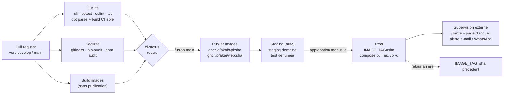

# 08 · DevOps, infrastructure, observabilité et coûts — Assaman & Suuf

> Audit du 21/11/2026, branche `dev/all-recup` (commit `51e448d`). Lecture seule : aucun déploiement, aucune modification d'infrastructure.
> `gh` n'est pas installé : les durées de CI, la protection des branches et les secrets GitHub n'ont pas pu être lus (**À vérifier**). La configuration réelle du VPS n'a pas été vue.
> Préfixe des constats : `OPS`. Les montants sont des **ordres de grandeur publics** (novembre 2026), à confirmer sur les factures.

---

## 1. Note globale : **2 / 5 (fragile)**

La conteneurisation est soignée et proportionnée : un seul VPS, Docker Compose, Caddy, des limites de ressources et des healthchecks. Mais la livraison est entièrement **manuelle** : build sur le VPS, pas de registre, pas de staging. Il n'y a **aucune observabilité** (ni supervision externe, ni suivi d'erreurs, ni alerte). La continuité repose sur des comptes et des savoirs individuels, et la CI touche la prod (DATA-01).

| Domaine | Note | En bref |
|---|---|---|
| CI | 3 | 5 jobs (ruff, pytest, dbt, front, verdict `ci-status`), concurrence par branche. Mais ruff réduit à 5 règles d'erreur, pas de cache pip, pas de scan de sécurité, et **dbt écrit en prod** (DATA-01, SEC-02). |
| CD | 1 | `git pull` + `docker compose up -d --build` en SSH (`deploy/README.md:50-54`). Pas d'image versionnée, pas de staging, pas de retour arrière du code documenté. |
| Infra | 3 | Compose propre (réseaux internes, `cap_drop`, limites mémoire et processus, healthchecks, rotation des journaux). VPS seul, mémoire réservée ≈ 7 Go sur 8, build lourd sur la machine de prod (OPS-04). |
| Observabilité | 1 | Journaux texte locaux de 30 Mo au plus. Aucun Sentry, aucune métrique, aucune supervision externe, aucune alerte (OPS-05). |
| Continuité | 2 | Retour arrière du **cache de données** possible (`/cache/retour-arriere`). Pas de sauvegarde des volumes, pas de runbook de reconstruction, comptes personnels (OPS-06, OPS-07). |
| Coûts | 3 | Faibles et prévisibles : VPS, domaine, Snowflake au rafraîchissement. Pas de suivi ni de garde-fou Snowflake. Offres gratuites (Mapbox, HF) à surveiller (OPS-08). |

---

## 2. Indicateurs DORA (estimation sur l'historique git)

| Indicateur | Estimation | Base |
|---|---|---|
| Fréquence de déploiement | **≈ 1 à 2 par semaine**, manuels. La prod en ligne date du 19/11 (`last-modified` du site) et correspond à `origin/main` (`3922c9e`, PR n° 19, 19/11). | 81 commits en 14 jours (pic de 23 le 11/11), 0 tag, 22 fusions, PR n° 9 à n° 19 |
| Délai de mise en prod | **2 à 5 jours** entre un commit et la prod. `dev/all-recup` a 7 commits d'avance sur `main` (21/11) ; `develop` a 2 jours de retard. | `git rev-list --count origin/main..HEAD` |
| Taux d'échec des changements | **Au moins 1 sur 11 PR** a été annulée : la branche `origin/revert-17-dev/front-djigo` existe (PR n° 17 annulée, puis PR n° 19). | branches distantes |
| Temps de restauration | **Inconnu.** Aucun incident tracé. Une reconstruction complète du VPS demanderait plusieurs heures (OPS-06). | — |

Niveau DORA estimé : **moyen** pour la fréquence, **bas** pour la restauration. C'est normal pour un prototype de concours, mais insuffisant pour un service présenté à l'État.

---

## 3. Constats

> Déjà traités ailleurs, non répétés ici :
> - **DATA-01 / SEC-02** (🔴) : la CI dbt écrit dans les schémas de prod.
> - **SEC-06** (🟡) : dépendances et images non figées, pas de Dependabot.
> - **ARC-03** (🟠) : procédure de rafraîchissement des données fausse dans `deploy/README.md`.
> - **ARC-07** (🟡) : VPS unique sans sauvegarde.
> - **DATA-10** : sauvegarde Snowflake.

### [OPS-01] Déploiement manuel sur le VPS, sans image versionnée ni retour arrière du code
- Sévérité : 🟠 Élevé   Statut : Constaté
- Où : `deploy/README.md:50-54` (`git pull` puis `docker compose -f docker-compose.prod.yml up -d --build`) ; `docker-compose.prod.yml` (`build:` et non `image:`)
- Constat :
  - Chaque mise en ligne reconstruit les images **sur le serveur de prod**, en prenant les dernières versions des dépendances (SEC-06).
  - Rien ne relie la version en ligne à un commit : pas de tag, pas d'étiquette d'image, `/sante` ne donne pas de version de code.
  - Pour revenir en arrière, il faut faire un `git checkout` et reconstruire, soit 5 à 10 minutes d'après `deploy/README.md:44`, avec le risque d'obtenir des dépendances différentes de la première fois.
  - Rien n'est automatisé après la fusion dans `main`.
- Impact : une mise en ligne ratée la veille d'une présentation se répare lentement et à l'aveugle. Personne ne peut dire avec certitude « quelle version tourne ».
- Recommandation : construire les deux images en CI sur `main` (étiquette = SHA court) et les publier sur `ghcr.io`. Sur le VPS, `docker compose pull && up -d` avec `IMAGE_TAG=<sha>` dans `.env`. Le retour arrière revient alors à changer l'étiquette (moins d'une minute). Exposer `version` et `commit` dans `/sante` et dans le pied de page. Taguer les versions présentées (`v1.0-jury`, `v1.0-autorites`).
- Effort : M

### [OPS-02] Pas d'environnement de préproduction ; la démo et la prod sont la même chose
- Sévérité : 🟡 Moyen   Statut : Constaté
- Où : contexte (« Pas d'environnement de staging distinct ») ; `docker-compose.prod.yml` (un seul jeu de services) ; CI front construite avec `VITE_USE_MOCK=true` (`.github/workflows/ci.yml`, job `front`)
- Constat :
  - La configuration de prod (`VITE_AUTH_DEMO=true`, `VITE_DONNEES_DEMO=false`, `VITE_API_URL=""`) n'est testée nulle part avant la mise en ligne.
  - Le bug du service worker (FE-01) en est un exemple : il n'apparaît qu'avec cette configuration.
  - Une nouvelle version est donc vue pour la première fois par le public.
- Impact : risque de casser le site au moment où il est montré. Aucun endroit pour répéter la démo sur la version exacte.
- Recommandation : un second fichier compose (`docker-compose.staging.yml`) sur le même VPS, sous-domaine `staging.`, protégé par une authentification basique Caddy, avec les mêmes images que la prod (OPS-01) et un Redis séparé. Le job front de la CI construit aussi en configuration de prod. La règle « on montre ce qui a tourné 24 h en staging » s'applique avant chaque présentation.
- Effort : S

### [OPS-03] CI incomplète : lint minimal, pas de scan de sécurité, pas de cache, protection de `main` non vérifiée
- Sévérité : 🟡 Moyen   Statut : Constaté / À vérifier (protection de branche)
- Où : `.github/workflows/ci.yml`
- Constat :
  - `ruff --select E9,F63,F7,F82,F401` : erreurs de syntaxe et imports inutiles seulement.
  - `pip install -r requirements.txt` sans cache, ce qui inclut dbt, XGBoost et pandas, à chaque push.
  - Pas de `pip-audit`, `npm audit`, `gitleaks` ni construction des images Docker.
  - Les tests vocaux (torch) ne sont pas exécutés : `requirements-voix.txt` n'est pas installé, c'est un choix raisonnable mais non signalé.
  - Les actions sont référencées par étiquette (`@v4`) et non par empreinte.
  - Le `CONTRIBUTING.md` exige « PR + 1 relecture » sur `main`. L'historique montre bien des fusions par PR, mais rien ne prouve que GitHub l'**impose** (protection de branche non lisible sans `gh`).
- Impact : le secret de SEC-01 serait passé inaperçu même avec cette CI. Les dépendances vulnérables ou un Dockerfile cassé ne sont détectés qu'au déploiement.
- Recommandation : ajouter `gitleaks`, `pip-audit -r requirements-api.txt`, `npm audit --omit=dev` et `docker build` (sans publication sur les PR). Mettre en cache pip (`actions/setup-python` `cache: pip`). Activer la protection de `main` et `develop` (PR obligatoire, `ci-status` requis, pas de push forcé). Épingler les actions par SHA.
- Effort : S

### [OPS-04] Mémoire réservée ≈ 7 Go sur 8, et build lourd sur la machine de prod
- Sévérité : 🟡 Moyen   Statut : Probable (non mesuré sur le VPS)
- Où : `docker-compose.prod.yml` (`mem_limit` : api 5 g, redis 1 g, umami 512 m, web 256 m, umami-db 256 m = **7 Go**) ; `deploy/Dockerfile.api` (PyTorch CPU, transformers) ; `deploy/Dockerfile.web` (`npm ci` et build Vite)
- Constat : au repos, l'API prend 2 à 3 Go d'après `deploy/README.md:10`. Pendant un `up --build`, la prod tourne pendant que `pip install torch` et `npm ci` s'exécutent sur les mêmes 2 vCPU et 8 Go, en plus du système et de Docker. Un rafraîchissement du cache construit en plus 236 Mo de réponses en mémoire (BE, mesure de `/systeme/cache`), alors que le modèle vocal est chargé.
- Impact : risque d'arrêt brutal par manque de mémoire (le noyau tue un processus, « OOM ») ou de site très lent pendant chaque déploiement ou rafraîchissement. Sans supervision (OPS-05), personne ne le voit.
- Recommandation : builds en CI (OPS-01). Ajouter un fichier d'échange de 2 Go comme filet de sécurité. Mesurer avec `docker stats` pendant un rafraîchissement, et ajuster `mem_limit` de l'API selon le pic réel. Sortir la voix dans un conteneur limité (ARC-02).
- Effort : S

### [OPS-05] Aucune observabilité : ni supervision externe, ni suivi d'erreurs, ni alerte
- Sévérité : 🟠 Élevé   Statut : Constaté
- Où : `grep -rEn "sentry|datadog|prometheus|opentelemetry|grafana|uptime"` sur `api`, `app/src`, `deploy`, `.github` → aucun résultat ; `api/main.py:31` (`logging.basicConfig`, texte simple) ; `docker-compose.prod.yml` (journaux `json-file`, 3 × 10 Mo par service)
- Constat :
  - Pas de sonde externe sur `/api/v1/systeme/sante` ni sur la page d'accueil.
  - Pas de remontée des erreurs JavaScript des téléphones : une PWA cassée sur Android passe inaperçue.
  - Pas d'identifiant de requête, pas de métriques de latence ni de taux de `429`, `503` et `5xx`, pas d'alerte vers l'équipe.
  - Les journaux d'accès d'Uvicorn (actifs par défaut) contiennent les adresses IP et les chemins (module 11) et disparaissent après 30 Mo.
- Impact : l'équipe apprend une panne par un utilisateur ou par le jury. Impossible de savoir si la voix sature (BE-01), si la limite par IP bloque une salle (BE-03) ou si le précache coûte trop (FE-04).
- Recommandation (gratuit ou presque, proportionné) :
  - Supervision externe toutes les 5 minutes sur `/sante` et sur `/`, avec alerte par e-mail ou WhatsApp. Uptime Kuma auto-hébergé ou un service gratuit, de préférence avec une sonde en Afrique de l'Ouest.
  - Sentry gratuit (ou GlitchTip auto-hébergé) côté front et API, avec IP masquées.
  - Journaux JSON avec identifiant de requête.
  - Un tableau de bord minimal : `docker stats`, taux de `5xx`, temps de synthèse vocale.
- Effort : S

### [OPS-06] Pas de runbook de reconstruction ni de sauvegarde des volumes
- Sévérité : 🟡 Moyen   Statut : Constaté
- Où : `deploy/README.md` (seul un `pg_dump` manuel d'Umami, l. 95) ; volumes `caddy-donnees`, `api-donnees` (modèle vocal, environ 600 Mo), `voix-cache`, `redis-donnees`, `umami-db`
- Constat : aucune procédure écrite ni testée pour remonter le service sur un nouveau VPS : DNS, `.env`, Snowflake, rafraîchissement du cache, test de fumée. Aucun runbook non plus pour « révoquer un secret » ou « la voix ne répond plus ». Voir aussi ARC-07.
- Impact : temps de restauration de plusieurs heures, et dépendance à la personne qui a installé le VPS.
- Recommandation : un `deploy/RUNBOOK.md` avec 5 fiches : redéployer une version, revenir en arrière, reconstruire le VPS, révoquer un secret, rafraîchir les données. Les tester une fois sur un VPS jetable (environ 1 € pour quelques heures). Sauvegarde hebdomadaire des volumes utiles (`umami-db`, `caddy-donnees`) hors du VPS, plus les instantanés Hostinger.
- Effort : S

### [OPS-07] Dépendance à des comptes personnels et à quelques personnes
- Sévérité : 🟡 Moyen   Statut : Probable
- Où : `git remote -v` → dépôt sous un compte GitHub personnel ; `REGLE.md:13` (« `api/` est géré par une seule personne ») ; SMTP Gmail personnel ou d'équipe (SEC-01) ; propriétaires du domaine, du VPS, de Snowflake et de Mapbox non documentés
- Constat :
  - Les accès critiques (code, domaine, VPS, Snowflake, Mapbox, Hugging Face, Gmail) semblent répartis sur des comptes individuels.
  - Le savoir est concentré : l'API chez une personne, les données chez une autre (`docs/etat-modelisation.md`).
  - Le code amont de RAW n'est que sur un poste (DATA-02).
- Impact (grille locale « pérennité ») : le départ ou l'indisponibilité d'un membre peut bloquer le renouvellement du domaine, le paiement du VPS ou l'accès à Snowflake. Cela pose problème pour une V1 présentée à l'État et pour un futur abonnement.
- Recommandation : une **organisation GitHub** AKAI avec au moins 2 propriétaires. Domaine, VPS, Snowflake et Mapbox au nom de la structure, avec 2 administrateurs chacun. Un gestionnaire de mots de passe d'équipe (Bitwarden Organisation, gratuit pour 2 personnes). Un tableau « service → propriétaire → suppléant → date de renouvellement ».
- Effort : S

### [OPS-08] Coûts non suivis, garde-fous absents sur Snowflake et dépendance à des offres gratuites
- Sévérité : 🟡 Moyen   Statut : À vérifier (factures non vues)
- Où : `dbt/profiles.yml` (entrepôt `SALTIS_WH`, taille et `AUTO_SUSPEND` non définis dans le dépôt) ; `app/README.md:217` (Mapbox : 50 000 chargements par mois gratuits) ; Space HF gratuit (mise en veille)
- Constat : pas de *resource monitor* Snowflake documenté. La CI lance un `dbt build` complet à chaque push (DATA-01), ce qui consomme des crédits plusieurs fois par jour en période de développement. Si le compte Snowflake est un **compte d'essai**, c'est-à-dire limité dans le temps et en crédits, son expiration bloque toute mise à jour. L'API continuerait à servir l'ancien cache Redis, mais ne pourrait plus redémarrer sur un Redis vide.
- Recommandation : *resource monitor* (plafond mensuel, suspension à 100 %), `AUTO_SUSPEND = 60` et taille XS. Ne plus lancer dbt sur chaque push. Vérifier le type de compte et sa date de fin. Prévoir qu'en dernier recours l'API démarre sur un instantané local des marts (`ml/donnees/*.parquet` ou export CSV), comme elle le fait déjà pour `SALTIS.ML`.
- Effort : S

### [OPS-09] Documentation de déploiement contradictoire
- **Suivi (21/11/2026, après l'audit)** : ✅ Corrigé — `app/README.md` renvoie à `deploy/README.md` (VPS) ; sections Vercel, Render, Neon et contrat d'API obsolète retirées ; `Makefile` aligné.
- Sévérité : 🔵 Faible   Statut : Constaté
- Où : `app/README.md:189-238` (« Déploiement gratuit » : Vercel, Render, Neon PostgreSQL « comptes, organisations, stocks, scénarios ») ; `app/vercel.json` ; `deploy/README.md` (VPS, la vraie prod) ; `Makefile` (`api-prod` à 4 workers, `.venv`)
- Constat : trois façons de déployer sont décrites, dont deux qui ne servent plus. Elles mentionnent une base PostgreSQL de comptes qui n'existe pas.
- Recommandation : garder `deploy/README.md` comme seule référence. Réduire `app/README.md`, section 4, à un lien. Supprimer `vercel.json` ou le marquer « non utilisé ». Aligner le `Makefile` (ARC-10).
- Effort : S

---

## 4. Proposition de pipeline CI/CD cible



```yaml
# .github/workflows/livraison.yml : extrait, à adapter
name: Livraison
on:
  push:
    branches: [main]
permissions:
  contents: read
  packages: write          # publier sur ghcr.io
jobs:
  images:
    runs-on: ubuntu-latest
    steps:
      - uses: actions/checkout@<sha>                 # actions épinglées par empreinte
      - uses: docker/login-action@<sha>
        with: { registry: ghcr.io, username: ${{ github.actor }}, password: ${{ secrets.GITHUB_TOKEN }} }
      - name: API
        run: |
          docker build -f deploy/Dockerfile.api -t ghcr.io/${{ github.repository_owner }}/assaman-api:${GITHUB_SHA::7} .
          docker push ghcr.io/${{ github.repository_owner }}/assaman-api:${GITHUB_SHA::7}
      - name: Site (configuration de PROD, pas de mock)
        run: |
          docker build -f deploy/Dockerfile.web \
            --build-arg VITE_MAPBOX_TOKEN=${{ vars.MAPBOX_PUBLIC }} --build-arg VITE_URL_SITE=https://${{ vars.DOMAINE }} \
            -t ghcr.io/${{ github.repository_owner }}/assaman-web:${GITHUB_SHA::7} .
          docker push ghcr.io/${{ github.repository_owner }}/assaman-web:${GITHUB_SHA::7}
  staging:
    needs: images
    runs-on: ubuntu-latest
    environment: staging                              # secrets SSH de staging seulement
    steps:
      - name: Déployer sur staging et tester
        run: |
          ssh deploy@${{ vars.VPS }} "cd assaman && IMAGE_TAG=${GITHUB_SHA::7} docker compose -f docker-compose.staging.yml pull && IMAGE_TAG=${GITHUB_SHA::7} docker compose -f docker-compose.staging.yml up -d"
          curl -fsS --retry 10 --retry-delay 10 https://staging.${{ vars.DOMAINE }}/api/v1/systeme/sante
  prod:
    needs: staging
    runs-on: ubuntu-latest
    environment: production                           # approbation manuelle requise (règle GitHub)
    steps:
      - run: ssh deploy@${{ vars.VPS }} "cd assaman && sed -i 's/^IMAGE_TAG=.*/IMAGE_TAG=${GITHUB_SHA::7}/' .env && docker compose -f docker-compose.prod.yml pull && docker compose -f docker-compose.prod.yml up -d"
```

> L'utilisateur `deploy` est non `root`, avec une clé SSH dédiée à la CI (SEC-05). dbt n'est **jamais** lancé en prod par ce workflow (DATA-01) : la mise à jour des données reste une action manuelle et tracée (DATA-05).

---

## 5. Coûts actuels et projetés (ordres de grandeur, à confirmer)

1 € ≈ 656 FCFA (parité fixe).

| Poste | Aujourd'hui (≈ 500 utilisateurs) | × 10 (≈ 5 000) | × 100 (≈ 50 000) | Remarque |
|---|---|---|---|---|
| VPS Hostinger KVM 2 (2 vCPU, 8 Go) | ≈ 7 à 15 €/mois (≈ 5 000 à 10 000 FCFA), selon la durée d'engagement et le prix de renouvellement | même VPS | KVM 4 ou 2 VPS : ≈ 15 à 30 €/mois | Données précalculées : la charge reste faible. La voix est le facteur limitant (ARC-02). |
| Domaine `.tech` | ≈ 1 à 5 € la 1re année, **≈ 40 à 60 €/an au renouvellement** | idem | idem | Date de renouvellement et propriétaire à noter (OPS-07) |
| Snowflake | Crédits consommés seulement au `dbt build` et au rafraîchissement ; ≈ 0 à 20 €/mois **si** dbt ne tourne plus à chaque push | idem (le volume ne dépend pas des visiteurs) | idem | Compte d'essai ou payant ? (OPS-08). *Resource monitor* indispensable. |
| Mapbox GL | 0 € (≈ 1 000 à 3 000 chargements de carte par mois) | 0 € (≈ 10 000 à 30 000) | **Au-delà de 50 000 chargements : payant** (≈ 5 $ pour 1 000 supplémentaires, à vérifier) | Premier poste qui augmente. Alternative : MapLibre + tuiles OSM auto-hébergées ou Protomaps (0 €). |
| Hugging Face | 0 € (téléchargement des modèles ; Space gratuit non utilisé en prod) | 0 € | 0 € | Aucune dépendance de coût si la voix reste locale |
| SMTP (Gmail) | 0 € | 0 € (limite d'envoi quotidienne de Gmail) | Service transactionnel ≈ 0 à 15 €/mois | Volume très faible (avis des ONG) |
| Umami et PostgreSQL | 0 € (sur le VPS) | 0 € | 0 € (disque à surveiller) | — |
| Supervision (proposée) | 0 € (Uptime Kuma, Sentry ou GlitchTip gratuit) | 0 € | ≈ 0 à 25 €/mois | — |
| **Total estimé** | **≈ 10 à 40 €/mois (≈ 6 500 à 26 000 FCFA)** | **≈ 10 à 40 €/mois** | **≈ 50 à 300 €/mois**, selon Mapbox | Il n'y a **aucun coût par requête** (pas de LLM, pas de SMS) : le modèle économique gratuit pour les producteurs est soutenable. |

**Ce qui augmente en premier** : (1) les chargements de carte Mapbox ; (2) le processeur de la voix wolof si elle n'est pas pré-générée ; (3) la bande passante du précache (FE-04), si le VPS a un quota de trafic.

**Grille locale** : la latence depuis Dakar vers le centre de données du VPS (Europe ou autre ?) **n'a pas été mesurée** (À vérifier : `curl -w "%{time_connect}"` depuis une connexion Orange ou Free à Dakar). Pour des données de l'État, la question de l'hébergement au Sénégal (centres de données de Diamniadio, New Deal technologique) se posera. L'architecture Docker est portable, c'est un atout pour migrer.

---

## Résumé

- **2/5.** Docker Compose soigné et proportionné (réseaux internes, limites, healthchecks, Caddy HTTPS). Mais le déploiement est manuel et construit sur le VPS, et il n'y a ni staging ni observabilité.
- 🟠 OPS-01 : `git pull` puis build sur la prod, aucune image versionnée, retour arrière du code lent et non reproductible. 🟠 OPS-05 : aucune supervision externe, aucun suivi d'erreurs, aucune alerte.
- 🟡 Pas de staging (la configuration de prod n'est jamais testée avant mise en ligne). CI sans scan de sécurité ni cache, protection de `main` à vérifier. ≈ 7 Go réservés sur 8 avec build sur place. Pas de runbook. Comptes personnels. Coûts Snowflake sans plafond.
- DORA estimé : 1 à 2 déploiements par semaine, délai de 2 à 5 jours, au moins 1 PR sur 11 annulée, restauration inconnue.
- Coûts : ≈ 10 à 40 €/mois aujourd'hui, et toujours à 5 000 utilisateurs. Mapbox est le premier poste qui augmente. Aucun coût par requête.
