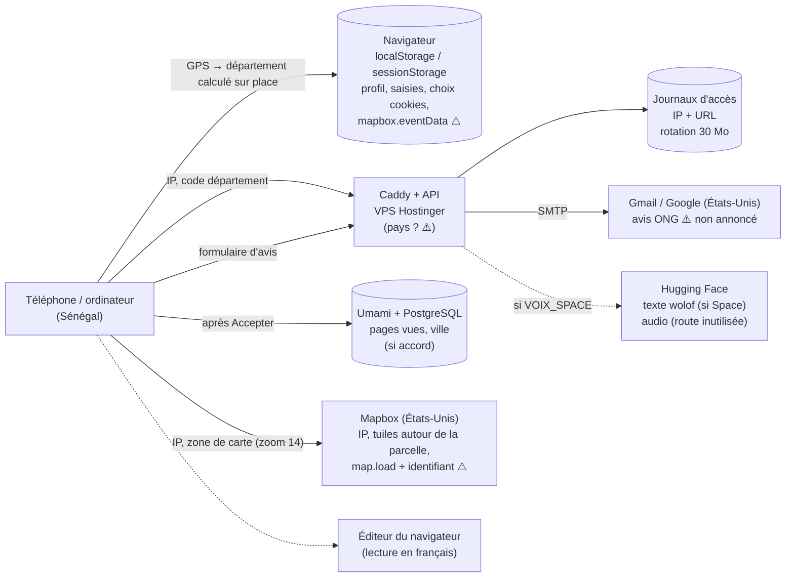

# 11 · Protection des données personnelles — Assaman & Suuf

> Audit du 21/11/2026, branche `dev/all-recup` (commit `51e448d`). Lecture seule.
> ⚠️ **Audit technique de conformité, pas un avis juridique.** Les références aux textes sont à faire valider par un juriste avant toute démarche officielle (déclaration à la CDP, réponse à une autorité).
> Aucune donnée personnelle réelle n'est recopiée : les adresses e-mail trouvées dans le dépôt sont masquées (`ak****`).
> Préfixe des constats : `PRIV`.

---

## 0. Cadre applicable

| Texte | S'applique ? | Pourquoi |
|---|---|---|
| **Loi n° 2008-12 du 25 janvier 2008** et décret n° 2008-721 | **Oui** | Responsable du traitement (équipe AKAI) au Sénégal, utilisateurs au Sénégal. Toujours en vigueur à la date de l'audit ; une réforme est annoncée mais **non adoptée à notre connaissance** (à revérifier). Autorité : **CDP**. |
| RGPD (UE 2016/679) | **Probablement non pour AKAI**, à confirmer | Le site ne cible pas des personnes dans l'UE : français, Sénégal, départements sénégalais. L'hébergeur (Hostinger) et Mapbox ont leurs propres obligations RGPD comme sous-traitants. À réexaminer si l'offre vise la diaspora ou des bailleurs européens (études sur mesure). |
| Convention de Malabo (UA) ; Acte additionnel CEDEAO A/SA.1/01/10 | Oui (cadre) | Ratifiée ou applicable au Sénégal ; pas d'obligation technique supplémentaire identifiée ici |
| Loi n° 25/2026 (cybersécurité) | **À vérifier** | La plateforme n'est vraisemblablement pas une infrastructure critique. Des clients publics (ministère, agences) peuvent imposer des exigences par contrat. |
| Règlement du SALTIS PAS Challenge | **À fournir** | Peut imposer des règles sur les données collectées pendant le concours |

Règle retenue : quand un point est flou, on applique la pratique la plus protectrice (guides CNIL réutilisés comme méthode).

---

## 1. Note : **3 / 5 en technique · 1 / 5 en formalités**

Côté technique, la plateforme est **bien conçue pour collecter peu** :
- pas de compte ;
- la position de la parcelle reste en mémoire et seul le code du département part vers l'API ;
- les saisies restent dans le navigateur ;
- la mesure d'audience est soumise à un vrai consentement, sans cookie, et refuser est aussi simple qu'accepter ;
- l'avis des ONG n'est pas stocké en base.

Côté formalités, presque tout manque :
- pas de déclaration à la CDP ;
- pas de responsable juridiquement identifié ;
- pas de durées de conservation appliquées ;
- pas de procédure en cas de violation ;
- **deux flux absents de la page Confidentialité** (avis ONG par Gmail, identifiant Mapbox) ;
- un secret de la boîte e-mail qui reçoit ces avis a fuité (SEC-01).

| Domaine | Note | En bref |
|---|---|---|
| Licéité | 1 | Aucune formalité CDP (confirmé par l'équipe). Bases légales non écrites. |
| Minimisation | 4 | Pas de compte, position non transmise, `excludeSearch` et `excludeHash` sur Umami. Géolocalisation en haute précision alors qu'un département suffit (PRIV-07). |
| Transparence | 3 | Page Confidentialité claire et datée. Mais deux flux manquent, l'hébergeur n'est pas nommé, et la page n'existe qu'en français écrit. |
| Droits | 3 | Droits rappelés avec la CDP. Presque rien n'est stocké côté serveur, donc il y a peu à effacer. Le contact n'est pas toujours publié. |
| Sécurité | 2 | TLS, CSP, accès restreints. Mais le mot de passe SMTP de la boîte qui reçoit les avis a fuité (SEC-01). |
| Sous-traitants | 2 | Mapbox, Google (Gmail), Hostinger, Hugging Face (selon la configuration) : aucun n'est documenté, pays non indiqués, transferts hors du Sénégal non traités. |
| Conservation | 2 | « Temporaire » annoncé pour les IP, sans durée. Les journaux tournent par taille (30 Mo), pas par date. Umami sans durée fixée. |
| Violations | 1 | Aucune procédure écrite (SEC-08). |
| IA et voix | 3 | Aucune donnée personnelle dans l'entraînement. La route audio existe mais n'est pas utilisée (BE-02). |

---

## 2. Registre des traitements

Tableau prêt à être repris pour la déclaration CDP, une fois relu par l'équipe et un juriste.

| Traitement | Finalité | Personnes | Données | Sensible ? | Base légale (proposée) | Source | Stockage (pays, fournisseur) | Destinataires / sous-traitants | Transfert hors Sénégal ? | Conservation |
|---|---|---|---|---|---|---|---|---|---|---|
| **T1. Consultation du site et de l'API** | Fournir le service, limiter les abus | Tout visiteur | Adresse IP, URL demandée (contient le code du département consulté), agent utilisateur, heure | Non | Intérêt légitime (sécurité, fonctionnement) | Navigateur → Caddy → API | VPS Hostinger (**pays du centre de données à vérifier**) : mémoire de l'API (limitation de débit) et **journaux d'accès Uvicorn** (actifs par défaut, `Dockerfile.api`) dans les journaux Docker | Hostinger | **Probable** (si le centre de données est hors du Sénégal) | Mémoire : 1 min à 10 min. Journaux : rotation à 3 × 10 Mo, donc durée **variable** |
| **T2. Mesure d'audience (Umami)** | Compter les visites | Visiteurs **qui acceptent** | Page vue (sans paramètres ni ancre), site d'origine, appareil, écran, navigateur, système, langue, pays et ville déduits de l'IP (IP non conservée) | Non | **Consentement** (bandeau, choix gardé 6 mois) | Script `/stats/script.js` chargé après « Accepter » (`consentement/audience.ts:13-34`) | PostgreSQL Umami sur le VPS | Hostinger | Probable (idem T1) | **Non définie** (pas de purge configurée) |
| **T3. Choix du profil et saisies** | Rouvrir la carte, calculer besoins et répartitions | Tout utilisateur | Profil (fausse session : courriel de démonstration, rôle, jeton factice), surface, doses, stocks, prix, scénarios, choix sur les cookies | Non | Exécution du service demandé | Saisie | **Navigateur seulement** (`localStorage`, `sessionStorage` : `auth/session.ts`, `scene/dossier.ts`, `consentement.ts`) | Aucun | Non | Jusqu'à l'effacement par l'utilisateur ; choix cookies 6 mois |
| **T4. Position de la parcelle** | Trouver le département, son sol et ses cultures | Agriculteurs | Coordonnées GPS (haute précision demandée) ou saisies | **Géolocalisation précise** : sensible au sens de la grille du module | Consentement (permission du navigateur, bouton dédié) | `navigator.geolocation` (`Parcelle.tsx:133-143`) | **Mémoire de la page seulement** (`Scene.tsx:131`, état React). Le département est calculé dans le navigateur (`Parcelle.tsx:76`) ; seul le code du département part vers l'API. | **Mapbox** : tuiles demandées autour du point, au zoom 14,4 (`Parcelle.tsx:203`) | **Oui** (Mapbox, États-Unis) | Durée de la visite |
| **T5. Télémétrie de la carte** | Facturation et mesure côté Mapbox | Tout utilisateur de la carte | IP, événement `map.load`, **identifiant aléatoire gardé dans `localStorage` (`mapbox.eventData`)**, jeton public | Non | **À définir.** Pas couverte aujourd'hui (PRIV-02). | SDK `mapbox-gl` (`node_modules/mapbox-gl/dist/mapbox-gl.js` : `events.mapbox.com/events/v2`, `mapbox.eventData`) ; `performanceMetricsCollection: false` (`Carte.tsx:172`) | Mapbox | Mapbox | **Oui** (États-Unis) | Selon Mapbox |
| **T6. Avis des ONG** | Recueillir les retours des ONG et services de l'État | Agents d'ONG et de l'État | Nom de l'organisation, type, régions, étape utile, textes libres (« ce que vous avez cherché », « un problème rencontré »), qui peuvent contenir noms ou téléphones ; IP (limitation de débit) | Non (textes libres à risque) | Intérêt légitime ou consentement (à choisir) | Formulaire `scene/AvisOng.tsx` → `POST /avis` | **Aucun stockage par l'API** (`api/routes/avis.py:1`). Boîte e-mail de l'équipe. | **Google (Gmail)**, via SMTP | **Oui** (Google) | Celle de la boîte mail (**non définie**) |
| **T7. Voix wolof (synthèse)** | Lire la réponse en wolof | Utilisateurs qui cliquent sur « Wolof » | Texte de la fiche affichée (aucune donnée personnelle, sauf le département choisi) | Non | Exécution du service | `scene/lecture.ts:102` → `POST /voix/parler` | Disque du VPS (`voix-cache`, 400 fichiers max) | Hugging Face **seulement si** `VOIX_SPACE` est renseigné ; sinon synthèse locale (configuration recommandée par `deploy/README.md`) | Seulement avec le Space | Cache sans durée |
| **T8. Question parlée (route non utilisée)** | Comprendre une question orale en wolof | — (aucun écran) | **Enregistrement de la voix**, transcription | **Voix** : non biométrique ici (pas d'identification), mais à traiter avec prudence | — | `POST /voix/question` (`api/routes/voix.py:79-110`) | Non conservé (`voix.py:89`) | **Hugging Face** (Space) | Oui | — |
| **T9. Lecture en français** | Lire la fiche à voix haute | Utilisateurs qui cliquent sur « Écouter » | Texte de la fiche | Non | Exécution du service | `speechSynthesis` du navigateur (`scene/lecture.ts:24`) | Navigateur ; selon le navigateur, l'éditeur (Google, Microsoft…) | Éditeur du navigateur | Possible | Selon l'éditeur |

---

## 3. Carte des flux de données personnelles

---

## 4. Constats

### [PRIV-01] Aucune formalité auprès de la CDP, et responsable du traitement non identifié juridiquement
- Sévérité : 🟠 Élevé   Statut : Constaté (déclaration : confirmé par l'équipe ; identité : `pages/site/Confidentialite.tsx`, `MentionsLegales.tsx`)
- Texte : loi n° 2008-12 (formalités préalables, information des personnes)
- Constat : la page désigne « l'équipe AKAI, dans le cadre du SALTIS PAS Challenge » comme responsable. Il n'y a ni structure juridique, ni adresse, ni représentant, et l'adresse de contact n'est affichée que si `EMAIL_CONTACT` est configuré. Aucune déclaration n'a été faite à la CDP. Les traitements T1, T2, T4, T5 et T6 portent pourtant sur des données personnelles (IP, géolocalisation, avis nominatifs d'organisations).
- Impact : présenter la V1 aux autorités, puis ouvrir un abonnement à l'État et aux ONG, sans formalité CDP expose le projet à un refus d'un partenaire public ou à une mise en demeure. C'est aussi un point d'attention pour un jury.
- Recommandation : désigner le responsable (association ou entreprise AKAI, ou porteur nommé) avec une adresse et un contact permanent dans les mentions légales. Préparer la **déclaration à la CDP** à partir du registre (section 2), sans doute une déclaration normale. Garder le récépissé dans `docs/conformite/`.
- Effort : S (rédaction), délai d'instruction CDP à prévoir

### [PRIV-02] Deux flux absents de la page Confidentialité : avis des ONG par Gmail, et identifiant Mapbox dans le navigateur
- **Suivi (22/11/2026, après l'audit)** : ✅ Corrigé — la page Confidentialité mentionne l'avis des organisations (envoyé par e-mail via Gmail de Google, rien d'enregistré) et l'identifiant aléatoire et le signal de chargement de Mapbox ; Google et Hostinger sont ajoutés aux services tiers ; une mention d'information figure sous le formulaire d'avis (« envoyé par e-mail via Gmail de Google, n'indiquez ni nom de personne ni numéro de téléphone », lien vers la page). Vérifié dans le navigateur.
- Sévérité : 🟠 Élevé   Statut : Constaté
- Texte : loi n° 2008-12 (obligation d'information) ; principe de transparence
- Où : `scene/AvisOng.tsx` (formulaire sans mention d'information) ; `api/routes/avis.py` (envoi SMTP) ; `.env.example:51-55` (Gmail) ; `node_modules/mapbox-gl/dist/mapbox-gl.js` (`mapbox.eventData`, `events.mapbox.com/events/v2`, `map.load`) ; `pages/site/Confidentialite.tsx` (tableau « Données traitées » et « Services tiers »)
- Constat :
  - (1) Le formulaire d'avis envoie le nom de l'organisation, les régions et deux textes libres vers une boîte Gmail. Ni la page Confidentialité ni le formulaire ne le disent, et Google n'est pas cité comme destinataire.
  - (2) Mapbox GL garde un identifiant aléatoire dans `localStorage` et envoie un événement `map.load` à chaque chargement de carte. L'équipe a bien coupé les métriques de performance (`Carte.tsx:172`), mais cet événement de facturation ne peut pas l'être. La page ne mentionne que « l'adresse IP et la zone de carte affichée ».
- Impact : l'information des personnes est incomplète. Pour le point (2), l'affirmation « aucun identifiant durable » (section Umami) est vraie pour Umami, mais un tiers en dépose un.
- Recommandation : ajouter T6 et T5 au tableau « Données traitées » et aux « Services tiers » : Google (Gmail), Mapbox (identifiant de télémétrie, États-Unis). Ajouter une mention courte sous le formulaire : « Votre avis est envoyé par e-mail à l'équipe (service Gmail de Google). N'indiquez pas de nom de personne ni de numéro de téléphone. Conservé X mois. » À moyen terme : remplacer Gmail par une adresse du domaine et envisager MapLibre et des tuiles auto-hébergées (sans télémétrie, OPS-08).
- Effort : S

### [PRIV-03] La boîte qui reçoit les avis est exposée par la fuite de son mot de passe
- **Suivi (21/11/2026, après l'audit)** : ✅ Corrigé — mot de passe révoqué par l'équipe (voir SEC-01). **Recommandé** : vérifier l'activité récente du compte (connexions SMTP et IMAP inconnues) et consigner l'incident dans un registre des violations (PRIV-06).
- Sévérité : 🔴 Critique   Statut : Constaté (voir SEC-01)
- Texte : loi n° 2008-12 (obligation de sécurité du responsable)
- Où : `.env.example:53-54` (commit `51e448d`, poussé)
- Constat : le mot de passe d'application de la boîte Gmail utilisée pour l'envoi est public dans le dépôt. Si c'est la même boîte qui reçoit les avis (`AVIS_DESTINATAIRE` commence aussi par `ak****`), tous les avis reçus, avec les noms d'organisations et les textes libres, sont lisibles par quiconque utilise ce mot de passe (selon les droits du protocole).
- Impact : violation de données personnelles possible. Il faudrait la qualifier et, le cas échéant, informer la CDP.
- Recommandation : révoquer (SEC-01). Vérifier dans le compte Google l'activité récente (connexions SMTP et IMAP inconnues). **Noter l'incident** dans un registre des violations (PRIV-06), avec la date de découverte (21/11/2026) et les mesures prises.
- Effort : S

### [PRIV-04] Durées de conservation non définies et non appliquées (journaux, Umami, boîte mail, cache vocal)
- Sévérité : 🟡 Moyen   Statut : Constaté
- Texte : loi n° 2008-12 (durée limitée à la finalité)
- Où : `deploy/Dockerfile.api` (journaux d'accès Uvicorn actifs : IP, URL, code de département) ; `docker-compose.prod.yml` (rotation par taille, `max-size: 10m`, `max-file: 3`) ; service `umami` (aucune purge) ; `api/routes/voix.py:152-155` (cache vocal sans durée) ; `Confidentialite.tsx` (« de façon temporaire »)
- Constat : la page promet une conservation temporaire des IP, mais la durée réelle dépend du trafic. Elle va de quelques heures à plusieurs semaines. Les statistiques Umami et les avis reçus par e-mail sont gardés sans limite.
- Recommandation : fixer et publier des durées, par exemple : journaux d'accès 30 jours, avec IP tronquée (dernier octet à 0) ou journaux d'accès coupés (`--no-access-log`) en gardant seulement les erreurs ; Umami 13 mois (purge SQL mensuelle par cron) ; avis 24 mois puis suppression ; cache vocal sans donnée personnelle, sans limite nécessaire. Configurer la rotation par date (`journald` ou `logrotate`).
- Effort : S

### [PRIV-05] Hébergeur, pays de stockage et transferts hors du Sénégal non documentés
- **Suivi (22/11/2026, après l'audit)** : 🟡 Partiellement corrigé — l'hébergeur (Hostinger) est nommé dans les mentions légales et la page Confidentialité, et Mapbox est signalé aux États-Unis. **Reste** : pays du centre de données Hostinger, et encadrement des transferts hors du Sénégal à voir avec un juriste.
- Sévérité : 🟡 Moyen   Statut : Constaté / À vérifier (pays du centre de données Hostinger)
- Texte : loi n° 2008-12 (transfert vers un pays tiers : niveau de protection suffisant ou autorisation de la CDP, **à faire préciser par un juriste**)
- Où : `MentionsLegales.tsx` (aucun hébergeur cité) ; registre (T1, T2, T4, T5, T6 vers des pays tiers)
- Constat : les IP, les journaux et les statistiques sont stockés chez Hostinger, dans un pays à confirmer, probablement hors du Sénégal. La position de la parcelle, de fait, part chez Mapbox (États-Unis) par les tuiles demandées au zoom 14, et les avis chez Google (États-Unis). Rien de cela n'est indiqué ni encadré.
- Recommandation : nommer l'hébergeur (raison sociale, adresse, pays du centre de données) dans les mentions légales. Lister les transferts dans la page Confidentialité. Demander au juriste quelle forme d'encadrement la CDP attend (conditions contractuelles des fournisseurs, mention dans la déclaration). Pour les données de l'État à venir, prévoir l'option d'un hébergement au Sénégal (module 08, New Deal technologique).
- Effort : S

### [PRIV-06] Pas de procédure en cas de violation ni de registre des incidents
- Sévérité : 🟡 Moyen   Statut : Constaté
- Texte : loi n° 2008-12 (sécurité) ; loi n° 25/2026 si applicable ; RGPD art. 33-34 comme méthode
- Où : aucun document ; voir SEC-08
- Constat : rien ne dit qui décide, en combien de temps, et comment informer la CDP et les personnes. Le cas réel de PRIV-03 n'a nulle part où être consigné.
- Recommandation : une page `docs/conformite/violation.md` : détection, qualification (données touchées, nombre de personnes, risque), confinement (révocation), information de la CDP et des personnes si le risque l'exige, avec un délai cible de 72 heures repris du RGPD comme bonne pratique. Un registre des incidents, même mineurs.
- Effort : S

### [PRIV-07] Géolocalisation demandée en haute précision alors que le département suffit
- Sévérité : 🔵 Faible   Statut : Constaté
- Texte : principe de minimisation (loi n° 2008-12)
- Où : `app/src/scene/modes/Parcelle.tsx:142` (`enableHighAccuracy: true, maximumAge: 60000`) ; `:203` (caméra au zoom 14,4 sur le point exact)
- Constat : la précision GPS (quelques mètres) sert à trouver un département sur 45, et à afficher la parcelle de près. C'est ce zoom qui transmet la position presque exacte à Mapbox par les tuiles demandées.
- Recommandation : `enableHighAccuracy: false` (précision réseau, souvent suffisante, et plus rapide sur un téléphone d'entrée de gamme). Arrondir la position affichée à 0,01° (≈ 1 km). Proposer « afficher ma parcelle de près » comme un choix explicite.
- Effort : S

### [PRIV-08] Page Confidentialité seulement en français écrit, et petites inexactitudes
- **Suivi (22/11/2026, après l'audit)** : 🟡 Partiellement corrigé — (a) le choix d'un département existe désormais (FE-02) ; (b) la voix wolof est décrite comme produite par le serveur, Hugging Face seulement si activé ; (c) le profil est décrit sans nom ni compte. **Reste** : un résumé oral en wolof de la page.
- Sévérité : 🔵 Faible   Statut : Constaté
- Texte : information compréhensible par les personnes concernées
- Où : `pages/site/Confidentialite.tsx`
- Constat :
  - Les agriculteurs visés lisent parfois peu le français, et aucune version orale ou wolof n'existe, alors que la mascotte sait lire en wolof.
  - Inexactitudes :
    - (a) « vous pouvez […] choisir un département » : sans carte, ce n'est pas possible (FE-02) ; *(corrigé le 22/11 : la liste existe désormais)*
    - (b) « Voix wolof : envoyé […] chez Hugging Face » : en prod, la synthèse est locale d'après `deploy/README.md` (à vérifier dans le `.env` de prod) ;
    - (c) « profil choisi » : c'est en réalité une fausse session avec jeton (ARC-06) ;
    - (d) la route audio n'est pas mentionnée. C'est acceptable tant qu'elle reste inutilisée (BE-02).
- Recommandation : un résumé en 3 phrases, lu en wolof par la mascotte (« Nous ne gardons pas votre nom. Votre position reste sur votre téléphone. Vous pouvez refuser la mesure de visites. »). Corriger (a) à (c).
- Effort : S

---

## 5. Écarts entre la page Confidentialité et le code

| Ce que dit la page | Ce que fait le code | Écart |
|---|---|---|
| « Pas de compte, pas de nom, pas d'adresse e-mail » | Fausse session avec courriel de démonstration, rôle et jeton dans `localStorage` (`auth/session.ts`) ; formulaire d'avis avec nom d'organisation (T6) | Partiel (pas de compte réel, mais un formulaire nominatif d'organisation non mentionné) |
| « Ce que vous saisissez […] reste dans votre navigateur » | Vrai pour la position, les surfaces, les doses et les stocks (`Scene.tsx:131`, `dossier.ts`) | ✅ Conforme |
| « Position […] le temps de la visite » | État React, non persisté ; seul le code du département part vers l'API | ✅ Conforme (Mapbox reçoit la zone : voir PRIV-07) |
| « Adresse IP […] de façon temporaire » | Journaux d'accès Uvicorn conservés jusqu'à 30 Mo par service ; aucune durée | ❌ Durée non définie (PRIV-04) |
| Umami : « avec votre accord seulement », « Ne pas me suivre respecté », sans paramètres | Script chargé après « Accepter », `data-do-not-track`, `excludeSearch`, `excludeHash` (`audience.ts:13-34`) ; « Refuser » au même niveau qu'« Accepter » | ✅ Conforme |
| « Aucun identifiant durable » (Umami) | Vrai pour Umami ; **Mapbox** dépose `mapbox.eventData` (identifiant aléatoire) | ❌ Non annoncé (PRIV-02) |
| Services tiers : Mapbox, lecture du navigateur, Hugging Face | **Google (Gmail)** absent ; Hugging Face peut-être inutilisé en prod | ❌ Incomplet ou inexact (PRIV-02, PRIV-08) |
| Responsable : « équipe AKAI » | Pas d'entité, pas d'adresse, contact conditionnel | ❌ (PRIV-01) |
| « Vous pouvez […] choisir un département » | Pas de sélecteur sans la carte | ❌ (FE-02) |

---

## 6. Documents manquants

| Document | État |
|---|---|
| Politique de confidentialité | ✅ Présente (`/confidentialite`, mise à jour le 17/11/2026), à compléter (PRIV-02, PRIV-05, PRIV-08) |
| Mentions d'information au moment de la collecte | ❌ Formulaire d'avis ; ✅ géolocalisation (bouton explicite et permission du navigateur) ; ✅ bandeau Umami |
| Registre des traitements | ❌ (base fournie en section 2) |
| Déclaration CDP et récépissé | ❌ (confirmé par l'équipe) |
| Analyse d'impact (AIPD) | Non nécessaire aujourd'hui (pas de données sensibles à grande échelle). **À faire** si la route audio est ouverte, si des comptes État et ONG arrivent, ou si des données d'agriculteurs identifiés sont collectées. |
| Conditions de traitement des sous-traitants (DPA) | ❌ Non rassemblées (Hostinger, Mapbox, Google, Hugging Face, Snowflake sans donnée personnelle) |
| Procédure de violation et registre des incidents | ❌ (PRIV-06) |
| Mentions légales complètes (éditeur, hébergeur) | ❌ Hébergeur absent, éditeur sans identité juridique |
| Durées de conservation | ❌ (PRIV-04) |

---

## 7. Plan de mise en conformité

| Échéance | Actions |
|---|---|
| **Immédiat** | Révoquer le mot de passe SMTP, vérifier l'activité du compte et consigner l'incident (PRIV-03, SEC-01). Ajouter la mention sous le formulaire d'avis et compléter « Services tiers » : Google et Mapbox (PRIV-02). |
| **30 jours** | Désigner le responsable et compléter les mentions légales avec l'hébergeur (PRIV-01, PRIV-05). Fixer et appliquer les durées : journaux, Umami, avis (PRIV-04). Procédure de violation et registre (PRIV-06). Géolocalisation en précision réduite (PRIV-07). Résumé oral en wolof (PRIV-08). **Déposer la déclaration à la CDP.** |
| **90 jours** | Rassembler les DPA des sous-traitants. Point juridique sur les transferts hors du Sénégal et sur la loi n° 25/2026. Avant tout compte État ou ONG, ou toute réouverture de la question parlée : AIPD, base légale, et durée de conservation de la voix (pas de conservation par défaut). Revue « données personnelles » ajoutée au modèle de PR. |

---

## 8. Questions à poser à un juriste

1. Quelle formalité exacte pour ce service auprès de la CDP (déclaration normale ou simplifiée) ? Qui peut être responsable du traitement tant qu'AKAI n'est pas une structure juridique ?
2. La transmission d'adresses IP et de zones de carte à Mapbox (États-Unis), et d'avis à Google, constitue-t-elle un transfert vers un pays tiers au sens de la loi n° 2008-12 ? Quelles garanties la CDP attend-elle ?
3. L'hébergement des journaux et des statistiques chez Hostinger, hors du Sénégal, demande-t-il une mention ou une autorisation particulière ?
4. La fuite du mot de passe de la boîte qui reçoit les avis (PRIV-03) doit-elle être notifiée à la CDP, et sous quelle forme ?
5. Pour l'offre payante à l'État et aux ONG : quelles clauses (hébergement au Sénégal, loi n° 25/2026, réversibilité) prévoir dans les contrats ?
6. Le règlement du SALTIS PAS Challenge impose-t-il des règles sur les données collectées pendant ou après le concours ?
7. Si la question parlée en wolof est ouverte : la voix, sans identification, est-elle une donnée sensible pour la CDP ? Quel consentement et quelle durée de conservation ?

---

## Résumé

- **3/5 en technique, 1/5 en formalités.** Bonne minimisation : pas de compte, GPS jamais envoyé à l'API, saisies dans le navigateur, Umami seulement après accord et sans cookie. Le droit (loi n° 2008-12, CDP) est rappelé sur le site.
- 🔴 PRIV-03 : la boîte Gmail qui reçoit les avis des ONG est exposée par le mot de passe publié (SEC-01). À révoquer et à consigner comme incident.
- 🟠 PRIV-01 : aucune déclaration à la CDP, responsable non identifié juridiquement. 🟠 PRIV-02 : l'avis par Gmail (Google) et l'identifiant Mapbox ne figurent pas dans la page Confidentialité.
- 🟡 Pas de durées de conservation appliquées (journaux, Umami, avis). Hébergeur et transferts hors du Sénégal non documentés. Pas de procédure de violation. 🔵 GPS en haute précision ; page seulement en français écrit.
- Livrables : registre des traitements (9 traitements) prêt pour la CDP, carte des flux, tableau des écarts, plan immédiat / 30 / 90 jours, 7 questions pour un juriste.
