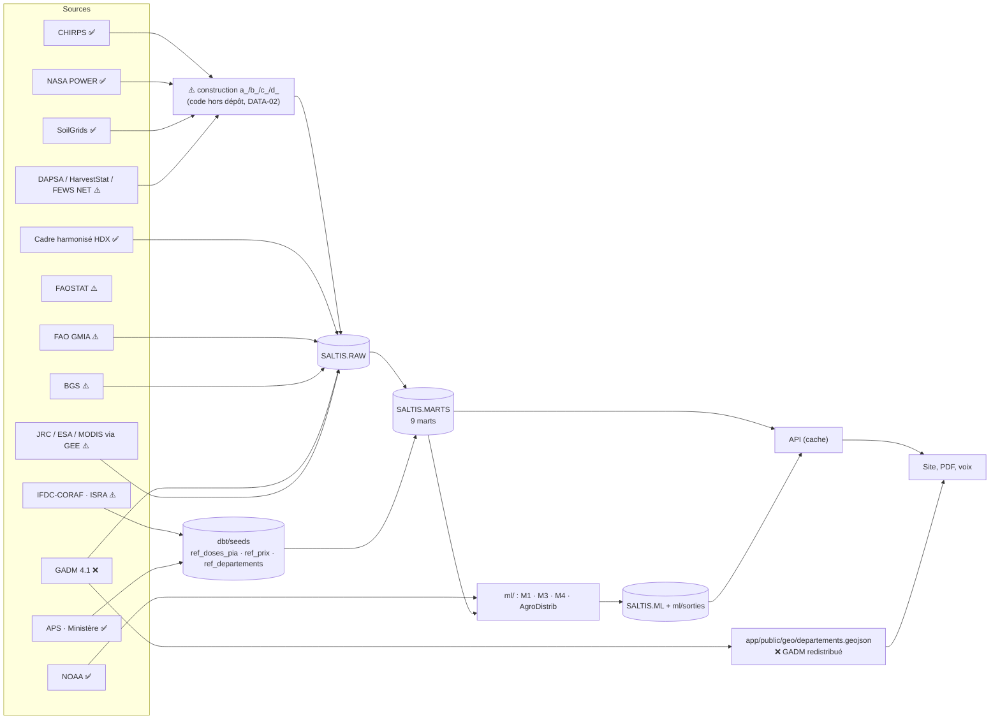

# 12 · Gouvernance des données, provenance et droits — Assaman & Suuf

> Audit du 21/11/2026, branche `dev/all-recup` (commit `51e448d`). Lecture seule.
> ⚠️ **Audit technique et organisationnel, pas un avis juridique.** Les licences citées sont celles **connues à la date de l'audit ou documentées dans le dépôt**. Aucune page de licence n'a été consultée en ligne pendant cet audit : chaque statut ⚠️ ou ❌ est à **revérifier sur le site de la source** et à valider avec un juriste avant toute commercialisation.
> Préfixe des constats : `GOV`. Renvois : module 05 (qualité et pipelines), module 06 (modèles), module 11 (données personnelles).

**Principes rappelés.** (1) Une donnée accessible publiquement n'est pas forcément libre de droits. (2) Transformer une donnée, c'est-à-dire l'agréger ou la simplifier, ne fait pas disparaître les restrictions de la source : le jeu dérivé en hérite. (3) Au Sénégal, ce sont la loi n° 2008-09 sur le droit d'auteur et l'Accord de Bangui (OAPI) qui s'appliquent ; l'exception de fouille de données (TDM) et le droit *sui generis* des bases de données sont des mécanismes **européens**, dont l'équivalent sénégalais est à vérifier. (4) Les modèles ont leur propre licence, qui s'impose aux usages dérivés.

---

## 1. Note globale : **3 / 5**

L'équipe a une **culture de la source remarquable** : citation ligne à ligne, page « Données » publique avec licences, statuts `A_CONFIRMER`, licences des modèles vocaux notées. Elle sait même que GADM est « non commercial » (`docs/etat-modelisation.md:100`).

Ce qui manque :
- une organisation (qui décide, qui est propriétaire) ;
- un catalogue unique ;
- la conservation des preuves de licence ;
- la propriété des actifs, puisqu'il n'y a ni licence de code ni accord entre membres ;
- surtout, la **compatibilité des licences avec l'abonnement prévu pour l'État et les ONG** : GADM, et peut-être GMIA et BGS.

| Domaine | Note | En bref |
|---|---|---|
| Organisation | 2 | Rôles implicites (« `api/` géré par … », `REGLE.md`). Aucun propriétaire de données nommé, aucune règle d'ajout de source. |
| Catalogue | 3 | `docs/contrat-donnees.md`, `docs/data-dictionary.md`, `dataset/README.md`, page « Données ». Mais pas de catalogue unique, et la lignée amont manque (DATA-02). |
| Classification et accès | 2 | Aucun niveau de sensibilité défini. Accès Snowflake en `SYSADMIN` (SEC-03). Données sur un Drive partagé. |
| Provenance et droits | 3 | Sources citées et licences connues pour la plupart. **GADM ❌** pour un usage commercial et la redistribution. GMIA, BGS, FAOSTAT, HarvestStat et IFDC-CORAF ⚠️. Aucune preuve de licence conservée. |
| Collecte automatisée | 4 | Pas de scraping de sites. Téléchargements de jeux publics par URL fixe (GADM, GMIA, HDX) et Earth Engine. |
| Lignée | 2 | dbt documente MARTS ← RAW. Sources → RAW absente du dépôt (DATA-02). Copies d'entraînement non versionnées (DATA-04). |
| Modèles IA | 3 | Fiches par modèle (`ml/*/README.md`, `MODELES.md`) équivalentes à des model cards. Licences des modèles vocaux notées, origine de leurs données d'entraînement non vérifiée. |
| Propriété des actifs | 1 | **Pas de fichier `LICENSE`**, dépôt sous un compte personnel, aucun accord entre les 4 contributeurs, règlement du concours non fourni. |
| Cycle de vie | 2 | Pas de durée de conservation des jeux, pas de procédure de retrait d'une source. |

---

## 2. Registre des sources

Légende : ✅ droits clairs pour l'usage prévu (gratuit et abonnement) · ⚠️ à clarifier · ❌ risque pour l'usage prévu.

| # | Source | Type | Où dans le dépôt | Licence (connue ou documentée) | Usage commercial ? | Attribution ? | Redistribution ? | Entraînement IA ? | Données perso ? | Preuve conservée | Statut |
|---|---|---|---|---|---|---|---|---|---|---|---|
| 1 | **CHIRPS** (Climate Hazards Center, UCSB) | Satellite + stations, pluie | RAW `a_*` (code amont absent) | Domaine public / renonciation aux droits (à revérifier) | Oui | Citation demandée | Oui | Oui | Non | Non | ✅ |
| 2 | **NASA POWER** | Réanalyse climatique | RAW `a_*` | Données NASA libres, remerciement demandé | Oui | Oui | Oui | Oui | Non | Non | ✅ |
| 3 | **SoilGrids** (ISRIC) | Carte des sols | RAW, `b_*` et `c_*` | CC BY 4.0 | Oui | **Oui** | Oui | Oui | Non | Non | ✅ |
| 4 | **NOAA** (indices El Niño, Atlantique) | Indices océaniques | `ml/entrees/indices_ocean.csv` | Domaine public (gouvernement des États-Unis) | Oui | Recommandée | Oui | Oui | Non | Non | ✅ |
| 5 | **DAPSA** via **HarvestStat** et **FEWS NET** | Statistiques de rendement | RAW `c_rendements_departement` | DAPSA : statistique publique de l'État ; HarvestStat : licence du jeu à vérifier ; FEWS NET : données publiques USAID | Probable | Oui | À vérifier | À vérifier | Non | Non | ⚠️ |
| 6 | **FAOSTAT** | Rendements nationaux | page « Données » | Conditions FAO (CC BY ou CC BY-NC-SA selon la période et le jeu) : **à vérifier** | À vérifier | Oui | À vérifier | À vérifier | Non | Non | ⚠️ |
| 7 | **Cadre harmonisé** (CILSS) via **HDX** | Insécurité alimentaire | `ingestion/collecte/cadre_harmonise/`, RAW `e_cadre_harmonise_departement` | **CC BY** (documenté : `docs/contrat-donnees.md:281`) | Oui | **Oui** (colonnes `source`, `licence` servies par l'API) | Oui | Oui | Non | Partielle (colonne `licence`) | ✅ |
| 8 | **GADM 4.1** | Contours des départements | `ingestion/collecte/eau/preparer_eau.py` (téléchargement) ; **`app/public/geo/departements.geojson`** (dérivé simplifié, **versionné et servi publiquement**) ; codes `GID_2` = clé de tout le modèle | **Usage académique et non commercial seulement ; redistribution et usage commercial interdits sans autorisation** (documenté : `docs/etat-modelisation.md:100`, `ConditionsGenerales.tsx:46`) | **Non** | Oui | **Non** | — | Non | Non | ❌ |
| 9 | **FAO GMIA v5** (zones irriguées) | Irrigation | `preparer_eau.py` (URL Firebase), RAW `e_irrigation_departement` | Conditions FAO : possiblement **non commerciales** (à vérifier) ; **absente de la page « Données »** | À vérifier | Oui | À vérifier | À vérifier | Non | Non | ⚠️ |
| 10 | **BGS** (cartes des eaux souterraines d'Afrique) | Nappes | `data/raw/eau/bgs/` (déposé à la main), RAW `e_eau_souterraine_departement` | Citation « © NERC 2012 » documentée (`docs/carte-opportunites.md:196`) ; conditions d'usage commercial **à vérifier** ; **absente de la page « Données »** | À vérifier | Oui | À vérifier | À vérifier | Non | Non | ⚠️ |
| 11 | **JRC Global Surface Water**, **ESA WorldCover**, **MODIS MOD13Q1** (Earth Engine) | Eau de surface, occupation du sol, NDVI | `ingestion/collecte/eau/gee_eau_surface.js` | Libres avec citation (Copernicus / ESA CC BY 4.0, NASA domaine public) ; conditions d'usage de Google Earth Engine (usage non commercial gratuit, commercial payant) **à vérifier** | Données : oui ; **plateforme GEE : à vérifier** | Oui | Oui | Oui | Non | Non | ⚠️ (GEE) |
| 12 | **IFDC-CORAF**, catalogue des Paquets d'Intrants Agricoles ; **fiches variétales ISRA** | Doses de référence | `dbt/seeds/ref_doses_pia.csv` (34 lignes, `A_CONFIRMER`) | Document publié ; les **faits** (doses) sont réutilisables, mais pas la reproduction du document ; pas d'accord avec l'ISRA | Faits : probable | Oui (fait : colonne `source_reference`) | Faits : probable | — | Non | Non | ⚠️ |
| 13 | **Articles scientifiques** (ex. Tounkara et al. 2022) | Doses | `data/referentiels/doses_engrais.csv` (colonne `origine`, nom de PDF) | Faits réutilisables avec citation ; PDF non redistribuable | Oui (faits) | Oui | PDF : non | — | Non | Le PDF **n'est pas** dans git (bien) | ✅ |
| 14 | **APS** (sept. 2025), **circulaire du ministère de l'Agriculture** (30/04/2026) | Prix des intrants | `dbt/seeds/ref_prix_intrants.csv` | Faits publics | Oui | Oui | Oui (faits) | — | Non | Non | ✅ |
| 15 | **Mapbox** + **OpenStreetMap** | Fond de carte | `app/src/scene/Carte.tsx` | Conditions Mapbox (compte, jeton, quotas) ; OSM **ODbL** (attribution) | Oui (offre payante au-delà du quota) | **Oui** (contrôle d'attribution de la carte) | Non (tuiles) | — | IP (module 11) | Non | ✅ (sous conditions) |
| 16 | **Données d'utilisateurs** (avis ONG, statistiques Umami) | Collecte | module 11 | Information et consentement (Umami) ; avis non annoncé (PRIV-02) | — | — | Non | **Non prévu** (à écrire) | Oui | Non | ⚠️ |

---

## 3. Carte de lignée



Le code GADM (`GID_2`, par exemple `SEN.10.1_1`) est la **clé de département de tout le système** : marts, API, front, ML (`api/routes/outils.py:17-29`). Remplacer GADM ne se limite donc pas à changer un fond de carte : il faut une table de correspondance (GOV-01).

---

## 4. Registre des modèles

| Modèle | Base utilisée | Licence | Données d'entraînement | Fiche (model card) | Statut |
|---|---|---|---|---|---|
| M1 · Saison | Maison (scikit-learn, ridge et logistique) | Code de l'équipe (pas de `LICENSE`, GOV-03) | MARTS (CHIRPS, NASA POWER) + NOAA | ✅ `ml/m1_prevision_saison/README.md`, `MODELES.md` | Hérite des sources ✅ |
| M3 · Rendement et alerte | Maison (linéaire régularisé) | idem | MARTS (DAPSA/HarvestStat ⚠️, climat) | ✅ `ml/m3_rendement/README.md` | Hérite de ⚠️ DAPSA/HarvestStat |
| M4 · Date de semis | Maison (seuils) | idem | MARTS (CHIRPS) + sorties M1 | ✅ `ml/m4_date_semis/README.md` | ✅ |
| AgroDistrib | Maison (prorata multicritère) | idem | MARTS (besoins IFDC/ISRA ⚠️, vulnérabilité) | ✅ `ml/agrodistrib/README.md` | Hérite de ⚠️ doses |
| ASR wolof | `AIHubSN/M-Kiriku-ASR` (Whisper affiné) | Apache 2.0 (`voix/space/README.md`) ; Whisper (MIT) | Corpus wolof d'AI Hub Sénégal : **origine et consentement des voix non vérifiés** | Celle de l'auteur | ⚠️ (à vérifier, utilisé seulement si `VOIX_SPACE`) |
| TTS wolof (Space) | `CONCREE/Adia_TTS` (Parler-TTS) | Apache 2.0 | Corpus de CONCREE : non vérifié | Celle de l'auteur | ⚠️ |
| TTS wolof (local, prod) | `bilalfaye/speecht5_tts-wolof` + `microsoft/speecht5_hifigan` + empreinte CMU Arctic « slt » | MIT (documenté `voix/README.md:77`) ; vocodeur MIT ; CMU Arctic : licence libre de type BSD (à vérifier) | Corpus wolof de l'auteur : non vérifié | Celle de l'auteur | ⚠️ (licence OK, données sous-jacentes non vérifiées) |

Aucun LLM, aucune API d'IA payante : pas de conditions sur la propriété des sorties à gérer. Aucune donnée personnelle dans les jeux d'entraînement maison (grain département). Pas de test de mémorisation nécessaire.

---

## 5. Constats

### [GOV-01] GADM (usage non commercial, sans redistribution) est la base du système et il est redistribué publiquement ; incompatible avec l'abonnement prévu
- Sévérité : 🟠 Élevé   Statut : Constaté (usage) / À vérifier (texte exact de la licence)
- Risque juridique : **licence (contrat) et droit d'auteur sur la base**
- Où : `app/public/geo/departements.geojson` (versionné, servi à `/geo/departements.geojson`, mis en cache par le service worker) ; `ingestion/collecte/eau/preparer_eau.py` (téléchargement GADM) ; codes `GID_2` dans tout le système ; `docs/etat-modelisation.md:100` (« usage non commercial uniquement ») ; `docs/business-model-canvas.md:11` (« abonnement annuel par organisation (État, ONG) ; études sur mesure pour les bailleurs »)
- Constat : l'équipe connaît la restriction et cite correctement GADM. Mais (1) le dépôt et le site **redistribuent** un fichier dérivé de GADM à tout visiteur, alors que les conditions GADM l'interdisent sans autorisation ; (2) le modèle économique prévoit un **usage commercial** (abonnements, études payantes) d'un produit qui repose sur ces contours.
- Impact : risque de devoir retirer la carte ou de payer une licence au moment de lancer l'offre payante ou de lever des fonds. Les clés `GID_2` irriguent les marts, l'API et le front : le remplacement est un vrai chantier si on le découvre tard.
- Recommandation : (1) Passer aux **limites administratives officielles** : ANSD, ou jeux **COD-AB** de l'OCHA sur HDX, souvent sous CC BY-IGO (à vérifier), ou **geoBoundaries** (CC BY 4.0, niveau ADM2), et garder `GID_2` seulement comme ancienne clé de correspondance. (2) À défaut, demander une autorisation écrite à GADM et la conserver. (3) Ne plus versionner le GeoJSON dans un dépôt public tant que la question n'est pas réglée.
- Effort : M

### [GOV-02] Sources de la carte des opportunités aux conditions non vérifiées et absentes de la page publique (GMIA, BGS, Earth Engine)
- Sévérité : 🟡 Moyen   Statut : Constaté (absence sur la page) / À vérifier (licences)
- Risque juridique : **licence et CGU**
- Où : `ingestion/collecte/eau/preparer_eau.py` (FAO GMIA, BGS) ; `gee_eau_surface.js` (JRC, ESA WorldCover, MODIS via Google Earth Engine) ; `app/src/pages/site/Donnees.tsx` (11 sources listées, **sans GMIA, BGS, JRC, ESA ni MODIS**) ; `docs/carte-opportunites.md:196` (citations prévues)
- Constat : 5 sources de la couche « eau » ne figurent pas sur la page « Données » ni dans les mentions légales. Les conditions de GMIA et de BGS peuvent exclure l'usage commercial. L'usage de Google Earth Engine est gratuit pour la recherche et les organisations à but non lucratif, mais encadré pour un usage commercial.
- Recommandation : vérifier et archiver les conditions des 5 sources. Les ajouter à la page « Données » avec leur citation. Si le projet devient commercial, faire le calcul GEE sous une licence adaptée, ou retélécharger les rasters JRC et ESA (libres) et les traiter hors de GEE.
- Effort : S

### [GOV-03] Aucune licence de code ni accord sur la propriété des actifs ; dépôt sous un compte personnel ; règlement du concours non fourni
- **Suivi (21/11/2026, après l'audit)** : 🟡 Partiellement corrigé — `LICENSE` « tous droits réservés, équipe AKAI » ajoutée, `"license": "UNLICENSED"` dans `app/package.json`. **Reste** : accord entre fondateurs, organisation GitHub, règlement du concours archivé.
- Sévérité : 🟠 Élevé   Statut : Constaté
- Risque juridique : **droit d'auteur (code, bases construites) et contrat**
- Où : racine du dépôt (pas de `LICENSE`) ; `app/package.json` (`"private": true`, pas de champ `license`) ; `git shortlog` (4 auteurs) ; `git remote` (compte GitHub personnel) ; `docs/team.md` ; pas de règlement SALTIS dans `docs/`
- Constat : par défaut, chaque contributeur garde le droit d'auteur sur ses contributions. Personne d'autre ne peut légalement réutiliser le code. Aucun écrit ne dit qui possède le code, les bases construites (marts, référentiels de doses) et les modèles : l'équipe, une future structure, chaque membre ? Le règlement du concours peut attribuer des droits à l'organisateur ou imposer une publication.
- Impact : blocage possible au moment d'une levée de fonds, d'un contrat avec l'État ou du départ d'un membre. Due diligence impossible.
- Recommandation : (1) Lire et archiver le règlement SALTIS PAS Challenge (`docs/conformite/`). (2) Un **accord entre fondateurs** (une page signée) qui cède ou licencie les droits des 4 contributeurs à la structure AKAI. (3) Choisir et ajouter une `LICENSE` : propriétaire « tous droits réservés » si le code reste fermé ; Apache 2.0 ou AGPL-3.0 si l'équipe veut l'ouvrir, en tenant compte de GOV-01. (4) Transférer le dépôt dans une organisation GitHub (OPS-07).
- Effort : S

### [GOV-04] Pas de catalogue unique ni de preuves de licence conservées
- Sévérité : 🟡 Moyen   Statut : Constaté
- Où : informations dispersées entre `app/src/pages/site/Donnees.tsx`, `app/src/export/texte.ts:86`, `dataset/README.md`, `docs/contrat-donnees.md`, `docs/data-dictionary.md`, `docs/carte-opportunites.md`, `docs/etat-modelisation.md` ; aucun `data/SOURCES.md` ni copie des conditions
- Constat : la documentation est riche, mais aucun fichier ne répond d'un coup à « quelles sources, sous quelle licence, téléchargées quand, avec quelle preuve ». Les conditions d'utilisation, qui changent souvent, ne sont pas archivées avec leur date.
- Recommandation : `data/SOURCES.md` (le registre de la section 2) et `data/CATALOGUE.md` (jeux RAW, seeds, marts, sorties ML : propriétaire, référent, emplacement, fréquence, sensibilité). Dossier `docs/conformite/licences/` avec la copie PDF datée des conditions de chaque source. La page « Données » du site est générée depuis `SOURCES.md`.
- Effort : S

### [GOV-05] Rôles de gouvernance et classification des données absents
- Sévérité : 🟡 Moyen   Statut : Constaté
- Où : aucun document ; indices de rôles implicites dans `REGLE.md:13` et `docs/etat-modelisation.md`
- Constat : pas de responsable des données, pas de propriétaire par jeu, pas de règle « qui peut ajouter une source » ni « qui valide une licence ». Pas de niveaux de sensibilité. C'est presque tout `public` aujourd'hui, mais les futurs comptes État et ONG, les stocks et les données de partenaires ne le seront pas.
- Recommandation : une page `docs/gouvernance.md`. Un responsable des données nommé (même à temps partiel). Un propriétaire et un référent pour RAW, les seeds, les marts et les sorties ML. 4 niveaux (`public`, `interne`, `confidentiel`, `personnel`). Règle : « une nouvelle source = une ligne dans `SOURCES.md`, validée par le responsable avant tout chargement ».
- Effort : S

### [GOV-06] Pas d'accord de partage avec les partenaires dont dépend la validation (ISRA, ANCAR, DAPSA)
- Sévérité : 🟡 Moyen   Statut : Constaté (aucun accord dans le dépôt) / À vérifier
- Risque juridique : **contrat**
- Où : `dbt/seeds/ref_doses_pia.csv` (34 doses `A_CONFIRMER`, en attente de l'ISRA) ; `dbt_project.yml` (seuils « à revoir avec ANCAR, SAED, DGPRE ») ; `docs/etat-modelisation.md` (« questions pour l'ISRA »)
- Constat : le produit attend de l'ISRA et de l'ANCAR une validation des doses et des seuils. La DAPSA est la source des rendements. Rien n'est écrit sur les conditions : publication, citation, droit de commercialiser un service qui contient les doses validées, durée, mise à jour.
- Recommandation : avant de recevoir les doses validées, un accord de partage simple (une à deux pages) avec chaque partenaire, couvrant les finalités, l'usage commercial, la citation, la confidentialité éventuelle, la durée et la propriété des résultats. Modèle en section 6.
- Effort : M (négociation)

### [GOV-07] Lignée et retrait d'une source impossibles à tracer de bout en bout
- Sévérité : 🟡 Moyen   Statut : Constaté
- Où : DATA-02 (code amont absent), DATA-04 (copies ML non versionnées) ; aucune DVC ni manifeste de jeu
- Constat : si une source retire sa licence (GADM, GMIA) ou demande un retrait, l'équipe ne peut pas lister automatiquement les tables RAW, marts, sorties ML, PDF exportés et fichiers du front concernés.
- Recommandation : versionner le code amont. Ajouter une colonne `sources` (liste) dans les métadonnées dbt (`meta: {sources: [...]}`) de chaque modèle, et un manifeste daté (empreinte + date) des fichiers RAW chargés et des copies d'entraînement.
- Effort : M

### [GOV-08] Modèles vocaux tiers : licence notée, origine des données d'entraînement non vérifiée
- Sévérité : 🔵 Faible   Statut : À vérifier
- Où : `voix/space/README.md:16-20`, `voix/README.md:77`, `api/voix/tts_local.py:3-5`
- Constat : les licences (Apache 2.0, MIT) sont compatibles avec un usage commercial. Mais les corpus de voix wolof sous-jacents (consentement des locuteurs, licence du corpus) ne sont pas documentés dans le dépôt. Si une voix a été enregistrée sans droit, la synthèse qui l'imite peut être contestée.
- Recommandation : lire et archiver les fiches des 3 modèles (section « données d'entraînement »). Préférer la version dont le corpus est documenté. Citer les auteurs (AI Hub Sénégal, CONCREE, l'auteur de SpeechT5 wolof) sur la page « Données ».
- Effort : S

### [GOV-09] Licences des composants : rien de bloquant, deux points à noter
- Sévérité : 🔵 Faible   Statut : Constaté
- Où :
  - front (`node_modules/*/package.json`) : MIT, ISC, OFL-1.1, et **mapbox-gl « SEE LICENSE IN LICENSE.txt »**, licence propriétaire Mapbox qui impose un compte Mapbox ;
  - Python de prod : FastAPI, Uvicorn, redis, numpy, torch, transformers, gradio_client, snowflake-connector, tous permissifs ;
  - dev seulement : `psycopg2-binary` (LGPL) et `text-unidecode` (GPL/Artistic), via `pip-licenses`, absents de l'image de prod ;
  - images : `redis:7-alpine` (les versions Redis ≥ 7.4 sont sous RSALv2/SSPL, ce qui n'interdit pas un usage interne).
- Constat : aucune dépendance GPL ou AGPL n'est livrée. Mapbox GL lie le front aux conditions de Mapbox (quota, attribution, pas d'usage sans jeton Mapbox).
- Recommandation : noter ces licences dans `docs/conformite/licences/`. Garder MapLibre comme option si les conditions ou le coût de Mapbox deviennent gênants (OPS-08).
- Effort : S

---

## 6. Modèles de documents à créer

**`data/SOURCES.md`** : une ligne par source, avec les colonnes du registre de la section 2, plus `fichier de preuve` et `date de vérification`.

**`data/CATALOGUE.md`** :
```markdown
| Jeu | Couche | Propriétaire | Référent | Emplacement | Sources | Fréquence | Sensibilité | Conservation |
|---|---|---|---|---|---|---|---|---|
| a_suivi_pluie_decade | RAW | <nom> | <nom> | SALTIS.RAW | CHIRPS | par campagne | public | illimitée |
| mart_territoires_agrodistrib | MARTS | … | … | SALTIS.MARTS | DAPSA, IFDC-CORAF | dbt build | public | version courante + 1 |
```

**Fiche de jeu (data card)**, une page : objet, grain, sources et licences, transformations (lien dbt), limites connues (taux de `NULL`, couverture), contact, date.

**Fiche de modèle (model card)** : les `ml/*/README.md` actuels en tiennent lieu. Ajouter une section « Données d'entraînement : sources et licences » et « Usages déconseillés ».

**Accord de partage de données** (ISRA, ANCAR, DAPSA), une à deux pages : parties ; données concernées ; finalités autorisées (affichage, calcul, usage commercial ou non) ; citation exigée ; confidentialité ; durée et mise à jour ; propriété des résultats dérivés ; retrait ; droit applicable (Sénégal).

**Politique de classification**, une page : `public` (site, marts) · `interne` (journaux, statistiques) · `confidentiel` (identifiants, `.env`, poids non publiés, stocks des ONG) · `personnel` (avis, IP). Pour chacun : qui accède, où stocker, durée.

---

## 7. Plan d'action

| Échéance | Actions |
|---|---|
| **Immédiat** | GOV-01 : lister tous les usages de GADM et arrêter de le versionner ou de le diffuser publiquement si le dépôt est public ; lancer la recherche d'une source de limites administratives ouverte (ANSD, COD-AB, geoBoundaries). GOV-03 : récupérer et archiver le règlement du concours. |
| **30 jours** | `data/SOURCES.md` et archives datées des conditions (GOV-04). Vérifier GMIA, BGS, FAOSTAT, HarvestStat et GEE, puis les ajouter à la page « Données » (GOV-02). Accord entre fondateurs et `LICENSE` (GOV-03). Page de gouvernance et classification (GOV-05). |
| **90 jours** | Migration des contours et table de correspondance `GID_2` → code officiel (GOV-01). Accords de partage avec l'ISRA, l'ANCAR et la DAPSA avant d'intégrer les doses validées (GOV-06). `meta.sources` dans dbt et manifeste des jeux (GOV-07). Fiches des modèles vocaux archivées (GOV-08). |

---

## 8. Questions à poser à un juriste

1. La simplification géométrique des contours GADM et leur diffusion sur le site constituent-elles une redistribution interdite ? Quelles options : autorisation de GADM, remplacement ?
2. Un abonnement payé par l'État ou une ONG pour un service qui affiche des données sous licence « non commerciale » (GADM, peut-être GMIA et BGS) est-il un usage commercial au sens de ces licences ?
3. En droit sénégalais (loi n° 2008-09) et OAPI (Accord de Bangui), les marts et référentiels construits par l'équipe (doses compilées, indicateurs) sont-ils protégeables comme compilations ? Existe-t-il un équivalent du droit *sui generis* européen ou de l'exception de fouille de données ?
4. Qui détient aujourd'hui le droit d'auteur sur le code et les modèles, en l'absence de structure et d'accord entre les 4 contributeurs ? Quelle forme pour l'accord de cession ?
5. Le règlement du SALTIS PAS Challenge attribue-t-il des droits à l'organisateur ou impose-t-il une licence ?
6. Quelles clauses minimales dans un accord avec l'ISRA ou la DAPSA pour pouvoir afficher et commercialiser des recommandations fondées sur leurs données ?
7. Les poids et le code des modèles peuvent-ils être protégés par le secret des affaires au Sénégal ? Quelles précautions (accès, clauses de confidentialité) ?

---

## Résumé

- **3/5.** Très bonne culture de la citation : page « Données », colonnes `source` et `licence`, statuts `A_CONFIRMER`, fiches de modèles, licences des modèles vocaux notées. Mais pas d'organisation, pas de catalogue unique, pas de preuves de licence, pas de propriété des actifs.
- 🟠 GOV-01 : **GADM** (non commercial, sans redistribution) est la clé de département de tout le système, il est redistribué publiquement dans `app/public/geo/`, et il est incompatible avec l'abonnement prévu.
- 🟠 GOV-03 : pas de `LICENSE`, pas d'accord entre les 4 contributeurs, dépôt sous un compte personnel, règlement du concours non fourni.
- 🟡 GMIA, BGS et Earth Engine non vérifiés et absents de la page publique. Pas de catalogue ni de preuves. Pas de rôles ni de classification. Pas d'accord avec l'ISRA, l'ANCAR ou la DAPSA. Lignée et retrait de source impossibles à tracer.
- Livrables : registre de 16 sources (8 ✅, 7 ⚠️, 1 ❌), carte de lignée, registre de 7 modèles, modèles de documents, plan immédiat / 30 / 90 jours, 7 questions pour un juriste.
