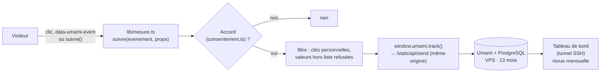

# 14 · Mesure d'audience et collecte des clics — Assaman & Suuf

> Audit du 21/11/2026, branche `dev/all-recup` (commit `51e448d`). Lecture seule.
> Test « sans consentement » fait dans le navigateur intégré, sur `https://assaman-suuf.tech/` (déploiement du 19/11), après avoir vidé le stockage, les caches et le service worker de ce navigateur d'audit.
> Préfixe des constats : `ANA`. Renvois : module 11 (consentement, conservation), module 03 (performance).

---

## 1. Note globale : **2 / 5**

L'**architecture** de collecte est exemplaire pour le contexte :
- Umami auto-hébergé, servi sur la même origine, sans cookie ;
- chargé seulement après « Accepter », avec « Refuser » au même niveau ;
- `Ne pas me suivre` respecté, paramètres et ancres d'URL exclus ;
- aucun tiers.

Mais elle **ne mesure rien d'utile aujourd'hui** :
- Umami n'est pas actif en prod ;
- aucun événement n'est défini ;
- toute l'application (12 écrans) tient sous l'adresse `/`, donc les pages vues ne disent pas ce que font les visiteurs ;
- il n'existe aucun plan de marquage ni de KPI.

| Domaine | Note | En bref |
|---|---|---|
| Objectifs | 1 | Aucune question métier écrite, aucun KPI défini. Le pitch et l'abonnement auront besoin de chiffres d'usage. |
| Plan de marquage | 0 | Absent |
| Collecte des clics | 1 | 0 événement (`umami.track`, `data-umami-event` : aucun). Les écrans de la scène ne changent pas l'URL. |
| Consentement | 5 | Opt-in réel, rien avant le choix, refus aussi simple qu'accepter, choix daté et versionné, modifiable (`consentement.ts`). |
| Performance | 5 | Script Umami de quelques Ko, `defer`, même origine, chargé seulement après accord. |
| Qualité | 2 | Pas de filtrage du trafic de l'équipe ni des démos, pas de séparation prod / test, pas de recette. |
| Usage | 1 | Tableau de bord Umami seulement par tunnel SSH. Personne n'est désigné pour le lire. |

---

## 2. Inventaire de l'existant

| Élément | Constat | Preuve |
|---|---|---|
| Outils | **Umami 3.4.1** auto-hébergé (PostgreSQL), seul outil. Aucune trace de GA4, GTM, Meta Pixel, Hotjar, Clarity, PostHog… | `docker-compose.prod.yml` (service `umami`) ; `grep` des outils dans `app/src` : seulement Umami |
| Chargement | Script `/stats/script.js` injecté en `defer` **après accord**, avec `data-do-not-track`, `data-exclude-search` et `data-exclude-hash` | `app/src/consentement/audience.ts:13-34` |
| Retrait du consentement | `localStorage['umami.disabled']` posé si l'utilisateur refuse après avoir accepté | `audience.ts:15-19` |
| Bandeau | Affiché seulement si un identifiant Umami est configuré. Version 2 (Umami, 17/11/2026), durée 6 mois, choix daté. | `consentement.ts:8-29`, `BandeauCookies.tsx` |
| Exposition | Seuls `/stats/script.js` et `/stats/api/send` sont publics ; le tableau de bord est sur `127.0.0.1:3001` (tunnel SSH) | `deploy/Caddyfile` (`@audience`), `docker-compose.prod.yml` |
| Événements envoyés | **Aucun** (`umami.track`, `data-umami-event`, `track(` : 0 occurrence dans `app/src`) | `grep` |
| Pages vues | Automatiques dans Umami (y compris les changements de route d'une application monopage). Mais **toute la scène est sous `/`** : les 12 écrans (Ma parcelle, Saison, Repartir…) changent d'état React, pas d'URL. | `App.tsx:26-29`, `Scene.tsx` |
| Liens de contact | `mailto:` seulement, sur la page Contact, affiché au clic (`AdresseContact.tsx:10`) ; pas de WhatsApp ni de `tel:` | `grep` |
| UTM | Exclus par `data-exclude-search` (les `?utm_*` ne sont pas gardés) | `audience.ts:30` |
| Qui consulte | Non documenté | — |

### Test « sans consentement » (prod, 21/11/2026)

| Contrôle | Résultat |
|---|---|
| Requêtes vers un domaine tiers au chargement de la page d'accueil | **0** (seulement `assaman-suuf.tech`) |
| Cookies | **Aucun** (`document.cookie` vide) |
| `localStorage` | Vide |
| Script Umami chargé | Non |
| Bandeau affiché | **Non** : en prod, `VITE_UMAMI_ID` est vide ou bien le déploiement du 19/11 précède l'intégration ; `/stats/script.js` renvoie la page HTML du site (1 719 octets) et pas le script |

**Conclusion** : en prod, aucun traceur n'est posé avant consentement. C'est conforme. Mais **aucune mesure n'a lieu du tout**. Remarque : sur la carte (pas sur la page d'accueil), Mapbox dépose un identifiant de télémétrie sans consentement (PRIV-02). Ce n'est pas de la mesure d'audience de l'équipe, mais un visiteur ou un contrôleur ne fera pas la différence.

### Poids et performance

- Script Umami : quelques Ko compressés, sous l'objectif de 30 Ko. Il n'a pas pu être mesuré en prod, faute de déploiement. Il est chargé après accord, en `defer`, sans bloquer l'affichage.
- Pas d'impact sur le LCP et l'INP attendu. Envoi en `fetch` sans file hors ligne : un événement émis sans réseau est perdu, ce qui est acceptable pour de la mesure d'audience.

---

## 3. Constats

### [ANA-01] La mesure d'audience n'est pas active en prod
- Sévérité : 🟡 Moyen   Statut : Constaté
- Où : prod (`/stats/script.js` → page HTML, pas de bandeau) ; `docker-compose.prod.yml` (`VITE_UMAMI_ID: ${UMAMI_WEBSITE_ID:-}`) ; `deploy/README.md` section 7 (création du site dans Umami)
- Constat : le code est prêt, mais l'identifiant du site n'est pas renseigné, ou la version en ligne est antérieure. Aucune visite n'est comptée.
- Impact : à la présentation au jury puis aux autorités, l'équipe ne pourra donner **aucun chiffre d'usage** (visiteurs, profils, écrans utilisés). Ces chiffres sont pourtant décisifs pour convaincre un financeur ou fixer le prix de l'abonnement.
- Recommandation : déployer la version actuelle, créer le site dans Umami (tunnel SSH), renseigner `UMAMI_WEBSITE_ID`, reconstruire `web`, puis vérifier que `/stats/script.js` renvoie du JavaScript et que le bandeau s'affiche.
- Effort : S

### [ANA-02] Aucun événement ; les 12 écrans de la scène sont invisibles dans les statistiques
- Sévérité : 🟠 Élevé   Statut : Constaté
- Où : `app/src` (0 appel `umami.track`, 0 attribut `data-umami-event`) ; `App.tsx:26-29` (scène sous `/`) ; `scene/modes/*.tsx`
- Constat : même une fois Umami actif, il ne verra qu'une page vue sur `/`, pour la landing comme pour la carte. Impossible de savoir combien de visiteurs entrent par « Agriculteur » ou par « ONG », quels écrans ils ouvrent, s'ils écoutent la voix wolof, exportent un PDF, utilisent la géolocalisation ou envoient un avis.
- Impact : aucune donnée pour décider (garder ou retirer un écran, prioriser le wolof, prouver l'usage des ONG). Le cahier des charges V1 retire déjà des écrans sans données d'usage (`docs/v1-cahier-des-charges.md`).
- Recommandation : un module `app/src/lib/mesure.ts` avec une fonction `suivre(evenement, proprietes)` unique, qui appelle `window.umami?.track()` seulement si l'accord est donné, et filtre les clés personnelles. Brancher les 12 événements du plan de la section 4. Envisager une URL par écran (`/carte/saison`, `/carte/parcelle`…), ce qui donne aussi des liens partageables par WhatsApp. Pour les clics simples, utiliser les attributs déclaratifs d'Umami (`data-umami-event="voix_wolof_ecouter"`).
- Effort : S

### [ANA-03] Aucun objectif, KPI ni plan de marquage écrit
- Sévérité : 🟡 Moyen   Statut : Constaté
- Où : aucun `docs/analytics/` ; le `docs/business-model-canvas.md` cite des revenus (abonnements) sans indicateur d'usage associé
- Recommandation : `docs/analytics/plan-de-marquage.md` (section 4) et une liste de 8 KPI (section 6), avec un responsable qui les lit chaque mois. **Une donnée que personne ne regarde ne doit pas être collectée** : ne brancher que les événements du plan.
- Effort : S

### [ANA-04] Le trafic de l'équipe et des démos va fausser les chiffres
- Sévérité : 🟡 Moyen   Statut : Probable
- Où : aucun filtrage dans `audience.ts` ; pas d'environnement de test séparé (OPS-02) ; trafic de développement et de démonstration sur le même site
- Constat : 4 développeurs, les répétitions de pitch, le jury et les ateliers ONG vont générer une grande part des premières visites. Les mêmes salles passent par une seule adresse IP (BE-03).
- Recommandation : un lien caché (`/?equipe=1`) qui pose `umami.disabled` sur les appareils de l'équipe. Un site Umami distinct pour le staging. Noter dans le tableau de bord les dates des démos et des ateliers pour lire les pics.
- Effort : S

### [ANA-05] Le choix « consentement obligatoire » réduit fortement les données ; arbitrage non documenté
- Sévérité : 🔵 Faible   Statut : Constaté
- Où : `consentement.ts` (opt-in) ; `Confidentialite.tsx` (Umami « avec votre accord seulement »)
- Constat : l'équipe a pris l'option la plus protectrice. Sous RGPD et selon la CNIL, une mesure d'audience Umami configurée comme ici (sans cookie, sans recoupement, IP non conservée, données pour le seul éditeur) **pourrait** être exemptée de consentement. Au Sénégal, l'information des visiteurs reste due (loi n° 2008-12). En pratique, souvent moins de la moitié des visiteurs acceptent, et sur mobile beaucoup ferment le bandeau sans choisir.
- Recommandation : garder l'opt-in tant qu'un juriste n'a pas validé une exemption au regard du droit sénégalais (question à ajouter au module 11). Afficher dans les rapports d'usage le **taux d'acceptation** pour corriger les chiffres. Si l'exemption est validée : mesure minimale sans bandeau (pages vues et événements agrégés), avec information dans la page Confidentialité.
- Effort : S

### [ANA-06] Durée de conservation des statistiques non configurée
- Sévérité : 🔵 Faible   Statut : Constaté (voir PRIV-04)
- Où : service `umami` ; aucune purge
- Recommandation : 13 mois, avec une purge mensuelle (requête SQL dans un cron du VPS). L'indiquer dans la page Confidentialité.
- Effort : S

---

## 4. Plan de marquage cible

Convention : `objet_action` en `snake_case`, en français, cohérent avec le code. **Jamais** de coordonnées, de nom, de texte libre, de surface exacte ou de stock dans les propriétés. Toutes les propriétés sont des valeurs d'une liste fermée.

| Événement | Déclencheur | Propriétés | Objectif métier | Page(s) | Consentement ? | Responsable | Statut |
|---|---|---|---|---|---|---|---|
| `page_vue` | Automatique (Umami) ; + URL par écran si ANA-02 | `path` | Audience, pages légales | Toutes | Oui (opt-in actuel) | Produit | Prêt dès qu'Umami est actif |
| `porte_entree` | Clic « Agriculteur » ou « ONG et services de l'État » | `profil` (`agriculteur`, `organisation`) | Répartition des publics | Landing | Oui | Produit | À créer |
| `ecran_ouvert` | Changement de mode dans la scène | `ecran` (12 valeurs), `profil` | Écrans utiles, écrans à retirer | Scène | Oui | Produit | À créer |
| `annee_choisie` | Saisie ou choix d'année | `type` (`passee`, `ocean`, `tendance`) | Intérêt pour la prévision | Scène | Oui | Data | À créer |
| `parcelle_localisee` | Résultat de « Me localiser » | `resultat` (`ok`, `refus`, `indisponible`, `saisie_manuelle`) — **jamais la position** | Faisabilité du GPS sur le terrain | Ma parcelle | Oui | Produit | À créer |
| `voix_lue` | Clic « Écouter » ou « Wolof » | `langue` (`fr`, `wo`), `ecran`, `resultat` (`ok`, `erreur`, `occupee`) | **Usage réel du wolof**, fiabilité de la voix | Scène | Oui | Produit | À créer |
| `export_pdf` | Fin d'export | `type` (`fiche_departement`, `dossier_national`, `ong`) | Valeur pour les ONG et l'État | Exporter | Oui | Produit | À créer |
| `repartition_validee` | Validation d'un scénario | `scenario` (`equite`, `equilibre`, `rendement`, `personnalise`), `niveau` | Usage d'AgroDistrib | Repartir | Oui | Produit | À créer |
| `avis_envoye` / `avis_erreur` | Retour de `POST /avis` | `type_organisation` (liste fermée), `code` d'erreur | Retours des ONG | Avis | Oui | Produit | À créer |
| `carte_indisponible` | Garde de carte affichée (pas de WebGL) | `raison` (`webgl`, `erreur`) | Part des appareils sans carte (FE-02) | Scène | Oui | Tech | À créer |
| `hors_ligne` | Requête échouée par coupure | `ecran` | Fréquence des coupures (FE-01, FE-03) | Scène | Oui | Tech | À créer |
| `lien_sortant` | Clic vers une source de données ou un réseau social | `domaine` | Intérêt pour les sources et réseaux | Pied de page, Données | Oui | Produit | À créer |

Règles :
- un nouvel événement n'entre dans le code qu'avec un objectif et un responsable ;
- toute modification du plan passe par une PR ;
- on vérifie à la recette que chaque événement part une seule fois (attention au `StrictMode` de React, qui monte les composants deux fois en dev).

---

## 5. Architecture recommandée

**Option A, conservée : Umami auto-hébergé.** C'est le bon choix pour un public au Sénégal sur mobile :
- script très léger et même origine, ce qui le rend peu sensible aux bloqueurs ;
- données sur le VPS de l'équipe, sans tiers, ce qui compte pour la souveraineté devant l'État ;
- 0 € ;
- les événements personnalisés d'Umami suffisent pour le plan ci-dessus.

PostHog (option B) n'apporterait rien d'utile à ce stade et alourdirait la page. GA4 (option C) est à écarter : script lourd, transferts vers Google, bloqué par les bloqueurs, et contraire à la promesse « sans tiers » de la page Confidentialité.



```ts
// app/src/lib/mesure.ts (proposition)
import { consentement } from '../consentement/consentement'

type Valeur = string | number | boolean
const INTERDIT = /lat|lon|position|nom|email|tel|texte|message|surface|stock|prix/i

declare global { interface Window { umami?: { track: (e: string, p?: Record<string, Valeur>) => void } } }

export function suivre(evenement: string, proprietes: Record<string, Valeur> = {}) {
  if (!consentement.audienceAcceptee()) return            // rien sans accord
  const sures = Object.fromEntries(Object.entries(proprietes).filter(([k]) => !INTERDIT.test(k)))
  try { window.umami?.track(evenement, sures) } catch { /* la mesure ne doit jamais casser l'écran */ }
}
```

```tsx
// Exemple déclaratif (attributs Umami), sans code :
<button data-umami-event="voix_lue" data-umami-event-langue="wo" data-umami-event-ecran="saison">Wolof</button>
```

---

## 6. KPI et tableau de bord

| KPI | Calcul | Question |
|---|---|---|
| Visiteurs et visites par mois | Umami | La plateforme est-elle utilisée ? |
| Taux d'acceptation de la mesure | accords / affichages du bandeau | Quelle part de l'audience voit-on ? |
| Répartition des profils | `porte_entree` par `profil` | Agriculteurs ou ONG ? |
| Taux d'entrée dans la carte | `porte_entree` / visiteurs | La landing convainc-elle ? |
| Écrans les plus ouverts | `ecran_ouvert` par `ecran` | Quoi améliorer, quoi retirer ? |
| **Part de lecture en wolof** | `voix_lue` `wo` / `voix_lue` total ; taux d'`erreur` et d'`occupee` | Le wolof est-il utilisé et fiable ? |
| Exports PDF et répartitions validées par mois | `export_pdf`, `repartition_validee` | Valeur pour l'abonnement État et ONG |
| Appareils sans carte et coupures | `carte_indisponible`, `hors_ligne` / visites | Faut-il un mode léger ou hors ligne (FE-01, FE-02) ? |

**Tableau de bord (maquette)** : 1 ligne de 4 chiffres (visiteurs, taux d'acceptation, entrées dans la carte, part du wolof). Un histogramme des écrans ouverts par profil. Une courbe mensuelle des exports PDF et des répartitions. Un tableau des appareils (taille d'écran, navigateur) avec la part `carte_indisponible`. Revue mensuelle par le responsable produit. Les dates des démos et des ateliers sont notées pour lire les pics.

---

## Résumé

- **2/5.** Architecture et consentement exemplaires : Umami auto-hébergé, même origine, sans cookie, opt-in réel. Le test sans consentement en prod ne montre **aucun cookie et aucune requête tierce**.
- 🟡 ANA-01 : la mesure **n'est pas active en prod** (pas de bandeau, `/stats/script.js` renvoie la page HTML). Aucun chiffre d'usage pour le jury ni pour les autorités.
- 🟠 ANA-02 : **0 événement**, et les 12 écrans de la scène sont sous `/`. Même active, la mesure ne dirait pas qui utilise quoi (profils, wolof, PDF, AgroDistrib).
- 🟡 Pas de plan de marquage ni de KPI. Trafic de l'équipe et des démos non filtré. 🔵 L'arbitrage opt-in contre exemption est à faire valider ; durée de conservation des statistiques non configurée.
- Livrables : plan de marquage de 12 événements (aucune donnée personnelle), module `suivre()` centralisé, 8 KPI et maquette de tableau de bord. On garde Umami, avec une justification.
