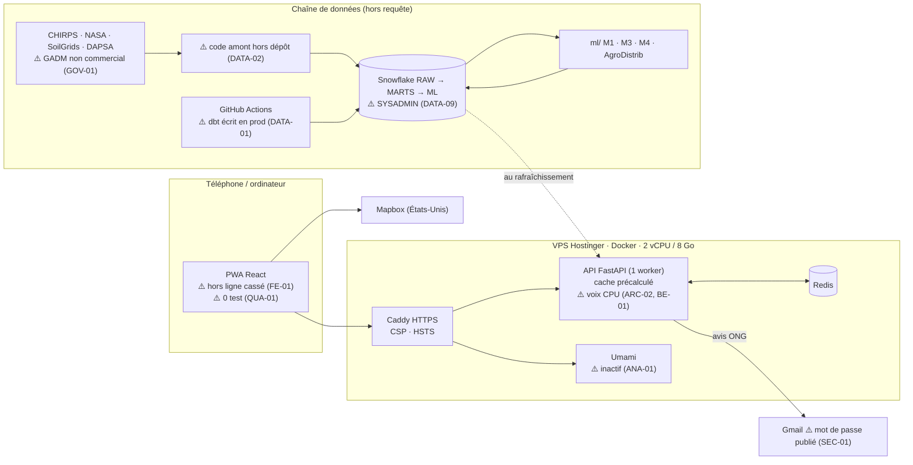

# Rapport d'audit technique : Assaman & Suuf (Ciel & Terre)

**Date :** 2026-11-21. **Version du code auditée :** branche `dev/all-recup`, commit `51e448d` (prod en ligne : déploiement du 19/11/2026, `origin/main` `3922c9e`). **Auditeur :** agent IA (Claude Code), en lecture seule, sur demande de l'équipe AKAI.

> **Suivi des corrections** : les corrections faites après l'audit (21/11/2026, préparation du rendu du code source) sont résumées en section 9. Les chemins cités sont ceux de la version auditée ; correspondance en annexe H.
>
> Ce rapport consolide 12 rapports de modules (`audit/rapports/01` à `14`). Les constats vus dans plusieurs modules sont fusionnés avec la sévérité la plus haute. Les notes sont reprises des rapports de modules. **Ce n'est pas un avis juridique** : les points de droit (CDP, licences, propriété) sont à valider par un juriste.

---

## 1. Synthèse exécutive

**Verdict.** Prototype **sérieux, honnête sur ses limites et bien construit côté données et API**. Il est présentable au jury après une journée de correctifs. Il n'est **pas prêt à être ouvert aux autorités ni vendu** en l'état : un mot de passe est publié, la CI peut modifier les données de prod, une alerte trompeuse s'affiche, et les formalités sur les données ne sont pas faites.

**Note globale : 2,7 / 5**

| Domaine | Note /5 | Commentaire en une ligne |
|---|---|---|
| Architecture | 3 | Bien dimensionnée (données précalculées). Logique en double et voix qui ralentit l'API. |
| Frontend | 3 | Page d'accueil légère et code propre. Hors ligne cassé, pas d'erreur affichée, bloquant sans carte. |
| Backend / API | **4** | La partie la plus solide : rapide, validée, testée à 91 %. Seule la voix est exposée aux abus. |
| Data | 3 | Bon modèle dbt (345 tests). La CI écrit dans la prod et l'amont n'est pas versionné. |
| IA / ML | 3 | Évaluation exemplaire. Alertes non fiables affichées comme sûres ; wolof non relu. |
| Sécurité | **2** | Bonne base HTTP et conteneurs. **Mot de passe publié sur GitHub**, rôle Snowflake trop puissant. |
| DevOps / Infra | **2** | Docker soigné. Déploiement manuel, aucune supervision. |
| Qualité / Tests | 3 | Back bien testé. **0 test front** sur les calculs de conseil. |
| Données personnelles | **2** | Très peu de collecte (3/5 en technique). Aucune formalité CDP (1/5). |
| Gouvernance des données | 3 | Sources bien citées. Licence GADM non commerciale et propriété du code non réglée. |
| Mesure d'audience | **2** | Dispositif respectueux, mais inactif en prod et sans aucun événement. |
| Adéquation Sénégal / Afrique | 2,5 | Bon sur la sobriété et le wolof. Faible sur le hors ligne, les vieux téléphones et les canaux. |

**Constats consolidés : 85** (97 avant fusion) · 🔴 **2** · 🟠 **20** · 🟡 **43** · 🔵 **20**

**Les 3 forces**
1. **Honnêteté des chiffres.** Une valeur inconnue n'est jamais affichée comme 0. Chaque prévision porte sa fiabilité. Les doses sont marquées « à confirmer (ISRA) ». Les modèles sont comparés à des références simples, sur des années entières.
2. **Une architecture sobre et adaptée.** Les réponses sont précalculées et Snowflake n'est jamais appelé pendant une visite. La page d'accueil pèse ≈ 227 Ko. Le tout coûte ≈ 10 à 40 € par mois, sans coût par utilisateur.
3. **Respect de la vie privée dès la conception.** Pas de compte, la position GPS ne quitte pas le téléphone, la mesure d'audience est sans cookie et soumise à accord, le site n'envoie aucune requête à un tiers avant consentement.

**Les 5 risques majeurs**
1. **Un mot de passe e-mail réel est publié sur GitHub** : n'importe qui peut écrire aux ONG au nom de l'équipe et lire les avis reçus. (SEC-01)
2. **N'importe quelle branche de travail peut réécrire les données de prod** à chaque envoi de code. (DATA-01)
3. **Des « alertes récolte » rouges clignotent pour 2026-2035 alors que le modèle les déclare non fiables**, sur l'écran destiné à l'État. (IA-01)
4. **Le site promet un usage hors ligne qui ne marche pas.** Sur un téléphone sans carte 3D et sans GPS, l'agriculteur reste bloqué au premier écran. (FE-01, FE-02)
5. **Aucune formalité auprès de la CDP, et une licence de cartes (GADM) incompatible avec l'abonnement prévu.** (PRIV-01, GOV-01)

**Décision recommandée.** Faire les 6 actions « Immédiat » (section 5) **avant la démo** ; chacune prend moins d'une journée. Ne pas présenter la V1 aux autorités, et ne pas ouvrir l'abonnement, avant d'avoir terminé le plan à 30 jours : formalités CDP, contours administratifs officiels, supervision, tests du front.

---

## 2. Contexte et périmètre

**Plateforme.** Aide à la décision agricole au Sénégal. Elle croise la pluie (CHIRPS), le climat (NASA POWER), les sols (SoilGrids) et les rendements (DAPSA) sur 45 départements, de 1981 à 2025. Elle répond à 4 questions : quelle saison s'annonce, que semer et quand, combien d'intrants, comment répartir un stock (AgroDistrib). Elle ajoute le Cadre harmonisé et une carte des opportunités. Deux profils sans compte : agriculteurs, et ONG et services de l'État. Environ 500 utilisateurs visés, tous types d'appareils. La V1 sera présentée aux autorités, avec un abonnement prévu pour l'État et les ONG.

**Contraintes terrain.** Réseau mobile lent ou coupé (PWA), téléphones d'entrée de gamme, voix en wolof, utilisateurs parfois peu à l'aise avec l'écrit. Le site doit rester sobre et ne jamais afficher 0 pour une valeur inconnue.

**Audité** :
- le code, la configuration et les documents de tout le dépôt ;
- les commandes locales : build et lint front, tests et couverture Python, `dbt parse`, scanners de secrets et de dépendances, `bandit`, `mypy`, `radon` ;
- des contrôles **passifs** sur la prod `https://assaman-suuf.tech` : en-têtes, TLS, CORS, codes de retour, test sans consentement, parcours à 360 px.

**Non audité, sur décision de l'équipe** : validation agronomique des doses et variétés (ISRA, ANCAR), business model et pitch, jeux bruts `data/` et `dataset/`, `venv/`, `node_modules/`, notebooks, `.claude/agents`.

**Limites et accès manquants** :
- aucune connexion à Snowflake (schéma, droits, historique des requêtes) ;
- `.env` de prod et VPS non vus ;
- `gh` absent : protection des branches, durée de CI et secrets GitHub non lus ;
- `npx` refusé par le contrôle des permissions : Lighthouse, axe, madge, jscpd non lancés ;
- le navigateur d'audit n'a pas WebGL : carte non testée visuellement ;
- licences des sources non consultées en ligne ;
- la prod en ligne date du 19/11 : elle est **antérieure au code audité**.

---

## 3. Cartographie

Détails : `01-cartographie.md` (composants, 37 routes, variables d'environnement), `02-architecture.md` (architecture annotée et cible).

---

## 4. Constats critiques et élevés

Triés par sévérité puis par effort. Les preuves complètes sont dans les rapports de modules.

### 🔴 Critiques

**[SEC-01 = PRIV-03] Mot de passe d'application Gmail réel dans `.env.example`, poussé sur GitHub**
- Où : `.env.example:51-55`, commit `51e448d`, branche distante `origin/dev/all-recup`. Valeur masquée : `kk**************`.
- Impact : envoi d'e-mails au nom d'AKAI aux ONG et à l'État, et lecture possible des avis reçus (violation de données personnelles). Il est aussi recopié sur tout serveur installé avec `cp .env.example .env`.
- Action : **révoquer aujourd'hui** dans le compte Google, mettre le nouveau mot de passe dans le `.env` du VPS seulement, vider `.env.example`, consigner l'incident, puis nettoyer l'historique. Effort **S**.

**[DATA-01 = SEC-02] La CI dbt reconstruit les schémas de prod depuis n'importe quelle branche**
- Où : `dbt/macros/generate_schema_name.sql:2-5` (ignore `SNOWFLAKE_SCHEMA=CI`) ; `.github/workflows/ci.yml` (push sur `dev/**`). Preuve : `dbt parse` avec la cible CI → tous les modèles dans `staging`, `intermediate` et `marts`.
- Impact : du code non relu remplace les chiffres de prod, qui sont ensuite servis au prochain rafraîchissement du cache.
- Action : désactiver dbt sur les push dès maintenant, préfixer les schémas en CI (ou base `SALTIS_CI` clonée, rôle CI sans droit sur la prod), et vérifier `QUERY_HISTORY`. Effort **S**.

### 🟠 Élevés

| ID | Constat | Preuve principale | Action | Effort |
|---|---|---|---|---|
| IA-01 | « Alertes récolte » rouges et clignotantes pour 2026-2035 alors que `alerte_fiable = False` sur 1 900 lignes sur 1 900 | `AlerteRecolte.tsx:39,67,70` ; `ml/sorties/prevision_rendement.csv` | Alerte seulement si `alerte_fiable` ; sinon « risque habituel » | S |
| FE-01 | Le cache hors ligne des données ne marche pas (`apiUrl` absente de `sw.js`), en prod aussi | `vite.config.ts:216-217` ; `sw.js` de prod | Règle Workbox sans variable extérieure, test en mode avion | S |
| FE-02 | Sans WebGL ni GPS, seule la saisie de latitude et longitude permet de choisir son lieu | navigateur sans WebGL : 0 `select` ; `Parcelle.tsx:133-153` | Sélecteur région → département toujours disponible | S |
| FE-03 | Aucun écran n'affiche d'erreur réseau : une panne ressemble à « non disponible » | 0 `isError` dans 12 écrans | Composant d'erreur commun avec « Réessayer » et bandeau hors ligne | S |
| ARC-03 | « Redémarrer l'API » ne relit pas les données avec Redis (cas de la prod) | `deploy/README.md:56` ; `service.py:55-56` | Corriger la doc, jeton admin obligatoire, version des données visible | S |
| DATA-09 = SEC-03 | Rôle Snowflake `SYSADMIN` par mot de passe pour l'API, qui ne fait que lire | `.env.example:9` ; `api/config.py` | Rôle de lecture dédié, clé RSA, *network policy*, *resource monitor* | S |
| SEC-05 | VPS administré en `root`, sans durcissement documenté (à vérifier) | `deploy/README.md:16` | Compte non `root`, clés SSH, `fail2ban`, mises à jour automatiques | S |
| PRIV-01 | Aucune déclaration CDP ; responsable du traitement sans identité juridique | confirmé par l'équipe ; `Confidentialite.tsx` | Désigner le responsable, déposer la déclaration (registre fourni) | S |
| PRIV-02 | Avis des ONG via Gmail et identifiant Mapbox absents de la page Confidentialité | `AvisOng.tsx` ; `mapbox.eventData` | Compléter la page et ajouter une mention sous le formulaire | S |
| GOV-03 | Pas de `LICENSE`, pas d'accord entre les 4 contributeurs, dépôt personnel, règlement du concours non fourni | racine du dépôt ; `git shortlog` | Accord entre fondateurs, licence, organisation GitHub | S |
| ANA-02 | 0 événement mesuré ; les 12 écrans sont tous sous `/` | `grep umami.track` → 0 | Module `suivre()` et plan de 12 événements | S |
| BE-01 = SEC-04 | `/voix/parler` synthétise tout texte (1 500 car.), file de 6 : la voix peut être bloquée pour tous | `api/routes/voix.py:112-160` | Phrases identifiées, plafond, délai de 60 s, cache LRU | M |
| ARC-01 | Deux moteurs AgroDistrib aux formules différentes ; celui de `ml/` n'est pas servi | `repartition.ts:27-30` contre `moteur.py:140` | Un seul moteur, testé, avec la méthode affichée | M |
| ARC-02 | Synthèse vocale sur le CPU du seul worker de l'API de données ; le front attend jusqu'à 15 min | `Dockerfile.api` ; `voix.py:24-29` ; `api/index.ts:159` | Conteneur voix séparé, phrases pré-générées | M |
| IA-02 | Wolof non relu et non évalué ; graphie « guerte » non reconnue | `comprendre.py:12,21` ; essais locaux | Relecture native, 50 questions enregistrées, mesures | M |
| DATA-02 | Le code qui produit les 16 tables RAW `a_` à `d_` est hors du dépôt ; RAW est chargé à la main | `dataset/README.md:3-10` | Versionner le code amont et un script de chargement | M |
| OPS-01 | Déploiement par `git pull` et build sur la prod, sans image versionnée ni retour arrière rapide | `deploy/README.md:50-54` | Images construites en CI, `IMAGE_TAG`, version dans `/sante` | M |
| OPS-05 | Aucune supervision, aucun suivi d'erreurs, aucune alerte | `grep sentry|uptime…` → 0 | Sonde externe, Sentry ou GlitchTip, alertes | S |
| QUA-01 | 0 test front ; complexité jusqu'à 155 (`Parcelle`) sur des calculs d'intrants | `app/package.json` ; ESLint `complexity` | Vitest sur les règles extraites, 1 parcours Playwright | M |
| GOV-01 | GADM (non commercial, sans redistribution) sert de clé de département et est servi publiquement | `app/public/geo/departements.geojson` (servi en prod) | Limites officielles (ANSD, COD-AB, geoBoundaries) et table de correspondance | M |

---

## 5. Plan d'action

Les responsables sont à désigner par l'équipe. La colonne indique le rôle concerné.

### Immédiat (cette semaine, avant la démo)

| # | Action | Constats | Effort | Rôle |
|---|---|---|---|---|
| 1 | Révoquer le mot de passe Gmail, vider `.env.example`, vérifier l'activité du compte, consigner l'incident | SEC-01 = PRIV-03 | S | Responsable technique |
| 2 | Retirer `dbt build` des push `dev/**` ; vérifier dans Snowflake ce que la CI a déjà écrit | DATA-01 = SEC-02 | S | Data |
| 3 | Alertes récolte seulement si `alerte_fiable` ; une ligne « même tendance pour tout le pays » sur la saison | IA-01, IA-05 | S | Front et ML |
| 4 | Corriger la règle hors ligne du service worker ; ajouter le sélecteur de département ; afficher les erreurs réseau | FE-01, FE-02, FE-03 | S | Front |
| 5 | Plafonner `/voix/parler` (≈ 300 car.), couper `/voix/question` et `/voix/texte`, protéger `/systeme/cache` | BE-01, BE-02, BE-05 | S | API |
| 6 | Corriger la procédure de rafraîchissement des données, redéployer la version actuelle, répéter la démo sur un appareil sans carte 3D | ARC-03, FE-02 | S | Responsable technique |

### Court terme (30 jours) : 🟠 et gains rapides

| # | Action | Constats | Effort |
|---|---|---|---|
| 7 | Rôles Snowflake séparés (lecture pour l'API, clé RSA) ; durcissement du VPS | DATA-09, SEC-05 | S |
| 8 | Supervision externe, suivi d'erreurs, alertes ; `SECURITY.md` et procédure de violation | OPS-05, SEC-08 = PRIV-06 | S |
| 9 | Déclaration CDP ; responsable identifié ; page Confidentialité et mentions légales complétées (Gmail, Mapbox, hébergeur, durées) | PRIV-01, PRIV-02, PRIV-04, PRIV-05 | S |
| 10 | Accord entre fondateurs, `LICENSE`, organisation GitHub, règlement du concours archivé | GOV-03, OPS-07 | S |
| 11 | Umami actif, module `suivre()` et 12 événements ; filtre du trafic de l'équipe | ANA-01, ANA-02, ANA-04 | S |
| 12 | Vitest sur les règles du front (répartition, besoins, format), test hors ligne, test « pas d'alerte non fiable » | QUA-01, FE-01, IA-01 | M |
| 13 | Un seul moteur AgroDistrib, avec un test d'équivalence | ARC-01 | M |
| 14 | Relecture wolof par des locuteurs natifs, et intention « incomprise » | IA-02, IA-03 | S-M |
| 15 | Images en CI et préproduction (staging) | OPS-01, OPS-02 | M |
| 16 | Profil local à la place de la fausse authentification | ARC-06 = FE-07 | S |

### Moyen terme (90 jours) : 🟡 et chantiers structurants

| # | Action | Constats |
|---|---|---|
| 17 | Remplacer GADM par des limites officielles, avec correspondance `GID_2` ; vérifier GMIA, BGS et Earth Engine ; `data/SOURCES.md` avec preuves | GOV-01, GOV-02, GOV-04 |
| 18 | Versionner le code amont de RAW ; chargements atomiques ; fraîcheur et journal ; `make campagne` | DATA-02, DATA-03, DATA-05 |
| 19 | Service voix séparé, voix pré-générées, modèles en version figée et téléchargés au déploiement | ARC-02, IA-04 |
| 20 | Types générés depuis OpenAPI ; phrases FR et WO servies par l'API ; contrats dbt | ARC-04, ARC-05, DATA-07 |
| 21 | Réorganisation du front par fonctionnalité, mode carte léger, précache allégé, mise à jour de la PWA | ARC-08, FE-04, FE-05, FE-06, FE-08 |
| 22 | Dépendances figées avec empreintes, Dependabot, scans en CI, sauvegardes et runbooks testés | SEC-06, OPS-03, ARC-07 = OPS-06, DATA-10 |
| 23 | Accords de partage avec l'ISRA, l'ANCAR et la DAPSA ; taux de couverture affiché ; complétion des doses | GOV-06, DATA-06 |
| 24 | Jeu d'évaluation vocale (50 questions enregistrées) ; tests M1, M3 et M4 ; réévaluation après chaque hivernage | IA-02, IA-06 |

### Architecture cible (6 mois)

Rester sur un **monolithe modulaire** sur un VPS. Seul changement : un service **voix** séparé (ressources bornées, phrases pré-générées). Ajouter :
- un module **abonnés** côté API, quand l'offre payante démarre ;
- un catalogue de textes **fr/wo** ;
- plus tard, un canal **WhatsApp ou serveur vocal** branché sur `api/voix/comprendre` et `repondre`.

Livraison : images versionnées → staging → prod avec approbation. Diagramme et étapes : `02-architecture.md`, section 5, et `08-devops.md`, section 4.

---

## 5 bis. Adéquation au contexte Sénégal / Afrique

**Note : 2,5 / 5.** La sobriété, l'honnêteté et le wolof sont de vrais atouts. Les réalités du terrain (coupures, vieux téléphones, accès hors web) ne sont pas encore couvertes.

| Thème | État | Constats liés | Priorité |
|---|---|---|---|
| Cadre juridique (CDP, loi n° 25/2026, Malabo, BCEAO) | Loi n° 2008-12 citée sur le site, mais aucune déclaration CDP ; loi n° 25/2026 à vérifier pour les clients publics ; BCEAO sans objet (pas de paiement) | PRIV-01, PRIV-05, SEC-08 | Haute |
| Réseau et coût des données | Landing ≈ 227 Ko ✅ ; précache ≈ 866 Ko ⚠️ ; **hors ligne cassé** ❌ ; aucune erreur réseau affichée ❌ | FE-01, FE-03, FE-04 | Haute |
| Appareils | Pas de défilement horizontal à 360 px ✅ ; carte 3D WebGL obligatoire, **sans solution de repli pour choisir son lieu** ❌ ; pas de mode léger | FE-02, FE-06 | Haute |
| Canaux (WhatsApp, SMS, USSD, voix) | Web seulement ; la logique vocale réutilisable existe (`comprendre`, `repondre`) | ARC-09 | Moyenne |
| Langues et alphabétisation | Voix wolof et règle « une phrase, 1 à 3 chiffres » ✅ ; **wolof non relu ni évalué** ; graphie à la française mal tolérée ; page Confidentialité seulement en français écrit | IA-02, IA-03, PRIV-08 | Haute |
| Paiement mobile | Sans objet aujourd'hui ; l'abonnement devra passer par un agrégateur agréé (Wave, Orange Money…) | — | Plus tard |
| Formats et référentiels locaux | FCFA ✅ (mais montants stockés en décimal) ; `Africa/Dakar` ✅ ; découpage **GADM au lieu des codes officiels ANSD** ❌ | DATA-11, GOV-01 | Moyenne |
| Hébergement et souveraineté | VPS Hostinger hors du Sénégal (pays à confirmer) ; architecture Docker **portable** ✅ ; latence depuis Dakar non mesurée | PRIV-05, OPS-08 | Moyenne |
| Fraude et sécurité locales | Pas d'OTP ni de paiement aujourd'hui ; secret publié et VPS en `root` à corriger ; prévoir une MFA sans SMS seul pour les comptes État | SEC-01, SEC-05, SEC-09 | Haute |
| IA adaptée au contexte | Modèles vocaux sénégalais (AI Hub SN, CONCREE) ✅ ; évaluation par années, honnête ✅ ; alertes non fiables affichées ❌ ; validation ISRA en attente | IA-01, IA-02, GOV-06 | Haute |
| Pérennité de l'équipe et du projet | Comptes personnels, pas d'accord sur la propriété, code amont sur un seul poste, savoir concentré | OPS-07, GOV-03, DATA-02 | Haute |

**5 actions locales prioritaires**
1. Rendre l'application utilisable **sans carte 3D, sans GPS et sans réseau** : sélecteur de département, cache hors ligne réparé, messages d'erreur clairs. (FE-01, FE-02, FE-03)
2. Faire **relire et tester le wolof** par des locuteurs natifs, si possible des agents d'ANCAR, avec des enregistrements de terrain. (IA-02)
3. **Déclarer les traitements à la CDP** et identifier juridiquement le responsable. (PRIV-01)
4. Remplacer GADM par le **découpage officiel ANSD** ou un équivalent ouvert. (GOV-01)
5. Mettre les comptes (domaine, VPS, Snowflake, GitHub, Mapbox) **au nom d'une structure AKAI**, avec 2 administrateurs chacun. (OPS-07, GOV-03)

**Textes à revérifier avec un juriste et démarches à faire** (mention « à vérifier » quand l'information manque) :
- **CDP** : déclaration (loi n° 2008-12, décret n° 2008-721) et encadrement des transferts hors du Sénégal (Mapbox, Google, Hostinger). À faire.
- **Loi n° 25/2026 / Autorité nationale de Cybersécurité** : applicabilité via les clients publics. À vérifier.
- **Droit d'auteur** (loi n° 2008-09, OAPI) : statut des bases construites, licences des sources. À vérifier.
- **ARTP** : seulement si un canal SMS, USSD ou numéro court est ajouté.
- **BCEAO / agrégateur de paiement** : seulement au lancement de l'abonnement.
- **Règlement du SALTIS PAS Challenge** : droits de l'organisateur. À fournir.

---

## 6. Matrice impact / effort

| | Effort S | Effort M | Effort L |
|---|---|---|---|
| **Impact fort** | SEC-01, DATA-01, IA-01, FE-01, FE-02, FE-03, ARC-03, DATA-09, SEC-05, PRIV-01, PRIV-02, GOV-03, OPS-05, ANA-02 | BE-01, ARC-01, ARC-02, IA-02, DATA-02, OPS-01, QUA-01, GOV-01 | — |
| **Impact moyen** | FE-04, FE-05, ARC-06, BE-02, BE-03, BE-04, BE-05, DATA-03, DATA-04, DATA-05, DATA-10, IA-03, IA-04, IA-05, SEC-06, SEC-08, OPS-02, OPS-03, OPS-04, ARC-07, OPS-07, OPS-08, QUA-05, PRIV-04, PRIV-05, GOV-02, GOV-04, GOV-05, ANA-01, ANA-03, ANA-04 | ARC-04, ARC-05, ARC-08, FE-06, FE-08, DATA-07, IA-06, QUA-02, GOV-06, GOV-07 | ARC-09 |
| **Impact faible** | ARC-10, ARC-11, FE-09, FE-10, BE-06, BE-07, BE-08, DATA-08, DATA-11, IA-07, SEC-10, SEC-11, OPS-09, QUA-03, QUA-04, PRIV-07, PRIV-08, GOV-08, GOV-09, ANA-05 | — | — |

DATA-06 (couverture des intrants) se coupe en deux : affichage du taux de couverture en *impact fort / S*, complétion des doses avec l'ISRA en *impact fort / L*.

---

## 7. Indicateurs à suivre

| Indicateur | Aujourd'hui | Cible à 90 jours | Source |
|---|---|---|---|
| Constats 🔴 et 🟠 ouverts | 2 🔴 · 20 🟠 | 0 🔴 · ≤ 5 🟠 | ce rapport |
| Écran déjà vu disponible en mode avion | Non (FE-01) | Oui, testé en CI | Playwright |
| Tests sur les règles de conseil du front | 0 | ≥ 30 (répartition, besoins, alertes, format) | Vitest |
| Disponibilité mesurée et temps de détection d'une panne | Non mesurés | ≥ 99 % ; < 10 min | sonde externe |
| Taux d'erreur API `5xx` et `503 voix_occupee` | Non mesuré | < 0,5 % ; < 2 % | journaux, Sentry |
| Poids de la 1re visite (landing + précache) sur mobile | ≈ 227 Ko + ≈ 866 Ko | ≈ 227 Ko + ≤ 400 Ko | build |
| Justesse de la compréhension vocale (50 questions enregistrées) et WER mesuré | Non mesurés | ≥ 85 % d'intentions justes | jeu d'évaluation |
| Sources avec licence vérifiée et preuve archivée | 0 / 16 | 16 / 16 | `data/SOURCES.md` |

---

## 8. Annexes

### A. Liste complète des constats (consolidée)

Les doublons sont fusionnés et écrits « = ». Le détail de chaque constat est dans le rapport du module.

**🔴 Critiques (2)** : SEC-01 = PRIV-03 · DATA-01 = SEC-02

**🟠 Élevés (20)** : IA-01 · FE-01 · FE-02 · FE-03 · ARC-03 · DATA-09 = SEC-03 · SEC-05 · PRIV-01 · PRIV-02 · GOV-03 · ANA-02 · OPS-05 · BE-01 = SEC-04 · ARC-01 · ARC-02 · IA-02 · DATA-02 · OPS-01 · QUA-01 · GOV-01

**🟡 Moyens (43)** :
- Architecture : ARC-04 · ARC-05 · ARC-06 = FE-07 = SEC-09 · ARC-07 = OPS-06 · ARC-08 · ARC-09
- Front : FE-04 · FE-05 · FE-06 · FE-08
- API : BE-02 · BE-03 · BE-04 · BE-05 = SEC-07
- Data : DATA-03 · DATA-04 · DATA-05 · DATA-06 · DATA-07 · DATA-10
- IA : IA-03 · IA-04 · IA-05 · IA-06
- Sécurité : SEC-06 · SEC-08 = PRIV-06
- DevOps : OPS-02 · OPS-03 · OPS-04 · OPS-07 · OPS-08
- Qualité : QUA-02 · QUA-05
- Données personnelles : PRIV-04 = ANA-06 · PRIV-05
- Gouvernance : GOV-02 · GOV-04 · GOV-05 · GOV-06 · GOV-07
- Mesure d'audience : ANA-01 · ANA-03 · ANA-04

**🔵 Faibles (20)** :
- Architecture : ARC-10 · ARC-11
- Front : FE-09 = QUA-07 · FE-10
- API : BE-06 · BE-07 · BE-08
- Data : DATA-08 · DATA-11
- IA : IA-07
- Sécurité : SEC-10 · SEC-11
- DevOps et qualité : OPS-09 = QUA-06 · QUA-03 · QUA-04
- Données personnelles : PRIV-07 · PRIV-08
- Gouvernance : GOV-08 · GOV-09
- Mesure d'audience : ANA-05

Total : 2 + 20 + 43 + 20 = **85** constats consolidés (97 dans les rapports de modules, 12 fusions).

### B. Inventaire des endpoints
37 routes sous `/api/v1`, avec validation, limites et problèmes : `04-backend.md`, section 3.

### C. Schéma de données
Diagramme `erDiagram` des dimensions et faits, carte des flux et lignée : `05-data.md`, section 2 ; `12-gouvernance.md`, section 3.

### D. Registre des données personnelles
9 traitements (base, finalité, stockage, sous-traitants, transferts, durées) : `11-donnees-personnelles.md`, section 2.

### D bis. Registre des sources et des modèles
16 sources (8 ✅, 7 ⚠️, 1 ❌) et 7 modèles avec leurs licences : `12-gouvernance.md`, sections 2 et 4.

### D ter. Plan de marquage analytics
12 événements, module `suivre()`, 8 KPI : `14-analytics.md`, sections 4 à 6.

### E. Mesures brutes

| Mesure | Résultat |
|---|---|
| Front : typecheck, ESLint, `npm audit --omit=dev` | 0 erreur · 0 erreur · 0 vulnérabilité |
| Front : 1re visite / précache / Mapbox (gzip) | ≈ 227 Ko / ≈ 866 Ko / 525 Ko |
| Front : complexité > 20 | 20 fonctions (max. 155) |
| Python : ruff CI, `pytest` | 0 erreur · **121 réussis** en 9,6 s |
| Couverture API | **91 %** (`prechargement` 0 %, `source_snowflake` 38 %, voix 41-46 %) |
| mypy `api/` hors tests | 60 erreurs (surtout des `Optional`) |
| dbt | 51 modèles, 345 tests, 5 seeds, 22 sources (0 fraîcheur), 49/215 colonnes décrites |
| `pip-audit -r requirements-api.txt` | 0 vulnérabilité (versions non figées) |
| Secrets (`git log -p --all`, 81 commits) | **1 secret réel** (SMTP) ; `.env` jamais commité |
| Prod : TLS / en-têtes / CORS | TLS 1.3 seulement ; HSTS, CSP stricte ; CORS fermé |
| Prod : temps de réponse de l'API (depuis le poste d'audit) | 0,27 à 1,08 s ; réponses de 0,1 à 25 Ko gzip |
| Prod : test sans consentement | 0 cookie, 0 requête tierce, Umami inactif |
| Lighthouse, axe, jscpd, madge, trivy, gitleaks | **Non lancés** (`npx` refusé, outils absents) |

### F. Secrets à révoquer

| Fichier | Type | Valeur masquée | Statut |
|---|---|---|---|
| `.env.example:54` | Mot de passe d'application Gmail (`SMTP_PASSWORD`) | `kk**************` | **À révoquer** (commit `51e448d`, poussé) |
| `.env.example:53,55` | Adresses e-mail de l'équipe (`SMTP_USER`, `AVIS_DESTINATAIRE`) | `ak****` | Pas un secret : à retirer |
| *(à vérifier)* | `SNOWFLAKE_PASSWORD` de prod, mot de passe `root` du VPS | — | Rotation conseillée si le dépôt est public ; passer Snowflake en clé RSA |

### G. Questions ouvertes et accès manquants

1. Le dépôt GitHub est-il public ? (Gravité de SEC-01.)
2. Valeur du secret `SNOWFLAKE_DATABASE` de la CI, et historique des requêtes de l'utilisateur CI dans Snowflake. (DATA-01)
3. Compte Snowflake d'essai ou payant ? Date de fin, plafond de crédits. (OPS-08)
4. Pays du centre de données Hostinger ; configuration SSH, pare-feu et sauvegardes du VPS. (SEC-05, PRIV-05)
5. Variables renseignées dans le `.env` de prod : `VOIX_SPACE`, `UMAMI_WEBSITE_ID`, `SNOWFLAKE_ROLE`. (PRIV-08, ANA-01, DATA-09)
6. Protection des branches `main` et `develop` sur GitHub, et durée de la CI. (OPS-03)
7. Date de la démo du SALTIS PAS Challenge et de la présentation aux autorités.
8. Règlement du concours ; propriétaires du domaine, du VPS, de Snowflake et de Mapbox. (GOV-03, OPS-07)
9. Usage prévu de `/voix/question` et `/voix/texte` : WhatsApp ou autre client ? (BE-02)
10. Statut du chargeur PostgreSQL historique (`ingestion/load_modules.py`).
11. Mesures à faire depuis Dakar sur un Android d'entrée de gamme : Lighthouse mobile bridé, axe, latence vers le VPS. (FE-06, FE-10)

### H. Correspondance des chemins (après la réorganisation du 21/11/2026)

| Chemin dans la version auditée | Nouveau chemin |
|---|---|
| `audit/` (kit) · `audit/rapports/` | `docs/audit/kit/` · `docs/audit/rapports/` |
| `logo.png` · `les_logos/` | `docs/visuels/logo.png` · `docs/visuels/logos-sources/` |
| `dbt.ps1` | `dbt/dbt.ps1` (lancé par `.\dbt\dbt.ps1`) |
| `REGLE.md` | `docs/outils-ia/consignes-assistant-ia.md` |
| `package-lock.json` (racine, vide) | supprimé |
| `docs/contrat-donnees.md`, `data-dictionary.md`, `guide-api.md`, `etat-modelisation.md`, `carte-opportunites.md`, `rapport-comparaison-modeles.md`, `README-constellation.md` | `docs/technique/…` |
| `docs/v1-cahier-des-charges.md`, `team.md`, `pitch-2-minutes.md`, `presentation-pitch.pptx`, `business-model-canvas.md`, `plan-7-jours.md` | `docs/projet/…` |
| `docs/prompt-front-pro.md`, `prompt-front-vitrine.md`, `journal-ong.md` | `docs/outils-ia/…` |
| `docs/logo.md` | `docs/visuels/logo.md` |
| `app/src/scene/{Carte, GardeCarte, couleurs, crans, fonds, geo, vueVulnerabilite}` | `app/src/scene/carte/` |
| `app/src/scene/{Fenetre, Dock, FicheReponse, fiche, ui, CourbeCumul}` | `app/src/scene/interface/` |
| `app/src/scene/{conseil, repartition, besoinsPays, cadreHarmonise, fiabilite}` | `app/src/scene/regles/` |
| `app/src/scene/{Mascottes, lecture, wolof}` | `app/src/scene/voix/` |
| `app/src/scene/{ong, dossier, registreExport, AvisOng}` | `app/src/scene/ong/` |

---

**Contrôle final**
- ✅ Chaque 🔴 et 🟠 a une preuve vérifiable et une recommandation.
- ✅ Aucun secret en clair.
- ✅ Notes identiques à celles des modules.
- ✅ Doublons fusionnés (12 fusions).
- ✅ La synthèse exécutive tient en une page.

---

## 9. Suivi des corrections (21/11/2026, après l'audit)

Périmètre choisi par l'équipe pour le rendu du code source : **structure et organisation du projet, sans déplacement à risque**, puis la correction du constat critique DATA-01. Les dossiers `app/`, `api/`, `dbt/` et `ml/` gardent leur nom. Le travail est commité par l'équipe sur la branche `assaman_suuf` (commit `2a9c664`).

| Étape | Ce qui a été fait | Constats |
|---|---|---|
| 1. Secret | Valeurs SMTP retirées de `.env.example` ; plus aucun fichier du dépôt ne contient le mot de passe ; **mot de passe révoqué** par l'équipe dans le compte Google | SEC-01 = PRIV-03 |
| 2. Racine | Logos d'origine vers `docs/visuels/` ; `package-lock.json` vide supprimé ; `dbt.ps1` vers `dbt/` (chemins corrigés partout) ; `REGLE.md` vers `docs/outils-ia/` ; PostgreSQL et Redis de dev sur `127.0.0.1` ; `LICENSE` « tous droits réservés » ; `docs` exclu des images Docker | ARC-10, SEC-10, GOV-03 (partiel) |
| 3. Documentation et commandes | README racine réécrit (structure, démarrage Linux et Windows, licence) ; `Makefile` sur `venv/`, `api-prod` à 1 worker, `make test` et `make verifier`, lint identique à la CI ; `.python-version` et `.nvmrc` ; `.env.example` complété ; `app/README.md` sans les sections obsolètes ; procédure de rafraîchissement corrigée ; `CONTRIBUTING.md` et modèle de PR | QUA-05, OPS-09, ARC-03 (partiel), QUA-06 (partiel) |
| 4. `docs/` | Rangé en `technique/`, `projet/`, `audit/` (`kit/`, `rapports/`), `visuels/`, `outils-ia/`, avec un index ; liens corrigés dans 34 fichiers ; 0 lien relatif cassé | QUA-06 (partiel) |
| 5. Front | `app/src/scene/` rangé en `carte/`, `interface/`, `regles/`, `voix/`, `ong/` (25 fichiers, imports réécrits) ; typecheck, ESLint et build réussis ; 13 écrans et le formulaire d'avis vérifiés dans le navigateur | ARC-08 (partiel) |
| 6. CI dbt | Cible `ci` isolée (`CI_STAGING`, `CI_INTERMEDIATE`, `CI_MARTS`) ; dbt lancé seulement sur les PR, `main`, `develop` ou à la main ; garde-fou sur le manifeste ; `ci-status` accepte un job dbt sauté ; `dbt/README.md` documente les deux cibles | DATA-01 = SEC-02 |

**Bilan** (constats consolidés) : 5 corrigés (SEC-01 = PRIV-03, DATA-01 = SEC-02, ARC-10, SEC-10, OPS-09) et 5 partiellement (ARC-03, ARC-08, QUA-05, QUA-06, GOV-03), sur 85. **Plus aucun constat critique ouvert** (les deux 🔴 sont corrigés ; restent des actions recommandées côté Snowflake et Google). Les notes de la synthèse ne changent pas : elles décrivent la version auditée.

**Vérifications après corrections** : `make lint` OK ; `make test` → 121 tests réussis ; `npm run typecheck`, `eslint`, `npm run build` OK ; `dbt parse` OK ; `docker compose config` (dev) OK.

**Reste prioritaire avant le rendu ou la démo** (hors périmètre « structure ») :
1. ~~Révoquer le mot de passe Gmail~~ : **fait**. Reste facultatif : vérifier l'activité du compte, consigner l'incident, nettoyer l'historique git si le dépôt devient public (SEC-01).
2. ~~Isoler la CI dbt~~ : **fait** dans le code (cible `ci`). Reste : rôle CI dédié et vérification de `QUERY_HISTORY` (DATA-01).
3. Alertes récolte seulement si fiables ; cache hors ligne ; sélecteur de département (IA-01, FE-01, FE-02).
4. Commiter la correction de DATA-01, puis ouvrir une PR de `assaman_suuf` vers `develop` : le CI de la PR utilisera déjà la cible `ci`.
